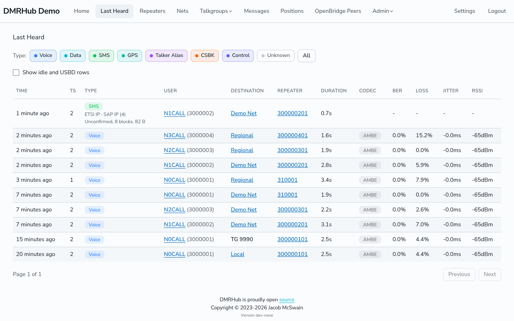

# DMRHub

      

DMRHub runs a DMR network server, like TGIF or BrandMeister, in a single binary. Hotspots and repeaters connect to it with the MMDVM network protocol or IPSC, and other networks link to it with OpenBridge. It has group and private calls, static and dynamic talkgroups, 4000 to unlink, text messages, positions, and plugins such as the 9990 parrot. It is quick to deploy, for example in an emergency.

## Documentation

| Section     | For                                    | Start here                                                                                                                       |
| ----------- | -------------------------------------- | -------------------------------------------------------------------------------------------------------------------------------- |
| Get started | Hams who are new to DMRHub             | [User's Guide](doc/User-Guide.md): make an account and connect your first hotspot.                                               |
| Guides      | Hams with a radio or a hotspot         | [User's Guide](doc/User-Guide.md): one task at a time, such as talkgroups, the parrot, private calls and text messages.          |
| Admin       | People who run a DMRHub server         | [Set up a DMRHub server](doc/setup.md): from install to the first call. [Install DMRHub](doc/admin/install.md), [Admin overview](doc/admin/overview.md), [Configuration](doc/admin/configuration.md), [Stress results](doc/admin/stress-results.md) |
| Reference   | Facts to look up                       | [Messages and SMS Storage](doc/messages.md), [Positions](doc/positions.md), [FAQ](doc/FAQ.md)                                    |
| Developers  | People who write plugins, apps or code | [Plugins](doc/plugins.md), [OAuth Apps](doc/oauth-apps.md), [MMDVM over WebTransport](doc/webtransport.md), [Building from Source](doc/Building.md) |

## Live server

<https://dmrhub.net> runs the canonical version of DMRHub. You can ask for an account there.

## License

DMRHub is under the [AGPL-3.0 or later](LICENSE). The plugin SDK (`sdk/`) and the plugin protocol (`proto/`) are under the MIT license.
