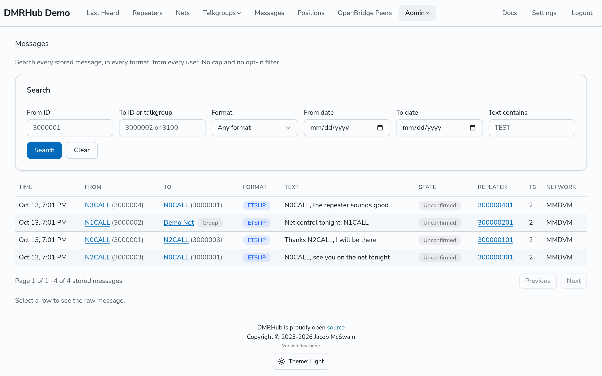
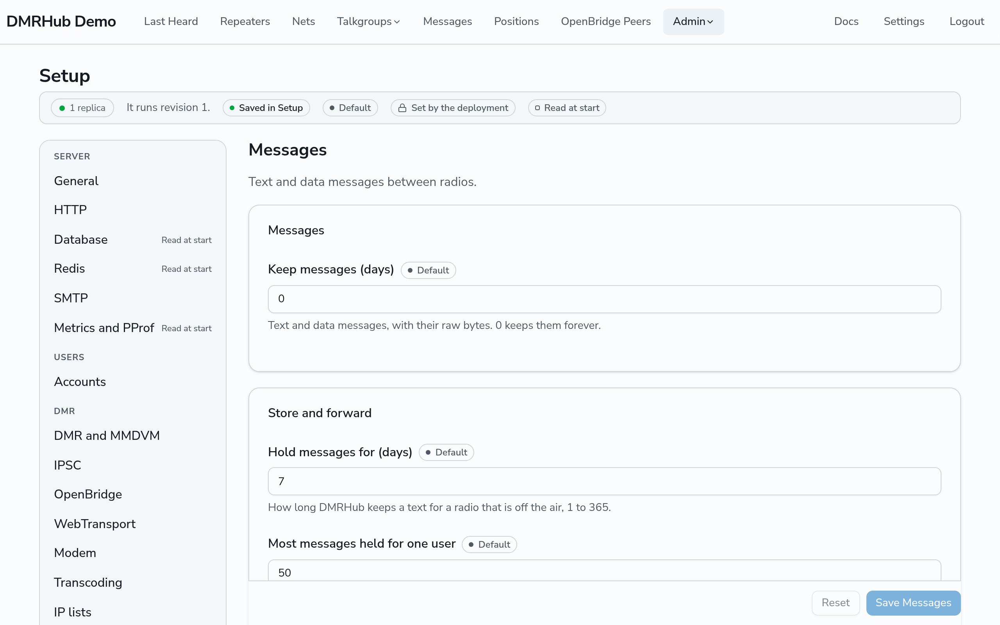

# Messages and retention

DMRHub routes text messages (SMS) and other data messages between radios. This page tells what the hub stores, how an admin searches it, and how long DMRHub keeps it. For what users see, see the [Messages reference](../messages.md).

## What the hub stores

DMRHub decodes and stores every text message and data message that it routes. It does this for all users, whatever their settings. The hub owner is responsible for the traffic that the hub routes, and can use these records to check that the traffic obeys the amateur radio rules.

For each message, DMRHub stores:

- The time, the source radio ID, and the destination radio ID or talkgroup.
- The repeater, the timeslot, and the network (MMDVM, IPSC or OpenBridge) that the message came from.
- The format and the text, when the message is text.
- Whether the message was confirmed, and the reply (ACK, NACK or SACK).
- The raw bytes: the data header, then the reassembled user data.

## Search all messages

Admins can search every stored message, in every format, from every user. Go to **Admin**, then **Messages** (`<siteurl>/admin/messages`). The search has no 250-message limit, and does not use the SMS Storage setting of the users.

You can search by:

- **From ID**: the source radio ID.
- **To ID or talkgroup**: the destination radio ID or talkgroup.
- **Format**.
- **From date** and **To date**: the days in your local time zone, both included.
- **Text contains**: a part of the text, in upper or lower case.

Click a row to see the details of the message and its raw bytes.

## Message access log

DMRHub logs each time that an admin sees stored messages: each search that shows at least one message, and each message that an admin opens. Each entry has the admin, the time, the search or the message, the number of messages shown, and the radio IDs whose messages the admin saw, with the users who have those radio IDs. DMRHub always writes this log. If DMRHub cannot write an entry, it does not show the messages.

Go to **Admin**, then **Message access** (`<siteurl>/admin/message-access`). Each row shows the time, the admin, the search or the message, the number of messages, and the radio IDs with the callsigns of their users. Enter a **Radio ID** to see who saw the messages of one radio ID, or pick an **Admin** to see what one admin saw. Only admins see this page.

The log follows the message retention: **Keep messages** (`dmr.retention.messages`) also deletes the entries that are older than it, and 0 keeps them all.

## Store and forward

Users turn store and forward on for their own radios in **Settings**. DMRHub then keeps the private text messages to their radio IDs that it cannot deliver, and sends them when it hears the radio again. See [Send and read text messages](../guides/text-messages.md#keep-messages-for-your-radio-while-it-is-off-the-air).

Set the limits on **Admin**, **Setup**, **Messages** tab, **Store and forward** card:

| Setting | Default | What it does | Configuration key |
| ------- | ------- | ------------ | ----------------- |
| **Hold messages for (days)** | 7 | DMRHub stops keeping a message that it could not deliver in this time. 1 to 365. | `dmr.messages.hold-days` |
| **Most messages held for one user** | 50 | DMRHub keeps no new message for a user who has this many waiting. 1 to 1000. | `dmr.messages.hold-max` |

How DMRHub sends a kept message:

- It sends a message only in the text format that the radio itself sends: the same format, header type, rate, IP header and end of text as the last private text that the radio sent through a repeater of its owner or a trusted repeater. A text through another repeater does not count, so a hotspot that sends with the ID of the radio cannot set the format. The wrong format can lock up a radio; for example, an ETSI IP text locks up a BTECH DA-7X2. Before it uses a format, DMRHub checks that it can build the last text of the radio again, octet for octet. If it cannot, or the radio never sent a text, the message stays waiting and the users see "Held: radio format not known yet".
- It sends from the ID that sent the message, to the hotspot or repeater that heard the radio, on the timeslot that the radio used, after the radio is quiet for 2 seconds.
- When the radio asks for replies to its own texts, DMRHub asks for one too, and keeps the message waiting when none comes. After 5 sends with no reply, it stops.
- With several replicas, the replica that hears the radio takes the waiting messages of that radio in the database first, so only one replica sends each message.

**Keep messages** (`dmr.retention.messages`) also deletes the store and forward records of the messages that it deletes.

## Retention

By default, DMRHub keeps all records forever. To delete old records:

1. Go to **Admin**, then **Setup**.
2. Enter a number of days for each kind of record:

   | Setting | Tab | What it deletes | Configuration key |
   | ------- | --- | --------------- | ----------------- |
   | **Keep messages (days)** | **Messages** | Text and data messages, with their raw bytes | `dmr.retention.messages` |
   | **Keep last heard (days)** | **DMR and MMDVM** | Last Heard entries for voice, data and control traffic | `dmr.retention.transmissions` |
   | **Keep raw bursts (days)** | **DMR and MMDVM** | The raw DMR bursts of each transmission | `dmr.retention.bursts` |

3. Click **Save** on each tab that you changed.

Each value is a number of days from 0 to 36500, and 0 keeps the records forever.

DMRHub deletes old records once each hour. With several replicas, only one replica deletes in each hour. Retention also deletes records from the admin search. Set a period that your local rules allow.
