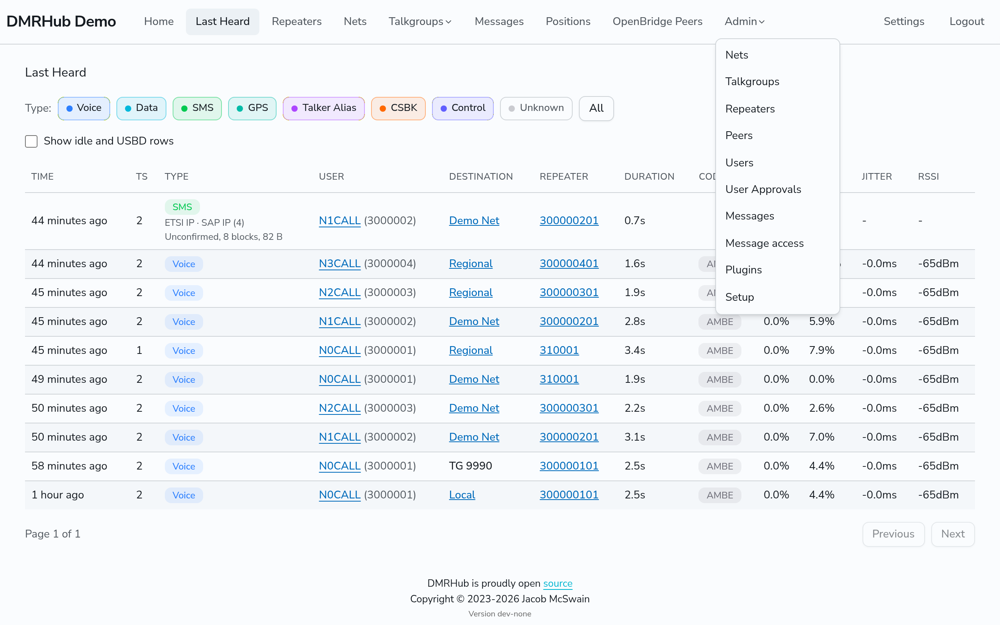

# Admin overview

This section is for the admins of a DMRHub network, and for the person who runs the server. In these pages, `<siteurl>` is the web address of your DMRHub server.

To install DMRHub, see [Install DMRHub](install.md).

## Admins and the super admin

An admin is a user with the **Admin?** box on in the **Users** page. An admin can:

- Approve new users, suspend users, edit their callsign and username, and set a temporary password.
- Make, edit and delete talkgroups, and pick the admins and the net control operators (NCOs) of each talkgroup.
- See, edit and delete every repeater, and mark a repeater as trusted.
- Add and delete OpenBridge peers.
- See and change the nets.
- Search every stored text and data message.
- Add and change plugins.
- Change the settings on the **Setup** page.

The first user, which you make in the setup wizard, is the super admin. The web interface calls this user the System Admin. Only the super admin can:

- Make another user an admin, or stop a user being an admin (the **Admin?** box on the **Users** page).
- Delete a user.

An admin cannot approve or suspend their own account.

## The Admin menu

When you log in as an admin, the navigation bar has an **Admin** menu with these pages:

| Menu item | Page | What you do there |
| --------- | ---- | ----------------- |
| **Nets** | `<siteurl>/admin/nets` | See all nets and scheduled nets, and pick which ones show at the top of the Nets page. See [Nets](nets.md). |
| **Talkgroups** | `<siteurl>/admin/talkgroups` | Make and edit talkgroups. See [Talkgroups](talkgroups.md). |
| **Repeaters** | `<siteurl>/admin/repeaters` | See and edit every repeater. See [Repeaters](repeaters.md). |
| **Peers** | `<siteurl>/admin/peers` | Add OpenBridge peers. The item shows only when OpenBridge is on. See [OpenBridge peers](openbridge.md). |
| **Users** | `<siteurl>/admin/users` | Edit, suspend and delete users. See [Users](users.md). |
| **User Approvals** | `<siteurl>/admin/users/approval` | Approve new users. See [Users](users.md#approve-new-users). |
| **Invites** | `<siteurl>/admin/invites` | Make invite links. It shows only while registration is by invite. See [Invite a user](users.md#invite-a-user). |
| **Messages** | `<siteurl>/admin/messages` | Search all stored messages. See [Messages and retention](messages.md). |
| **Message access** | `<siteurl>/admin/message-access` | See which admin saw whose messages, and when. See [Message access log](messages.md#message-access-log). |
| **Plugins** | `<siteurl>/admin/plugins` | Add and change plugins. See [Plugins](plugins.md). |
| **Setup** | `<siteurl>/admin/setup` | Change the settings. See [The Setup page](configuration.md#the-setup-page). |

## Admin tasks

- [Users](users.md): approve, suspend and edit users.
- [Talkgroups](talkgroups.md)
- [Repeaters](repeaters.md)
- [Nets](nets.md)
- [OpenBridge peers](openbridge.md): link DMRHub to other networks.
- [Motorola IPSC repeaters](ipsc.md)
- [MMDVM modem on a serial port](modem.md)
- [Transcoding between Codec2 and AMBE](transcoding.md)
- [Private call routing](private-calls.md)
- [Routing settings](routing.md): dynamic talkgroups and their timeout, unknown and ephemeral talkgroups, who may transmit, the longest transmission, and two calls at once.
- [IP lists](ip-lists.md): refuse the addresses of hotspots, repeaters and peers, or accept only some.
- [Messages and retention](messages.md)
- [Positions and APRS-IS](positions.md)
- [Plugins](plugins.md): the parrot, the location server, uploaded plugins and plugins that run as their own programs.
- [Replicas and scaling](replicas.md)
- [Back up and restore](backups.md)
- [Upgrade DMRHub](upgrade.md)

## Reference for admins

- [Configuration](configuration.md): every setting, its default, its environment variable and its flag.
- [Transmission kinds](transmission-kinds.md): the `kind` and `sub_kind` of each Last Heard entry, and the undeliverable reasons.
- [Stress results](stress-results.md): how much load DMRHub carries, and what fails first.
- [External software](../external/index.md): how to connect Pi-Star, MMDVMHost, DMRGateway, HBlink, FreeDMR and other programs.
