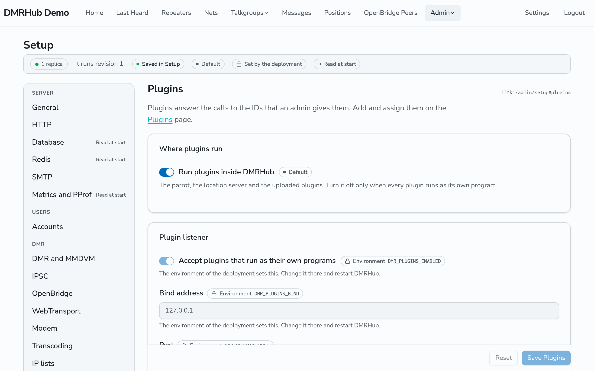
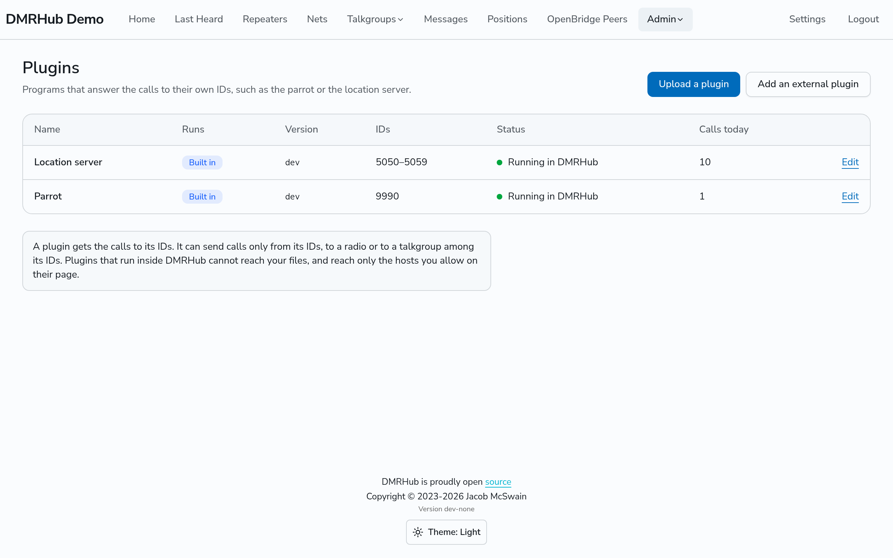
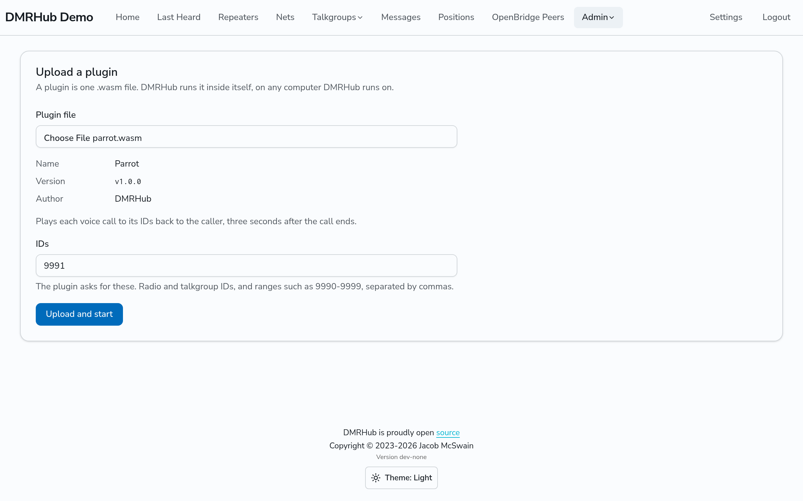
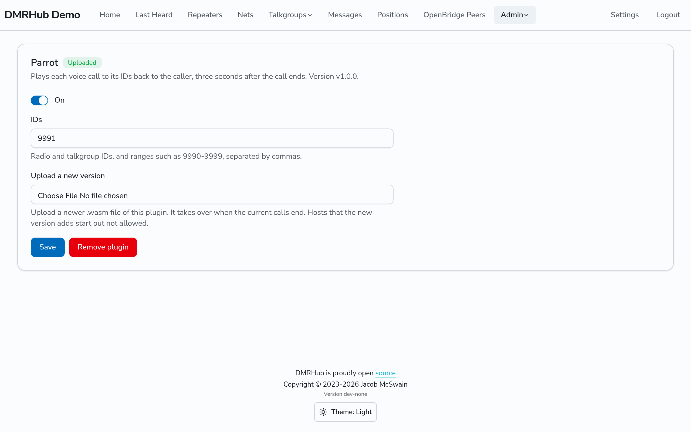
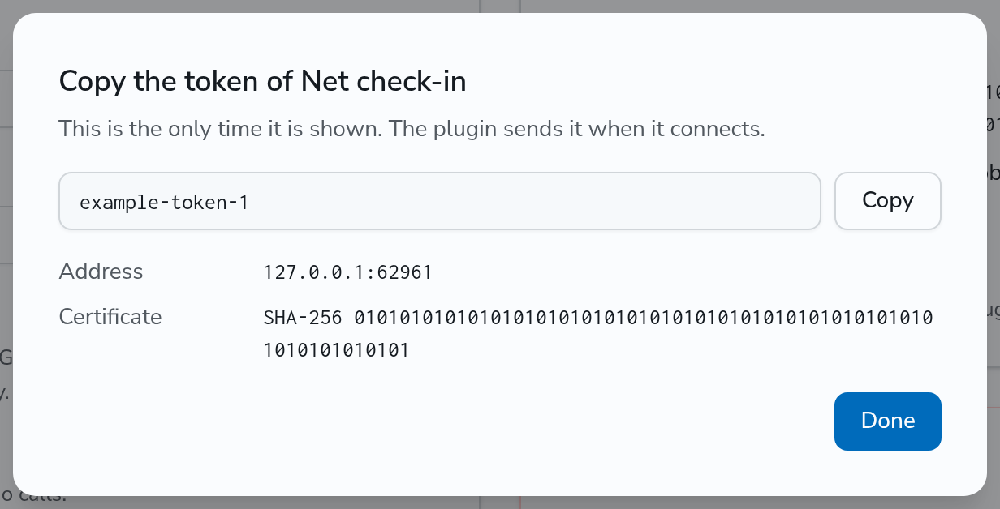

# Plugins

A plugin is a program that answers the calls to the DMR IDs that you give it. The parrot (9990) and the location server (5050 to 5059) are plugins. A plugin runs inside DMRHub, as a WebAssembly module in a sandbox, or as its own program that connects to the hub over TLS.

This page tells how to run plugins on your DMRHub server. To write a plugin, see [Plugins](../plugins.md) in the developer docs. For how the hub routes the calls of a plugin, see [How the hub routes plugin calls](../plugins.md#how-the-hub-routes-plugin-calls).

In this page, `<siteurl>` is the URL of your DMRHub server.

## Settings

Go to **Admin**, then **Setup**, and open the **Plugins** tab (`<siteurl>/admin/setup#plugins`).



| Setting                                       | What it does                                                                | Configuration key        | Default |
| --------------------------------------------- | --------------------------------------------------------------------------- | ------------------------ | ------- |
| Run plugins inside DMRHub                     | Runs the built-in plugins and the uploaded plugins.                         | `dmr.plugins.in-process` | On      |
| Accept plugins that run as their own programs | Opens the listener that external plugins connect to.                        | `dmr.plugins.enabled`    | Off     |
| Port                                          | The TCP port of the listener. It must not be the HTTP port.                 | `dmr.plugins.port`       | 3006    |
| Certificate file                              | The TLS certificate of the listener. DMRHub reads it again when it changes. | `dmr.plugins.cert-file`  | Empty   |
| Key file                                      | The key of the certificate.                                                 | `dmr.plugins.key-file`   | Empty   |

The listener binds to `dmr.plugins.bind`, which is `[::]` (all addresses) by default. DMRHub reads the listener settings at start only, so the Setup page shows them but cannot change them.

- Turn off **Run plugins inside DMRHub** only when every plugin runs as its own program. A Setup save turns it on or off at once on the replica that took the save. The other replicas follow when they restart. A hub that started with both settings off also needs a restart.
- The listener starts when DMRHub restarts.
- With no certificate file, DMRHub makes its own certificate from its secret. Every replica has the same certificate. Plugins then check it by its fingerprint, which the plugin's page shows.

## The plugins page

Go to **Admin**, then **Plugins** (`<siteurl>/admin/plugins`). The page lists each plugin with its name, where it runs, its version, its IDs, its status and its calls today.



The **Runs** column shows one of these:

| Runs     | Meaning                                               |
| -------- | ----------------------------------------------------- |
| Built in | The parrot or the location server, inside DMRHub.     |
| Uploaded | A `.wasm` file that an admin uploaded, inside DMRHub. |
| External | A plugin that runs as its own program.                |

The **Status** of a plugin inside DMRHub is one of these:

| Status                                             | Meaning                                                                                                                   |
| -------------------------------------------------- | ------------------------------------------------------------------------------------------------------------------------- |
| Running in DMRHub                                  | The plugin runs.                                                                                                          |
| Starting                                           | The plugin starts.                                                                                                        |
| Stopped at `<time>`, starts again in `<n>` s       | The plugin crashed, ended or went over a limit. DMRHub starts it again after a wait. The plugin's page tells why it stopped. |
| Waiting for its IDs, `<id>` is used by `<plugin>`  | A plugin that is on already has one of its IDs. It starts when the IDs are free.                                          |
| Off                                                | An admin turned the plugin off.                                                                                           |

The **Status** of an external plugin is **Connected for** a time and from an address, **Not connected since** a time, **Not connected yet**, or **Off**.

## The built-in plugins

When **Run plugins inside DMRHub** is on, DMRHub adds two built-in plugins:

| Plugin          | IDs          | What it does                                                                                                                                                                     |
| --------------- | ------------ | -------------------------------------------------------------------------------------------------------------------------------------------------------------------------------- |
| Parrot          | 9990         | Records each voice call to its IDs, private or group, and plays it back to the caller as a private call 3 seconds after the call ends. It keeps at most 3 minutes of a call. |
| Location server | 5050 to 5059 | Answers radio registrations (ARS) and location reports, asks the radios whose owners turned tracking on for their positions, and gives the positions to the hub. See [Positions](../positions.md). |

You cannot remove a built-in plugin. Turn it off on its page instead. You can change its IDs.

## Upload a plugin

1. Go to `<siteurl>/admin/plugins` and click **Upload a plugin**.
2. In **Plugin file**, choose the plugin's `.wasm` file. DMRHub starts the plugin to read its manifest. It then shows the name, version, author, description, the IDs the plugin asks for, and the hosts it asks to reach.
3. Change the IDs if necessary. Select the hosts that the plugin can reach.
4. Click **Upload and start**.



A plugin file is at most 32 MiB. DMRHub refuses a file when:

- the name is empty, longer than 64 characters, or the name of another plugin that is not built in;
- the plugin gives no version;
- the author is longer than 64 characters, or the description is longer than 500 characters;
- its IDs are not free;
- it asks for more than 16 hosts, a host that is not `host:port`, the same host twice, or gives a reason longer than 200 characters.

To upload a newer version of an uploaded plugin, open the plugin and use **Upload a new version**. Do not upload it again with **Upload a plugin**.

## Change a plugin inside DMRHub

Open the plugin from the plugins page. Its page has:

- **On**, to turn the plugin on and off.
- **IDs**, the radio and talkgroup IDs of the plugin, as single IDs and ranges such as `9990, 5050-5059`.
- **Network**, the hosts that the plugin asks to reach. It can reach only the hosts that you select.
- **Upload a new version**, for an uploaded plugin only. The new version takes over when the plugin's calls end: after 5 quiet seconds, or after 5 minutes at most. The hosts that the new version adds start out not allowed.
- **Remove plugin**, for an uploaded plugin only. After you remove it, calls to its IDs go nowhere.

Click **Save** to keep the changes.



## Add a plugin that runs as its own program

1. Turn on **Accept plugins that run as their own programs** in Setup, and restart DMRHub.
2. Go to `<siteurl>/admin/plugins` and click **Add an external plugin**.
3. Give it a **Name** and its **IDs**, as one or more ranges. Use **Add a range** for each more range. Click **Save**.
4. Copy the token. DMRHub shows it only once.



The **Connection** card of the plugin shows the address and the certificate fingerprint that the plugin connects with.

- **Make a new token** replaces the token. The plugin disconnects until it uses the new token.
- When you turn **Plugin on** off, or **Delete** the plugin, DMRHub disconnects it and its IDs are free again.

Rules for IDs:

- Two plugins that are on never share an ID, except a built-in plugin.
- A built-in plugin never keeps another plugin from its IDs. When another plugin that is on has some of them, the built-in plugin waits until they are free.
- A plugin that is off keeps its IDs, but another plugin can take them. The first plugin then cannot be turned on until its IDs are free.
- A built-in plugin and another plugin can have the same name. Two plugins that are not built in cannot.
- DMRHub does not give IDs to an external plugin. The admin sets them all.
- A plugin has at most 32 ranges, and each ID is a 24-bit DMR ID.

## Run the parrot and the location server as programs

The parrot and the location server are also programs, `dmrhub-parrot` and `dmrhub-locator`, for a hub that does not run plugins inside DMRHub. The release archives and the Docker image include them. To move a hub from the built-in plugins to these programs, follow [Upgrade from a hub with the built-in parrot](#upgrade-from-a-hub-with-the-built-in-parrot). Each program takes the hub's address and fingerprint as flags or environment variables, and its token from the environment:

| Flag           | Environment variable        | Value                                                                                                              |
| -------------- | --------------------------- | ------------------------------------------------------------------------------------------------------------------ |
| `-address`     | `DMRHUB_PLUGIN_ADDRESS`     | The address and port from the plugin's page, such as `hub.example.org:3006`.                                      |
| `-fingerprint` | `DMRHUB_PLUGIN_FINGERPRINT` | The fingerprint from the plugin's page. Leave it empty when the hub has a certificate from a certificate authority. |
|                | `DMRHUB_PLUGIN_TOKEN`       | The token of the plugin.                                                                                           |

A program exits with status 2 when the address or the token is missing. When it loses the hub, it connects again after a wait that grows from 1 second to 30 seconds.

```bash
DMRHUB_PLUGIN_TOKEN=dmrhub_plg_... dmrhub-parrot -address hub.example.org:3006 -fingerprint 4F:2A:...
DMRHUB_PLUGIN_TOKEN=dmrhub_plg_... dmrhub-locator -address hub.example.org:3006 -fingerprint 4F:2A:...
```

The location server keeps nothing on disk. After a restart, it learns each open request from the next report that answers it. It asks a tracked radio for its position the next time the hub hears the radio.

In Docker, the programs are in `/app` of the DMRHub image:

```bash
docker run -e DMRHUB_PLUGIN_TOKEN=dmrhub_plg_... --entrypoint /app/dmrhub-parrot ghcr.io/usa-reddragon/dmrhub \
  -address hub.example.org:3006 -fingerprint 4F:2A:...
```

## Upgrade from a hub with the built-in parrot

Before plugins, DMRHub answered 9990 and 5050 to 5059 itself. With **Run plugins inside DMRHub** on, as by default, the built-in plugins answer those IDs. You do not have to do anything.

To run them as programs instead:

1. Turn off **Run plugins inside DMRHub**, and turn on **Accept plugins that run as their own programs**. Restart DMRHub.
2. Add an external plugin named Parrot with the ID 9990, and run `dmrhub-parrot` with its token.
3. Add an external plugin named Location server with the IDs 5050 to 5059, and run `dmrhub-locator` with its token.

The built-in plugins stay on the plugins page with the status **Off**. When you turn **Run plugins inside DMRHub** on again, they show **Waiting for its IDs** while the external plugins have their IDs.

The upgrade removes the user 9990 (callsign Parrot) and the talkgroup 9990 (DMRHub Parrot) that older versions made, unless an admin changed them. When it removes the talkgroup, it also removes it from the static and dynamic talkgroups of every repeater. The old calls to and from the parrot stay in Last Heard.

## Several replicas

Only one replica runs each plugin inside DMRHub: the replica that holds the plugin's lease in the KV store (Redis). A replica renews its leases every 5 seconds, and a lease lasts 15 seconds. When a replica stops without warning, another replica takes the plugin over in about 15 to 20 seconds. When a replica stops cleanly, it gives up its leases, and another replica starts the plugins a moment later. The calls to their IDs in that gap are lost. DMRHub keeps uploaded plugins in the database, so every replica has them.

A plugin that runs as its own program connects to any one replica. A newer connection of the same plugin ends the older one.

When a replica stops and other replicas run, as in a rolling update, the replica drains its external plugins:

1. It sends a `Draining` message to each external plugin that is connected to it, and refuses new plugin connections.
2. A plugin built with the current SDK opens a second connection, which reaches another replica. It keeps the first connection.
3. When the new connection is up, the plugin sends on it. The old replica ends the old connection about a second later.

A burst that comes on both connections reaches the plugin once. The plugin sees no disconnection, and no call to its IDs is lost. The replica waits for this for as long as it drains its repeaters (`dmr.drain-timeout`, 25 seconds by default). A plugin built with an older SDK ignores `Draining`. It connects again when its connection ends, and the calls to its IDs in that gap are lost.
