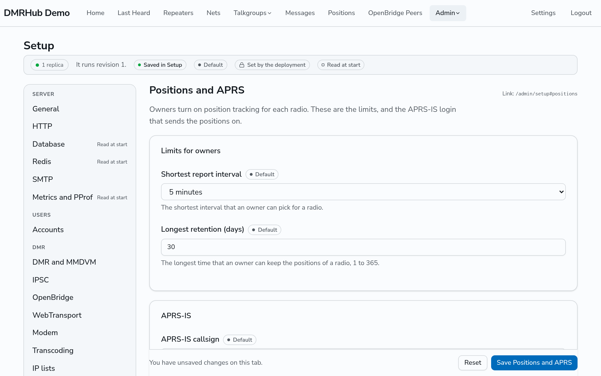

# Positions and APRS-IS

The location server is a plugin that comes with DMRHub (see [The built-in plugins](plugins.md#the-built-in-plugins)). For what users see and set, see the [Positions reference](../positions.md).

## What the hub stores

DMRHub stores positions from the location server, from the GPS that its modem hears in voice calls, and from the `DMRG` packets of hotspots and repeaters. It stores positions only for the radios whose owners turn on position tracking, only from that time, and only when the position came through a repeater that the owner of the radio owns or that an admin trusts, the same rule as private call routing (see [Trusted repeaters](repeaters.md#trusted-repeaters)). A location report counts as coming through the repeater of its data call. It stores at most one position of a radio each 30 seconds from all sources together: the latitude and longitude, the accuracy, speed, heading and altitude when the radio sends them, the time of the fix and of its arrival, the repeater and timeslot, and the location service ID. When the owner turns tracking off, DMRHub deletes the positions of the radio.

Admins see the same positions as everyone else: their own radios, and the radios of the users who share with them. Apps never get admin rights.

## Limits

Go to **Admin**, then **Setup**, and open the **Positions and APRS** tab.

| Setting | What it does | Configuration key |
| ------- | ------------ | ----------------- |
| **Shortest report interval** | Owners can pick 5, 10, 15, 30 or 60 minutes, but not less than this. The default is 5. | `dmr.positions.min-interval` |
| **Longest retention (days)** | Owners can keep positions for 24 hours, 7 days, 30 days or this many days, from 1 to 365. The default is 30. | `dmr.positions.max-retention` |

Each hour, DMRHub deletes the positions older than the time that the owner picked, and never keeps them longer than the longest time.

## APRS-IS

DMRHub logs in to APRS-IS once, and sends the positions of the radios whose owners turn it on, each under the callsign of its owner. Set the login on the same tab:

| Setting | What it is | Configuration key |
| ------- | ---------- | ----------------- |
| **APRS-IS callsign** | The callsign and SSID that the hub logs in as, such as `N0CALL-10`. Empty sends nothing. | `dmr.positions.aprs-is.callsign` |
| **APRS-IS server** | The APRS-IS server, as host and port. The default is `rotate.aprs2.net:14580`. | `dmr.positions.aprs-is.server` |

DMRHub calculates the APRS-IS passcode from the callsign, so there is nothing to register. Use a callsign that you hold a license for. When DMRHub runs as several replicas, only one of them logs in at a time.

Each packet has the destination `APZDMH` and the path `<repeater or hotspot callsign>*,qAR,<hub login>`, like the packets of the BrandMeister APRS gateway.

## The map

The Positions page loads its map from `https://tiles.squallar.app`, without cookies, and keeps the map data that it read in the cache of the browser. If you add a Content-Security-Policy, allow `connect-src https://tiles.squallar.app`, `worker-src 'self' blob:`, `img-src 'self' data: blob:` and `style-src 'unsafe-inline'`.
