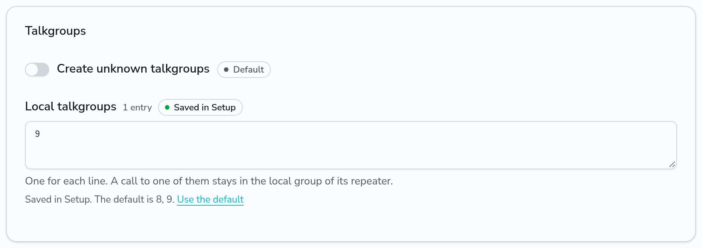
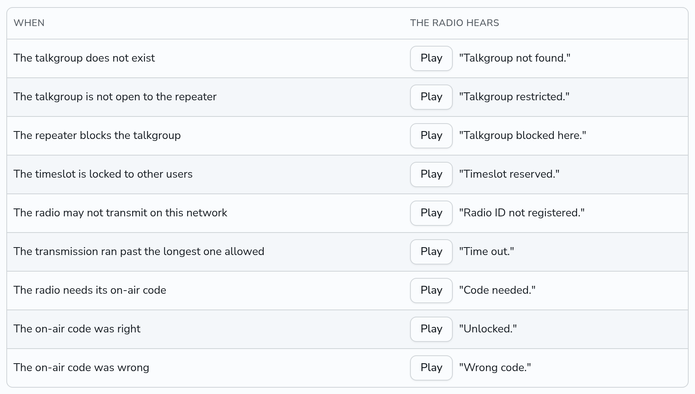

# Routing settings

This page tells how DMRHub links talkgroups to the timeslots of repeaters and hotspots, and the settings that change it. Change them on the **Routing** tab of the Setup page (`<siteurl>/admin/setup#routing`), or set them in the config file, in the environment or with flags. See [Configuration](configuration.md). DMRHub puts a change of these settings into effect at once on every replica, with no restart.

| Setting | What it does | Default | Configuration key |
| ------- | ------------ | ------- | ----------------- |
| Dynamic links | When off, a call on a talkgroup and the default dial of a hotspot link no dynamic talkgroup. See [Dynamic talkgroups](#dynamic-talkgroups). | on | `dmr.routing.disable-dynamic-links` (`true` turns them off) |
| Dynamic talkgroup timeout | The time with no transmission from a repeater on its dynamic talkgroup after which DMRHub unlinks the talkgroup from that timeslot, such as `15m`. `0s` never unlinks it. | `15m` | `dmr.routing.dynamic-timeout` |
| Make unknown talkgroups | When `true`, a group voice call from a repeater or hotspot to an ID that is not a talkgroup makes that talkgroup. See [Unknown talkgroups](#unknown-talkgroups). | `false` | `dmr.routing.auto-create-talkgroups` |
| Ephemeral talkgroups | When `true`, DMRHub deletes a talkgroup that it made by itself when no call is made on it for the ephemeral TTL. | `false` | `dmr.routing.ephemeral-talkgroups` |
| Ephemeral TTL | The time with no call after which DMRHub deletes a talkgroup that it made by itself, such as `24h`, when ephemeral talkgroups are on. | `24h` | `dmr.routing.ephemeral-ttl` |
| Who may transmit | The radios whose transmissions DMRHub takes from repeaters and hotspots: `any`, `radioid` or `members`. See [Who may transmit](#who-may-transmit). | `any` | `dmr.routing.transmit` |
| Longest transmission | The longest voice call that DMRHub routes. DMRHub drops the rest of a longer call. On the Setup page, **Limit transmission length** turns it on at 180 seconds. `0s` is no limit. | `0s` | `dmr.routing.max-transmission` |
| On-air unlock | How long a right [on-air code](../guides/on-air-code.md) unlocks a radio ID on the timeslot of the hotspot or repeater that it came through, such as `24h`. On the Setup page, in hours. | `24h` | `dmr.routing.on-air-unlock` |
| Two calls at once | What a repeater gets when two group calls reach the same timeslot of it at once: `mix` or `first`. See [Two calls at once](#two-calls-at-once). | `mix` | `dmr.routing.contention` |
| Local talkgroups | The talkgroups that users make local groups on. See [Local talkgroups](#local-talkgroups). | `8`, `9` | `dmr.routing.local-talkgroups` |
| Spoken refusals | When `true`, a radio whose voice call DMRHub refuses hears a short spoken prompt that tells why. See [Spoken refusals](#spoken-refusals). | `false` | `dmr.routing.spoken-refusals` |
| Prompt voice | The voice of the spoken prompts for users who did not pick their own. | `kitten-mini-luna` | `dmr.routing.prompt-voice` |
| Prompt service ID | The DMR ID that the spoken prompts come from. | `9999` | `dmr.routing.prompt-service-id` |

## Dynamic talkgroups

A group voice call from a repeater or hotspot links its talkgroup as the dynamic talkgroup of the timeslot, as does the default dial in the options of a hotspot. Each timeslot has one dynamic talkgroup. A call on another talkgroup replaces it, and a voice call to talkgroup 4000 unlinks it.

Each voice call from the repeater on its dynamic talkgroup starts the timeout again. Calls from other repeaters on the talkgroup do not. When the timeout passes with no such call, DMRHub unlinks the talkgroup from that timeslot. The static talkgroups stay.

- The replica that serves the repeater counts the timeout. When the repeater connects again, or moves to another replica, the count starts again from that time.
- A dynamic talkgroup that a user or an admin picks on the **Repeaters** page also times out, counted from the time that DMRHub sees it.
- A change of the timeout applies to the links that exist. With `0s`, no link times out.

With dynamic links off, calls still reach the repeaters that carry the talkgroup as a static talkgroup or as a dynamic talkgroup that was linked before. A user or an admin can still pick a dynamic talkgroup on the **Repeaters** page, and talkgroup 4000 still unlinks.

## Unknown talkgroups

By default DMRHub drops a group call to an ID that is not a talkgroup, as [Talkgroups](talkgroups.md) tells. With unknown talkgroups made, the first group voice call from a repeater or hotspot of this network to such an ID makes the talkgroup, named `TG` and its ID, such as `TG 3999`, and DMRHub routes the call as on any talkgroup. The call also links the new talkgroup as the dynamic talkgroup of its timeslot, unless dynamic links are off. Calls from OpenBridge peers and plugins, calls to talkgroup 4000, data and IDs above 16777215 make no talkgroup.

With ephemeral talkgroups on, each call on a talkgroup that DMRHub made starts its TTL again. When the TTL passes with no call, DMRHub deletes the talkgroup, as an admin would: it unlinks it from every repeater, and its calls leave Last Heard. Each replica writes the calls it routed to the database at least once a minute, or four times in each TTL when the TTL is shorter, so the TTL can run up to that much late. When an admin edits a talkgroup that DMRHub made, DMRHub keeps it like any other talkgroup. With ephemeral talkgroups off, DMRHub keeps the talkgroups that it made.

## Who may transmit

DMRHub checks the source radio ID of each transmission that comes from a repeater or hotspot of this network:

- `any` takes every radio ID.
- `radioid` takes the radio IDs that the RadioID list has (see `dmr.radio-id-url` in [Configuration](configuration.md)).
- `members` takes the DMR ID of each account and the radio IDs that users added on the Settings page.

DMRHub drops a transmission that the setting refuses, all of it, logs it once and counts its bursts in the metric `ingress_dropped_bursts_total` with the reason `transmit`. It checks the first burst of each transmission, so a change of the setting applies from the next transmission. Transmissions from OpenBridge peers and plugins are not checked.

## Longest transmission

DMRHub counts the length of a voice call from its first burst. When a call is longer than the longest transmission, DMRHub drops the rest of it, its terminator too, logs it once and counts its bursts in the metric `ingress_dropped_bursts_total` with the reason `transmit`. The repeaters that got the start of the call end it as for a lost signal. The next call starts a new count. The limit applies to calls from repeaters, hotspots and OpenBridge peers, and not to plugins or data.

## Two calls at once

Two radios can key up the same talkgroup at the same time, on two hotspots or repeaters. Each call is its own stream.

- With `mix`, DMRHub sends the bursts of both calls to each hotspot and repeater that carries the talkgroup, interleaved on the same timeslot. A listener hears a mix of both, or the radio follows one of them. This is what DMRHub always did.
- With `first`, the first call that reaches a timeslot of a hotspot or repeater holds that timeslot until the call ends: at its terminator, or 2 seconds after its last burst. DMRHub drops the other group calls to that timeslot to their end, and logs each dropped call once. A call that starts after the first one ends goes through.

The setting applies to each timeslot of each hotspot and repeater, so it also applies when calls on two talkgroups reach the same timeslot. The replica that serves the hotspot or repeater decides, so the setting works the same with any number of replicas. It does not apply to private calls.

A Motorola repeater on IPSC gets one call at a time on a timeslot with either setting. With `mix`, DMRHub queues the bursts of a second call for it and sends them after the first call ends, and drops a call that waits too long and reports it as undeliverable (slot busy).

## Local talkgroups

Users make local groups of hotspots and repeaters on the local talkgroups, as [Make a local group](../guides/local-groups.md) tells. A group call to a local talkgroup on a repeater in a group on it, on the timeslot of the repeater in the group, goes to the other repeaters of the group, and nowhere else. On any other repeater or timeslot it goes nowhere, and DMRHub reports it as undeliverable. A call to a local talkgroup from an OpenBridge peer or a plugin goes nowhere. A call to a local talkgroup makes no talkgroup and links no dynamic talkgroup.

Set the local talkgroups under **Talkgroups** on the Routing tab, one for each line. Each must be a number from 1 to 16777215, other than 4000. An empty list turns local groups off; the groups stay, and take calls again when their talkgroup is local again.

A local talkgroup cannot also be a network talkgroup: while a number is local, a call to it never reaches the network talkgroup of that number. When DMRHub is upgraded to the version with local groups, and the network already has a talkgroup 8 or 9, DMRHub saves the local talkgroups in Setup without that number, so the network talkgroup keeps working. It does not do so when the admins saved the local talkgroups before.

Each replica routes the calls of a group from the repeaters that it serves, and delivers them to the repeaters of the group that it serves, so a group works across replicas, and a repeater that moves to another replica stays in its groups.

## Spoken refusals

With **Tell the radio why its call was refused** on, under **Spoken refusals** on the Routing tab, DMRHub answers a voice call that it refuses from a hotspot, a repeater or DMRHub Radio with a short spoken prompt. It does not answer calls from OpenBridge peers or plugins. The prompt plays once for each transmission, about 1 second after the radio stops transmitting, so the radio is back in receive. It plays as a private call from the service ID to the radio ID that transmitted, on that timeslot of that hotspot or repeater only, so every radio unmutes for it and no other radio hears it. Some radios show it as a private call. A hotspot or repeater that carries Codec2 gets the prompt in Codec2.

| When | The radio hears |
| ---- | --------------- |
| The talkgroup does not exist | "Talkgroup not found." |
| The talkgroup is not open to the repeater | "Talkgroup restricted." |
| The repeater blocks the talkgroup | "Talkgroup blocked here." |
| The timeslot is locked to other users | "Timeslot reserved." |
| The radio may not transmit on this network (see [Who may transmit](#who-may-transmit)) | "Radio ID not registered." |
| The transmission ran past the longest one allowed | "Time out." |
| Another call held the timeslot when the radio keyed up (see below) | "Channel busy." |
| The radio needs its [on-air code](../guides/on-air-code.md) | "Code needed." |
| The on-air code was right | "Unlocked." |
| The on-air code was wrong | "Wrong code." |

DMRHub plays "Channel busy." only when [Two calls at once](#two-calls-at-once) is `first` and spoken refusals are on, and only when the first burst of the transmission comes in while the call of another radio holds that timeslot of the hotspot or repeater that the radio transmits through. DMRHub still routes the transmission as before; the prompt only tells the radio that its timeslot was busy. The radio whose call held the timeslot first hears no prompt. The Spoken refusals card lists this prompt only when Two calls at once is `first`. DMRHub plays no prompt when a call reaches some repeaters but a timeslot of another one is busy, as the call still reaches the others.

A prompt or a text message that DMRHub sends itself waits until the timeslot carried nothing for 1 second, so it does not go out over a call. Voice goes first: when a call reaches the timeslot while DMRHub sends a prompt there, DMRHub drops the rest of the prompt, and when it sends a text message there, it stops the text and sends it again in full 1 second after the call ends.

**Voice** sets the voice for users who did not pick their own in Settings; each user can pick a voice for the prompts to their radios. **Play** plays a prompt in the voice on the page. **Service ID** is the ID that the prompts come from. It must be a number from 1 to 16777215, other than 4000 and the on-air code IDs 9000000 to 9999999. Pick an ID that no talkgroup, repeater or plugin uses on the network.

The voices are speech that text-to-speech models made, encoded once as AMBE+2 and Codec2 frames. DMRHub has them built in, so it needs no AMBE server for them. Luna, Bruno and Hugo come from KittenTTS 0.8 (Apache License 2.0); Lewis comes from Kokoro-82M (Apache License 2.0). The NOTICE file of DMRHub lists their sources. `hack/prompts` makes the frames again on an AMBE server.
