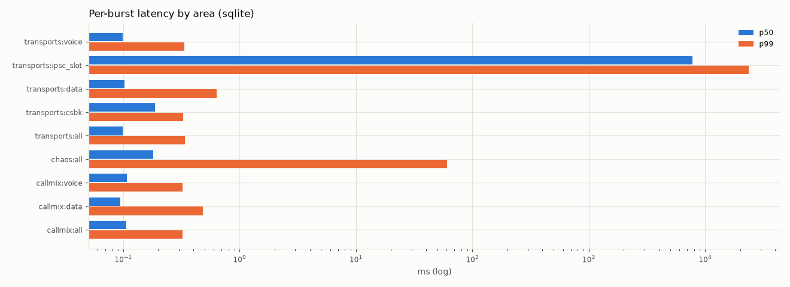
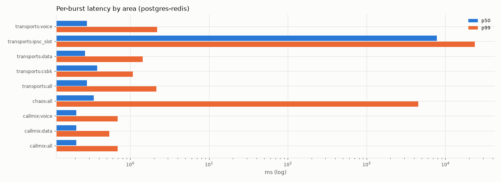
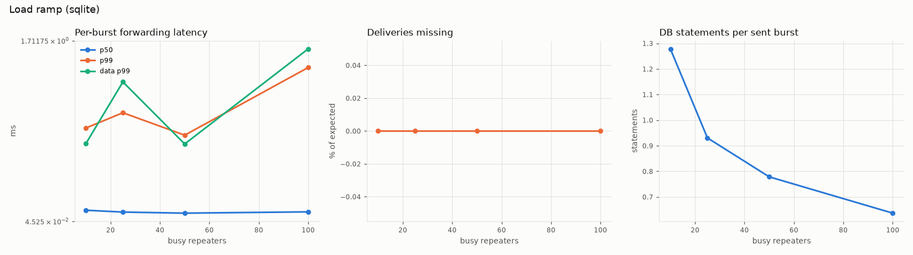
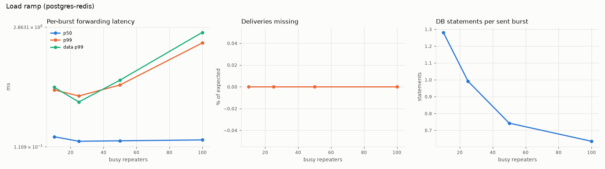
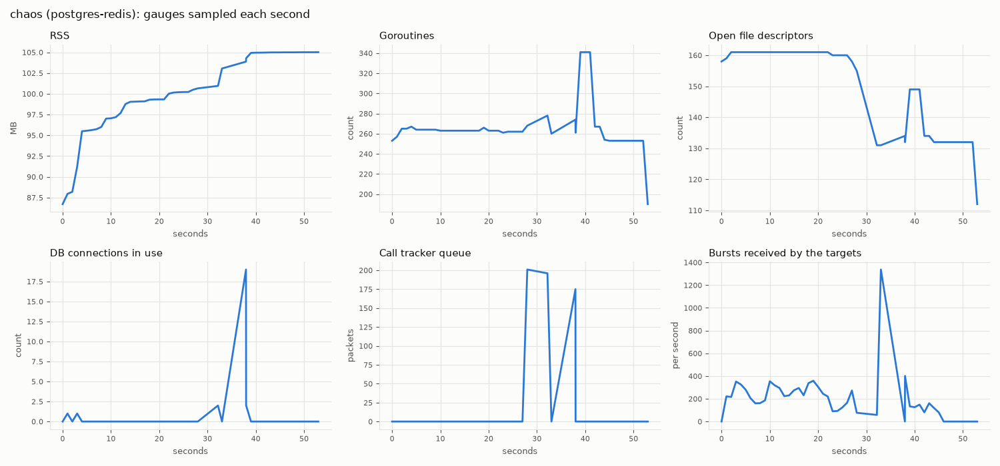
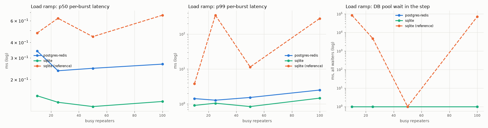

# Stress test results

This document gives the results of the DMRHub stress battery on the SQLite and the Postgres and Redis backends. It tells what each area of the battery does, how the runs were set up, and what the results show. It also gives the root cause of each problem that the runs found.

## Run the battery

The battery is in `internal/stress` (build tag `stress`). `hack/stress.sh` runs it area by area and writes JSON, CSV, logs and PNG graphs to a results directory. `hack/stress_plot.py` makes the graphs. The environment variables are at the top of `hack/stress.sh`.

The runs in this document used these commands:

```sh
DMRHUB_STRESS_AREAS="callmix transports ramp chaos" \
DMRHUB_STRESS_BACKENDS="sqlite postgres-redis" \
DMRHUB_STRESS_RESULTS=<results dir> PYTHON=python3 \
systemd-run --user --scope -q -p CPUQuota=400% nice -n 19 env GOMAXPROCS=4 hack/stress.sh

python3 hack/stress_plot.py <results dir> <earlier results dir>
```

The second argument of `stress_plot.py` is optional. When you give the results of an earlier run, the script also draws `ramp-compare.png`.

## Areas

Each area starts its own hub in the test process, with 20 MMDVM repeaters (the load ramp uses 100) that log in over UDP on loopback. Repeater `i` has one static talkgroup on each timeslot. With the default fanout of 5, about 5 repeaters carry each talkgroup on each slot. Each slot of each repeater is a lane. A lane carries one transmission at a time, at the pace of the air interface (one burst every 60 ms), and is busy for 60% of the time (`DMRHUB_STRESS_DUTY`). A ledger knows each burst that a lane sent and each target that must get it. It counts every delivery, so it finds missing, duplicate, changed and misrouted bursts. The latency of a burst is the time from the send to the receive at a target, in the same process.

| Area | Test | What it does | Pass criteria |
| --- | --- | --- | --- |
| callmix | `TestCallMix` | Runs the call mix on both slots of every repeater for 20 s: group calls, kerchunks, late entry, lost terminators, private calls to radios and to repeaters, calls to the parrot plugin, group and private SMS. An OpenBridge peer gets every call. One call on the first repeater lasts 16 s. | Every burst reaches each target exactly once and unchanged. Each transmission has one correct row that is not active at the end. Each SMS has one message row. The parrot plays each call back to its caller only. |
| transports | `TestTransports` | Runs the call mix and, on one talkgroup, sends voice, SMS and a CSBK in turn from each transport: MMDVM, an MMDVM session peer, OpenBridge v1 and v5, and IPSC. The targets are the MMDVM repeaters of the talkgroup, the session peer, the OpenBridge peer and the IPSC repeater 329001. Then it logs in a peer that speaks HBRP. | Same as callmix. On IPSC, the voice and data payloads must arrive. A burst that the IPSC server reports `slot_busy` is dropped and counted, not missing (see [Transports](#transports-and-the-ipsc-slot)). |
| ramp | `TestLoadRamp` | Connects 100 repeaters, then makes 10, 25, 50 and 100 of them busy, 20 s for each step, with mostly voice and some SMS on the same slots. | The area records where the hub degrades: a p99 latency over 50 ms or a missing delivery. |
| chaos | `TestChaos` | Keeps 3 repeaters busy at 42% duty and breaks one thing at a time (the steps below). After each step a probe call must get through. | No burst goes to a wrong target. The bursts of the lossy path arrive as often as the proxy passed them. No burst arrives more than 5 s late (traffic is dropped and counted, never held). |

The chaos steps:

| Step | What it does | Recovery check |
| --- | --- | --- |
| peer-drop | A repeater stops in the middle of a 6 s call, then logs in again. | A call from it gets through within 15 s. |
| loss-dup-reorder | A UDP proxy between one repeater and the hub loses 5%, duplicates 5% and reorders 5% of the DMRD packets, for 10 calls of 40 bursts. | Each target gets each burst as often as the proxy passed it. |
| mmdvm-restart-handoff | Restarts the MMDVM server with a handoff of its sessions. | A call gets through within 20 s. |
| redis-outage | Pauses the Redis container for 5 s (`postgres-redis` only). | A call gets through within 30 s. |
| postgres-outage | Pauses the Postgres container for 5 s (`postgres-redis` only). | A call gets through within 30 s. |
| replica-failover | Starts a second replica with a session peer on it, then stops the replica. The peer logs in to the first replica. | A call from the peer gets through within 30 s. |
| clock-jump | Skipped: the step has no clock injection point. | None. |

## Setup of the runs

| Item | Value |
| --- | --- |
| Date | 2026-10-26, 11:12 to 11:22 CDT. The SQLite ramp ran again at 12:24 CDT with the synchronous change (see [SQLite commits waited for the disk](#sqlite-commits-waited-for-the-disk)). |
| Code | main at `8ecf1dbe` (v1.3.14) plus the changes in [Changes in this branch](#changes-in-this-branch) |
| Machine | AMD Ryzen 9 7950X, 16 cores, 32 threads, 93 GB RAM, NVMe SSD (ext4 on LVM), Linux 7.2.9 |
| Other load | The machine also ran training and labeling jobs. The one-minute load average was 11 to 22 during the runs. Each area records it in `loadavg_start` and `loadavg_end`. |
| Hub and test process | One Go process (Go 1.27.3) in a systemd scope with `CPUQuota=400%`, `nice -n 19` and `GOMAXPROCS=4`. The hub, the simulated repeaters, the ledger and the sampler share these 4 CPUs. |
| Postgres and Redis | `postgres:16-alpine` and `redis:7-alpine` in Docker 29.9.0, each capped at 4 CPUs (`NanoCPUs`), on loopback |
| SQLite | A database file with the default parameters of a production install: `foreign_keys(1)`, `journal_mode(WAL)`, `_txlock=immediate`, and for the SQLite ramp `synchronous(NORMAL)`. The other SQLite areas ran with the old default, `synchronous(FULL)`. |
| Network | Loopback only. No public network. |
| Duration | 20 s of traffic for each area and for each ramp step |

## Results

### Summary

Latency is the time from the send of a burst to its receive at a target, over all targets of all bursts of the area. "slot_busy drops" are the deliveries to the IPSC repeater that the IPSC server dropped and reported, because its timeslot was busy (see [Transports](#transports-and-the-ipsc-slot)). The chaos area counts its losses during the faults but does not fail for them.

| Area | Backend | Result | Bursts sent | Deliveries expected | Missing | Duplicates | Wrong target | slot_busy drops | p50 ms | p90 ms | p99 ms | max ms |
| --- | --- | --- | --- | --- | --- | --- | --- | --- | --- | --- | --- | --- |
| callmix | sqlite | pass | 8603 | 36798 | 0 | 0 | 0 | 0 | 0.11 | 0.18 | 0.33 | 2.34 |
| callmix | postgres-redis | pass | 8603 | 36798 | 0 | 0 | 0 | 0 | 0.21 | 0.36 | 0.70 | 3.35 |
| transports | sqlite | pass | 8596 | 38752 | 0 | 0 | 0 | 516 | 0.10 | 0.17 | 0.34 | 83.5 |
| transports | postgres-redis | pass | 8596 | 38752 | 0 | 0 | 0 | 516 | 0.28 | 0.69 | 2.14 | 11.7 |
| chaos | sqlite | pass | 1944 | 7665 | 20 | 0 | 0 | - | 0.18 | 0.29 | 60.2 | 120 |
| chaos | postgres-redis | fail | 2404 | 8833 | 86 | 0 | 0 | - | 0.34 | 1.11 | 4536 | 5011 |
| ramp, 100 busy | sqlite | pass | 43077 | 148504 | 0 | 0 | 0 | - | 0.13 | 0.29 | 1.46 | 41.1 |
| ramp, 100 busy | postgres-redis | pass | 43077 | 148504 | 0 | 0 | 0 | - | 0.27 | 0.75 | 2.50 | 8.34 |

Other checks of callmix and transports, on both backends:

- Each of the 223 (callmix) and 241 (transports) transmissions has one correct row, and no row is active at the end.
- Each of the 26 SMS of callmix has one message row with its text.
- The parrot played 220 bursts back for 188 voice bursts sent to it, to the callers only.
- A peer that speaks HBRP logged in.
- No burst arrived changed, and no packet of an unknown stream arrived.

### Latency by kind

| Area | Backend | Kind | Deliveries | p50 ms | p90 ms | p99 ms | max ms |
| --- | --- | --- | --- | --- | --- | --- | --- |
| callmix | sqlite | voice | 35804 | 0.11 | 0.18 | 0.32 | 2.34 |
| callmix | sqlite | data | 994 | 0.09 | 0.17 | 0.49 | 0.88 |
| callmix | postgres-redis | voice | 35804 | 0.21 | 0.36 | 0.70 | 3.35 |
| callmix | postgres-redis | data | 994 | 0.21 | 0.36 | 0.55 | 2.15 |
| transports | sqlite | voice | 36288 | 0.10 | 0.17 | 0.34 | 83.5 |
| transports | sqlite | data | 1485 | 0.10 | 0.19 | 0.64 | 1.28 |
| transports | sqlite | csbk | 45 | 0.19 | 0.29 | 0.33 | 0.33 |
| transports | sqlite | IPSC slot | 408 | 7795 | 10732 | 23621 | 24522 |
| transports | postgres-redis | voice | 36288 | 0.28 | 0.69 | 2.20 | 11.7 |
| transports | postgres-redis | data | 1485 | 0.27 | 0.59 | 1.44 | 2.66 |
| transports | postgres-redis | csbk | 45 | 0.38 | 0.94 | 1.07 | 1.08 |
| transports | postgres-redis | IPSC slot | 408 | 7793 | 10732 | 23620 | 24520 |

Data does not wait behind voice: the data p99 is near the voice p99 in each area. The "IPSC slot" row is the time that the bursts to the IPSC repeater waited for its timeslot. It is not a forwarding latency (see [Transports](#transports-and-the-ipsc-slot)).





### Load ramp

| Backend | Busy repeaters | Lanes | Bursts sent | Deliveries expected | Missing | Duplicates | p50 ms | p90 ms | p99 ms | max ms | CPU (cores) | DB statements per burst | DB pool wait ms | Call tracker drops | Load average |
| --- | --- | --- | --- | --- | --- | --- | --- | --- | --- | --- | --- | --- | --- | --- | --- |
| sqlite | 10 | 20 | 4339 | 17244 | 0 | 0 | 0.15 | 0.29 | 0.91 | 6.39 | 0.06 | 1.28 | 0 | 0 | 14.4 |
| sqlite | 25 | 50 | 10685 | 38553 | 0 | 0 | 0.13 | 0.26 | 1.05 | 8.83 | 0.11 | 0.93 | 0 | 0 | 12.2 |
| sqlite | 50 | 100 | 21288 | 72779 | 0 | 0 | 0.12 | 0.26 | 0.84 | 18.7 | 0.19 | 0.78 | 0 | 0 | 11.3 |
| sqlite | 100 | 200 | 43077 | 148504 | 0 | 0 | 0.13 | 0.29 | 1.46 | 41.1 | 0.34 | 0.64 | 0 | 0 | 13.6 |
| sqlite, synchronous FULL | 100 | 200 | 43077 | 148504 | 0 | 0 | 0.12 | 0.22 | 0.54 | 86.8 | 0.28 | 0.57 | 0 | 21491 | 17.7 |
| postgres-redis | 10 | 20 | 4339 | 17244 | 0 | 0 | 0.34 | 0.64 | 1.42 | 4.86 | 0.09 | 1.28 | 0 | 0 | 16.2 |
| postgres-redis | 25 | 50 | 10685 | 38553 | 0 | 0 | 0.24 | 0.45 | 1.28 | 5.15 | 0.15 | 0.99 | 0 | 0 | 14.5 |
| postgres-redis | 50 | 100 | 21288 | 72779 | 0 | 0 | 0.25 | 0.55 | 1.53 | 7.51 | 0.25 | 0.74 | 0 | 0 | 11.4 |
| postgres-redis | 100 | 200 | 43077 | 148504 | 0 | 0 | 0.27 | 0.75 | 2.50 | 8.34 | 0.46 | 0.64 | 0 | 0 | 15.3 |

The SQLite rows come from the run with `synchronous(NORMAL)`. The last row is the 100 repeater step of the 11:12 run, with the old default `synchronous(FULL)`.

The hub forwards every burst at every step on both backends, with a p99 under 3 ms. The CPU column is the CPU time of the whole test process (hub and simulated repeaters) for each second of the step. At 100 busy repeaters the process uses about 0.3 cores (SQLite) and 0.46 cores (Postgres and Redis) of its 4.

With `synchronous(FULL)`, the ramp found a limit in the records, not in the forwarding: at 100 busy repeaters on SQLite, the call tracker dropped 21491 packets because its queue was full. With `synchronous(NORMAL)` it dropped none (see [SQLite commits waited for the disk](#sqlite-commits-waited-for-the-disk)).





### Chaos

| Step | sqlite recovery s | postgres-redis recovery s |
| --- | --- | --- |
| peer-drop | 0.74 | 0.74 |
| loss-dup-reorder | (no probe) | (no probe) |
| mmdvm-restart-handoff | 0.74 | 0.74 |
| redis-outage | (skipped) | 0.74 |
| postgres-outage | (skipped) | 0.74 |
| replica-failover | 2.32 | 2.32 |
| clock-jump | (skipped) | (skipped) |

A recovery of 0.74 s is the first probe call: the call got through at once. The lossy proxy lost 22, duplicated 18 and reordered 24 packets, and each target got each burst of the lossy calls as often as the proxy passed it on.

Losses during the faults:

| Backend | Missing deliveries | Cause |
| --- | --- | --- |
| sqlite | 20 | All in `replica-after`: the first call from the session peer after its replica stopped, before the peer logged in again to the first replica. |
| postgres-redis | 86 | 20 in `replica-after` as above. 66 (47 private, 19 group) in the calls that started while Redis was paused. |

The p99 of 60 ms on both backends comes from the reorder step: the proxy holds a packet until the next one, 60 ms later. The postgres-redis area fails because a burst arrived 5.0 s after it was sent (see [Bursts held through a Redis outage](#bursts-held-through-a-redis-outage)).



The burst rate peaks at about 33 s, when Redis resumes and runs the PUBLISH commands that waited in its socket.

## Findings

### Load ramp p99 not monotonic

**Status: fixed on main before this run. No change in this branch.**

In the run of 2026-10-23 (handoff bundle, `stress/run1-sqlite-before-fixes`), the p99 latency of the ramp went up and down with the number of busy repeaters:

| Busy repeaters | p99 ms (2026-10-23) | DB pool wait ms in the step (2026-10-23) | p99 ms (now, sqlite) |
| --- | --- | --- | --- |
| 10 | 3.79 | 85458 (see note) | 0.91 |
| 25 | 346 | 4742 | 1.05 |
| 50 | 11.4 | 0 | 0.84 |
| 100 | 280 | 70858 | 1.46 |

Root cause: in that version, the routing of a burst read the database (for example `FindRepeaterByID` in `subscribeTG`), so a burst waited for a free connection of the database pool. The pool waits came in bursts, and the p99 of each step followed the pool wait of that step, not the load: the step with no pool wait (50 repeaters) had the lowest p99 after the first step.

Main took the database and Redis off the packet path (for example `a764216d` "hub: keep the database off the routing path", `6c1a80ba` "hub: cache the repeater on the delivery path", `ec0d63cc` "hub: hold no burst on a lookup of a stalled database", with its test in `internal/dmr/hub/slow_db_test.go`). Proof that a slow database no longer reaches the bursts: in the 100 repeater step of the 11:12 run, with `synchronous(FULL)`, SQLite writers waited for the write lock for more than the 5 s busy timeout of the driver (25 `SQLITE_BUSY` errors, see [SQLite commits waited for the disk](#sqlite-commits-waited-for-the-disk)), and the p99 of that step was 0.54 ms. The p99 is now flat: 0.84 to 1.46 ms on SQLite (0.29 to 0.54 ms in the 11:12 run with FULL; at the 100 step, the six strace runs below gave 0.44 to 1.93 ms with either setting, so the difference is within the spread of this shared machine), 1.28 to 2.50 ms on Postgres and Redis.

Note: the 85458 ms of the first step of 2026-10-23 are the waits of the rig setup (100 logins and the first call of each user), not of the step. The sampler took its first sample on its own goroutine, so the first step often had no sample to start from and counted the setup. The commit "stress: take the first sample before the sampler returns" fixes this: before the fix, a run of this branch showed 77121 ms for the first step, and in this run the first step shows 0.

A run of the steps 10, 100, 10 and 25 in that order gave a p99 of 0.69, 0.37, 0.39 and 0.40 ms. The first step after the setup is a little slower (warm-up). The order of the steps, not the load, explains the small changes that remain.



In the third panel a step with no pool wait shows as 1 ms, because the scale is logarithmic.

### Transports and the IPSC slot

**Status: not a bug. The battery now counts each drop.**

The 2026-10-23 run found 152 missing deliveries, all to target 329001, and 94 duplicates. 329001 is the IPSC repeater of the transports area (`ipscRptID` in `internal/stress/rig_test.go`). It carries the talkgroup of the transports on timeslot 1 only.

Root cause: the area sends more traffic to that one timeslot than a timeslot can carry. The calls of 4 rig lanes on that talkgroup (one slot of each of 4 repeaters, at 60% duty) and the calls of the five transport sources, one after another, all go to the one IPSC slot. An IPSC slot carries one call at a time at 60 ms for each burst. The IPSC pacer (`internal/dmr/servers/ipsc/pacer.go`) queues the calls that wait, at most 8 calls and 30 s each, then drops a call and reports each of its bursts with the reason `slot_busy`. In this run the IPSC repeater got 408 bursts (about 24 s of air time), the waiting bursts waited 7.8 s at p50 and up to 24.5 s, and the pacer dropped 516 deliveries of voice and data bursts (639 reports with the LC headers and terminators). The duplicates and some of the missing deliveries of 2026-10-23 were faults of the ledger, which `b367eb8e` and `26b0e123` fixed (IPSC has no stream ID, so the ledger gave late bursts to the wrong call).

The battery used to forgive missing deliveries to 329001 when their number was at most the `slot_busy` counter. The commit "stress: count each burst that the IPSC server drops as slot_busy" replaces this: the rig hooks the undeliverable reports of the hub, the ledger marks each reported burst for its target, and the area fails when a missing delivery has no report or when a reported burst arrives. In this run all 516 missing deliveries had a `slot_busy` report, no report named an unknown burst, and no reported burst arrived.

The owner keeps the transports area as the IPSC overload test.

### Duplicate bursts after a Redis stall

**Status: fixed in this branch ("pubsub: send a publish to a stalled Redis only once").**

In the chaos area on postgres-redis, 28 to 33 deliveries arrived twice. Each was the first burst of a source slot that the hub published while Redis was paused. The trace of the slow publishes showed that each of these publishes took 4.1 s and failed with an i/o timeout, and each duplicate arrived when Redis resumed.

Root cause: go-redis sends a command again after a read timeout (`MaxRetries` defaults to 3, and `shouldRetry` in go-redis v9.23.0 `error.go` retries a timeout when the command has no read timeout of its own). Each copy of the PUBLISH went to another connection of the pool and waited in the socket of the paused Redis. When Redis resumed, it ran each copy. `internal/pubsub/redis.go` now sets `MaxRetries: -1`, because a PUBLISH is not idempotent.

Test: `TestAPublishToAStalledRedisIsSentOnce` in `internal/pubsub/redis_stall_test.go`. Before the fix, 3 of 3 runs failed: the publish returned after 4.09 s and the subscriber got the message 4 times. After the fix, 3 of 3 runs passed: the publish returned after 1.0 s and the message arrived once. The chaos area on postgres-redis now has 0 duplicates.

The KV client in `internal/kv/redis.go` keeps the retries. The hub calls only Get, Set, SetNX, Expire, Delete and Scan on it, which it can repeat without harm (`sharedClaim` reads the owner back after a SETNX that reports no change). `RPush` and `LDrain` of the KV interface are not safe to repeat, but nothing calls them.

### Bursts held through a Redis outage

**Status: open, in the `hub-redisout` lane.**

On postgres-redis, the bursts that the hub publishes while Redis is paused arrive when Redis resumes, up to 5.0 s late (p99 4.5 s). Each PUBLISH waits in the socket of Redis, and Redis runs it when it resumes, after the publish timed out on the hub. The chaos area fails for this, because traffic must be dropped and counted, never held. A fix needs the receiver to drop a burst that is too old, which is a change of the wire format.

### SQLite commits waited for the disk

**Status: fixed in this branch ("db: commit to SQLite with synchronous=NORMAL").**

With the old default parameters, at 100 busy repeaters (200 lanes) on SQLite, the queue of the call tracker filled up (about 7800 packets) and the tracker dropped 21491 packets. The forwarding was not affected, but a dropped tracker packet can leave a transmission row without its last bursts, or with wrong loss figures. The log had 25 `database is locked (SQLITE_BUSY)` errors. The process used 0.28 cores, so the CPU was not the limit. Postgres and Redis dropped nothing.

Root cause: in WAL mode with `synchronous=FULL` (the SQLite default), each commit waits for an fsync of the WAL file. SQLite has one writer at a time, so the commits wait for each other, and the fsync time is serial. To prove it, the 100 repeater step ran alone under `strace -f -e trace=fsync,fdatasync -T`, with the same caps, three times with each setting, in turns:

| Run | synchronous | WAL fsyncs in the 20 s step | Fsync time in the step | Fsync p50 ms | Fsync p99 ms | Call tracker drops |
| --- | --- | --- | --- | --- | --- | --- |
| 1 | FULL | 3307 (165/s) | 13.8 s (69%) | 3.72 | 8.18 | 1056 |
| 1 | NORMAL | 72 (4/s) | 0.7 s (3%) | 3.98 | 14.5 | 0 |
| 2 | FULL | 3418 (171/s) | 13.3 s (66%) | 3.65 | 8.11 | 826 |
| 2 | NORMAL | 82 (4/s) | 0.5 s (2%) | 3.86 | 21.0 | 0 |
| 3 | FULL | 3061 (153/s) | 14.3 s (71%) | 3.67 | 9.40 | 2285 |
| 3 | NORMAL | 112 (6/s) | 0.7 s (3%) | 4.66 | 14.4 | 0 |

With FULL, the one writer spent about 70% of the step in fsync, at about 3.7 ms for each commit, so the writes could not keep up and the tracker dropped packets. With NORMAL, the WAL is synced only at a checkpoint, the fsync time fell to 2 to 3% of the step, and the tracker dropped nothing. The SQLite ramp of this document, without strace, also had 0 drops and logged no error or warning.

Durability: with `synchronous=NORMAL` in WAL mode, a power cut or an operating system crash can lose the last commits before the next checkpoint. The database stays consistent. A crash of DMRHub alone loses nothing.

How an install gets it:

- The default of `database.extra-parameters` now has `_pragma=synchronous(NORMAL)`.
- An install that sets its own `database.extra-parameters` for SQLite gets `_pragma=synchronous(NORMAL)` added when none of its parameters is a `_pragma=synchronous(...)`. An install that sets synchronous keeps its own value. This is the same rule as for `_txlock=immediate`.
- `TestSQLiteSynchronousIsNormal` in `internal/db/db_test.go` checks the three cases on four connections of the pool. Before the change, the default and the own-parameters cases failed (`synchronous is 2, want 1`).

### Known design limit: replica moves under heavy load

`TestRotationMidCall` can duplicate or lose the two packets inside `hub.MoveSlack` when a replica moves under heavy load. This is a known limit of the handover design. This run did not touch it.

### Clock jumps

The chaos step `clock-jump` still skips: it has no way to step the clock of the hub inside the test process. Main tests wall clock steps in a throwaway VM (`f4b24122`).

## Changes in this branch

| Commit | Change |
| --- | --- |
| testutils: cap the Postgres and Redis containers at 4 CPUs | Each container of the postgres-redis backend gets at most 4 CPUs, as the MySQL container does. |
| pubsub: send a publish to a stalled Redis only once | See [Duplicate bursts after a Redis stall](#duplicate-bursts-after-a-redis-stall). |
| stress: time the session peer deliveries when they arrive | The transports area read the session peer in 100 ms drains and stamped each packet at the end of its drain, which added up to 100 ms to the latency (transports p99 57 ms before, 0.34 ms after). |
| stress: count each burst that the IPSC server drops as slot_busy | See [Transports and the IPSC slot](#transports-and-the-ipsc-slot). |
| stress: take the first sample before the sampler returns | See the note in [Load ramp p99 not monotonic](#load-ramp-p99-not-monotonic). |
| hack: compare the load ramp with an earlier run | `stress_plot.py` takes an earlier results directory and draws `ramp-compare.png`. |
| db: commit to SQLite with synchronous=NORMAL | See [SQLite commits waited for the disk](#sqlite-commits-waited-for-the-disk). |

## Compared with 2026-10-23

The 2026-10-23 results are in the handoff bundle (`stress/run1-sqlite-before-fixes`). That run was on SQLite only, on a quiet machine of unknown type (load average 0.6 to 1.9), without CPU caps.

| Area | p99 ms then | p99 ms now (sqlite) | Missing then | Missing now | Duplicates then | Duplicates now |
| --- | --- | --- | --- | --- | --- | --- |
| callmix | 5.67 | 0.33 | 0 | 0 | 0 | 0 |
| transports | 4318 | 0.34 | 152 | 0 (516 slot_busy drops) | 94 | 0 |
| chaos | 60.6 | 60.2 | 20 | 20 | 0 | 0 |
| ramp, 25 busy | 346 | 1.05 | 0 | 0 | 0 | 0 |
| ramp, 100 busy | 280 | 1.46 | 0 | 0 | 0 | 0 |
