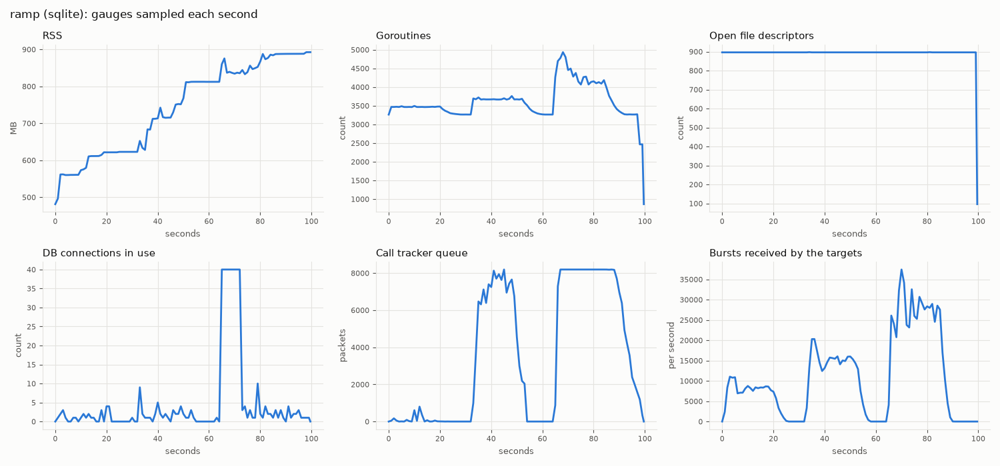
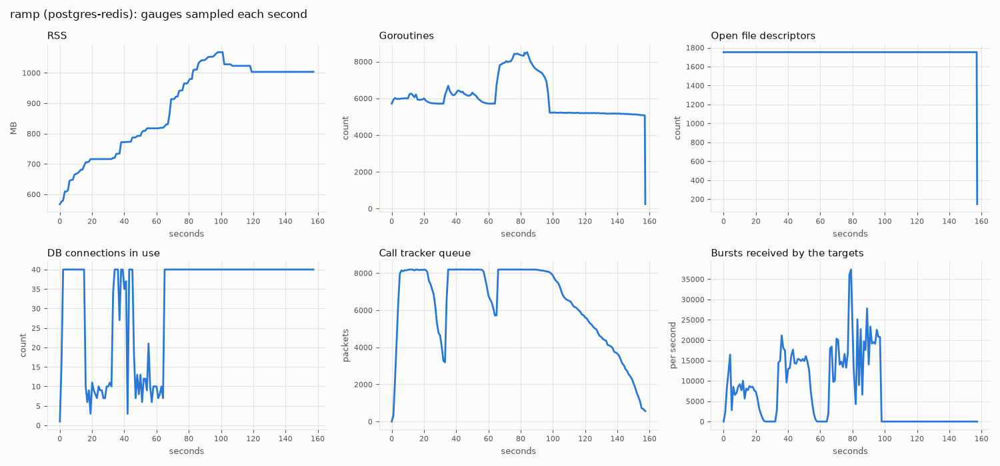

# Stress results

This page shows how much traffic DMRHub carries on the SQLite backend and on the PostgreSQL and Redis backend, what fails first when the load goes up, why, what an operator sees when it happens, and which settings or hardware move the limit. All numbers come from one set of runs on one commit (see [The runs](#the-runs)).

## Summary

| | SQLite | PostgreSQL and Redis |
| - | ------ | -------------------- |
| Normal traffic | Pass. callmix and transports: no missing, duplicated or misrouted burst. chaos: no misrouted burst, and every fault recovered. | Pass. The same as SQLite. |
| First metric to degrade | p99 latency over 50 ms at 100 busy repeaters | p99 latency over 50 ms at 100 busy repeaters |
| First records lost | 200 busy repeaters: the call tracker drops packets | 100 busy repeaters: the call tracker drops packets |
| Why bursts are lost | A lookup on the routing path (where a radio was last heard) waits 500 ms for the database, then gives up | A lookup on the routing path (a repeater) waits 500 ms for the database, then gives up |
| First bursts lost | 400 busy repeaters: 23 of 595641 in the ramp. None in the single-step run of 400. | 100 busy repeaters in the ramp (1223 of 175096), 200 in the single-step runs (2036 of 295956) |
| Failure (p99 over 500 ms) | 400 busy repeaters | 400 busy repeaters |
| What fails first | The one SQLite writer: the call tracker cannot write the records as fast as they come, and a dynamic talkgroup link waits for the writer on the routing path. | The database connection pool: all 40 connections are in use, the call tracker queue fills, and lookups on the routing path give up. |
| Not the limit | CPU: DMRHub used at most 1.6 of its 4 cores, and was never throttled. | CPU: DMRHub used at most 2 of its 4 cores, and was never throttled. |

A busy repeater has calls on both timeslots for 60% of the time, with mostly voice and some SMS. 100 busy repeaters are 200 lanes and about 7400 deliveries each second.

The machine also ran other heavy jobs during the runs, with a one-minute load average of 67 to 106 on 32 threads. This makes the latency at low load higher than on a quiet server (see [Latency at low load](#latency-at-low-load)).

## The runs

| Item | Value |
| ---- | ----- |
| Code | `main` at `8d7a3bf0` (the standard battery) and `4b12a3d8` (the ramps). The two commits have the same code; only the docs changed. |
| Date | 2026-10-26, 23:06 to 23:41 CDT |
| Machine | AMD Ryzen 9 7950X, 16 cores, 32 threads, 93 GB RAM, NVMe SSD (ext4 on LVM), Linux 7.2.9 |
| CPU limits | One Go process (Go 1.27.3) holds DMRHub, the simulated repeaters, the ledger and the sampler. It runs in a systemd scope with `CPUQuota=400%` (4 cores), `nice -n 19` and `GOMAXPROCS=4`. |
| PostgreSQL and Redis | `postgres:16-alpine` and `redis:7-alpine` in Docker 29.9.0, each limited to 4 CPUs, on loopback. The database pool of DMRHub has 10 connections for each CPU of `GOMAXPROCS`, so 40. |
| SQLite | A database file with the default parameters: `foreign_keys(1)`, `journal_mode(WAL)`, `synchronous(NORMAL)` and `_txlock=immediate`. |
| Other load | The machine ran training, labeling and build jobs at the same time. The one-minute load average was 67 to 106. Each result records it. |
| External clients | A separate run of the transports area on SQLite, with the programs that `hack/external/setup.sh` builds. See [External clients](#external-clients). |
| Network | Loopback only |

### Run it yourself

The battery is in `internal/stress` (build tag `stress`). `hack/stress.sh` runs it area by area and writes JSON, CSV and logs to a results directory, and `hack/stress_plot.py` draws the graphs. The settings are environment variables, listed at the top of `hack/stress.sh`. `PYTHON` must be a path, such as `/usr/bin/python3`, with matplotlib.

The standard battery:

```sh
DMRHUB_STRESS_AREAS="callmix transports ramp chaos" \
DMRHUB_STRESS_BACKENDS="sqlite postgres-redis" \
DMRHUB_STRESS_RESULTS=<results dir> PYTHON=/usr/bin/python3 \
systemd-run --user --scope -q -p CPUQuota=400% nice -n 19 env GOMAXPROCS=4 hack/stress.sh
```

The ramp to failure, with profiles:

```sh
DMRHUB_STRESS_AREAS=ramp \
DMRHUB_STRESS_BACKENDS="sqlite postgres-redis" \
DMRHUB_STRESS_RAMP=100,200,400,800 DMRHUB_STRESS_PPROF=1 \
DMRHUB_STRESS_RESULTS=<results dir> PYTHON=/usr/bin/python3 \
systemd-run --user --scope -q -p CPUQuota=400% nice -n 19 env GOMAXPROCS=4 hack/stress.sh
```

The ramp stops at the first step whose p99 is over 10 times the limit (500 ms). The single-step runs below use the same command with one value in `DMRHUB_STRESS_RAMP` for each run, so that each step has its own profiles and its own rig of that many repeaters. They also record the `cpu.stat` and `cpu.pressure` of the cgroup of the scope before and after each run.

## Areas

Each area starts its own hub in the test process, with 20 MMDVM repeaters that log in over UDP on loopback (the ramp uses as many as its largest step). Repeater `i` has one static talkgroup on each timeslot, and with the default fanout of 5, about 5 repeaters carry each talkgroup on each slot. Each slot of each repeater is a lane, which carries one transmission at a time at the pace of the air interface (one burst every 60 ms). A ledger knows each burst that a lane sent and each target that must get it, so it finds missing, duplicated, changed and misrouted bursts. The latency of a burst is the time from the send to the receive at a target, in the same process.

| Area | Test | What it does | Pass criteria |
| ---- | ---- | ------------ | ------------- |
| callmix | `TestCallMix` | 20 s of group calls, kerchunks, late entry, lost terminators, private calls to radios and to repeaters, calls to the parrot plugin, and group and private SMS, on both slots of every repeater. An OpenBridge peer gets every call. One call lasts 16 s. | Every burst reaches each target once and unchanged. Each transmission has one correct row that is not active at the end. Each SMS has one message row. The parrot plays each call back to its caller only. |
| transports | `TestTransports` | The call mix, plus voice, SMS and a CSBK from each transport in turn: MMDVM, an MMDVM session peer, OpenBridge v1 and v5, and IPSC. Then a peer logs in with the dialect of the published Homebrew specification. | As callmix. A burst that the IPSC server reports as `slot_busy` is dropped and counted, not missing. |
| ramp | `TestLoadRamp` | Makes 10, 25, 50 and 100 repeaters busy (or the steps of `DMRHUB_STRESS_RAMP`), 20 s for each step, with mostly voice and some SMS. | Records the step where the p99 goes over 50 ms or a delivery is missing. |
| chaos | `TestChaos` | Keeps 3 repeaters busy and breaks one thing at a time: a repeater stops in a call, a lossy UDP proxy, a restart of the MMDVM server with a handoff, a 5 s pause of Redis and of PostgreSQL, and the stop of a second replica. | No burst goes to a wrong target. The bursts of the lossy path arrive as often as the proxy passed them. A probe call gets through after each fault. |

## Normal traffic

| Area | Backend | Result | Bursts sent | Deliveries expected | Missing | Duplicates | Wrong target | slot_busy drops | p50 ms | p90 ms | p99 ms | max ms |
| ---- | ------- | ------ | ----------- | ------------------- | ------- | ---------- | ------------ | --------------- | ------ | ------ | ------ | ------ |
| callmix | sqlite | pass | 8603 | 36798 | 0 | 0 | 0 | - | 0.72 | 2.85 | 20.4 | 191 |
| callmix | postgres-redis | pass | 8603 | 36798 | 0 | 0 | 0 | - | 1.58 | 6.88 | 24.8 | 58.5 |
| transports | sqlite | pass | 8596 | 38752 | 0 | 0 | 0 | 516 | 0.63 | 2.70 | 10.6 | 44.9 |
| transports | postgres-redis | pass | 8596 | 38752 | 0 | 0 | 0 | 516 | 1.43 | 5.88 | 19.1 | 51.7 |
| chaos | sqlite | pass | 1944 | 7665 | 21 | 0 | 0 | - | 0.87 | 3.40 | 60.8 | 125 |
| chaos | postgres-redis | pass | 2461 | 9118 | 74 | 0 | 0 | - | 1.94 | 8.69 | 4749 | 5125 |

On both backends:

- Each of the 223 (callmix) and 241 (transports) transmissions has one correct row, and no row is active at the end.
- Each of the 26 SMS of callmix has one message row with its text.
- The parrot played 220 bursts back for 188 voice bursts sent to it, to the callers only.
- The peer with the dialect of the published Homebrew specification logged in.
- The 516 `slot_busy` drops are the bursts that the transports area sends to one IPSC timeslot while it is busy. The area sends more traffic to that slot than one slot can carry, on purpose.

Data does not wait behind voice:

| Area | Backend | Voice p50 / p99 ms | Data p50 / p99 ms | CSBK p50 / p99 ms |
| ---- | ------- | ------------------ | ----------------- | ----------------- |
| callmix | sqlite | 0.72 / 20.9 | 0.61 / 7.57 | - |
| callmix | postgres-redis | 1.58 / 25.0 | 1.50 / 22.3 | - |
| transports | sqlite | 0.63 / 10.9 | 0.63 / 6.93 | 1.85 / 5.14 |
| transports | postgres-redis | 1.44 / 19.1 | 1.32 / 20.9 | 3.73 / 5.78 |

### External clients

The transports area also runs real DMR programs against the hub, when `DMRHUB_STRESS_EXT_DIR` names the directory that `hack/external/setup.sh` builds. Each program logs in as a repeater (HBlink3 and HBlink4 also as OpenBridge peers), and a rig repeater then makes 3 calls on its talkgroup. The program must log in within 40 s and hear each call. YSF2DMR only logs in.

| Program | Commit | Logged in | Seconds to log in | Calls sent | Calls heard |
| ------- | ------ | --------- | ----------------- | ---------- | ----------- |
| MMDVMHost and DMRGateway | `9384d68` and `d751e20` | yes | 10.5 | 3 | 3 |
| HBlink3 | `1db2730` | yes | 0.5 | 3 | 6 |
| HBlink4 | `2348c3b` | yes | 0.5 | 3 | 3 |
| MMDVM_Bridge | `285e51e` | yes | 10.5 | 3 | 3 |
| YSF2DMR (MMDVM_CM) | `7328c9e` | yes | 10.5 | - | - |

HBlink3 heard each call two times: once as a repeater and once as an OpenBridge peer. The 10.5 s logins are the start time of the programs: the test checks the login each 0.5 s, and DMRGateway, MMDVM_Bridge and YSF2DMR wait about 10 s before they connect.

The same run had the same result as the standard battery: pass, 8596 bursts, 38752 deliveries expected, 0 missing, 0 duplicates, 0 wrong target, 516 `slot_busy` drops, p50 0.19 ms, p99 1.04 ms, max 50.3 ms. It ran on 2026-10-28 at 00:20 CDT on `main` at `e1034b5d`, with `CPUQuota=200%`, `nice -n 19` and `GOMAXPROCS=2`, and a one-minute load average of 11.8 to 24.8. The command:

```sh
DMRHUB_STRESS_AREAS=transports DMRHUB_STRESS_BACKENDS=sqlite \
DMRHUB_STRESS_EXT_DIR=~/.cache/dmrhub-ext \
DMRHUB_STRESS_RESULTS=<results dir> PYTHON=/usr/bin/python3 \
systemd-run --user --scope -q -p CPUQuota=200% nice -n 19 env GOMAXPROCS=2 hack/stress.sh
```

The `ipsc_slot` bar in the graphs below is the time that the bursts to the IPSC repeater waited for its busy timeslot. It is not a forwarding latency.


### Chaos

| Fault | SQLite recovery s | PostgreSQL and Redis recovery s |
| ----- | ----------------- | ------------------------------- |
| A repeater stops in a call and logs in again | 0.74 | 0.74 |
| MMDVM server restart with a handoff | 0.74 | 0.74 |
| Redis paused for 5 s | (no Redis) | 0.74 |
| PostgreSQL paused for 5 s | (no PostgreSQL) | 0.74 |
| A second replica stops | 2.33 | 2.33 |

A recovery of 0.74 s is the first probe call: it got through at once. The lossy proxy lost 22, duplicated 18 and reordered 24 packets, and each target got each burst of the lossy calls as often as the proxy passed it.

| Backend | Missing deliveries | Where |
| ------- | ------------------ | ----- |
| sqlite | 21 | 20 in the first call from a session peer after its replica stopped, before the peer logged in to the other replica. 1 in a group call. |
| postgres-redis | 74 | 20 as above. 53 in private calls that started while Redis or PostgreSQL was paused. 1 in a group call. |

The p99 of 4.7 s on PostgreSQL and Redis is the bursts that waited in Redis while it was paused, and arrived when it resumed. Outside the faults, the largest latency was 124 ms.


## Load until failure

### The ramp

One process, one rig of 800 repeaters, and steps of 100, 200, 400 and 800 busy repeaters. Both backends stopped after the 400 step, because the p99 was over 500 ms.

| Backend | Busy repeaters | Deliveries expected | Missing | p50 ms | p99 ms | max ms | Call tracker drops | CPU cores |
| ------- | -------------- | ------------------- | ------- | ------ | ------ | ------ | ------------------ | --------- |
| sqlite | 100 | 175156 | 0 | 1.75 | 54.5 | 98.6 | 0 | 0.94 |
| sqlite | 200 | 324551 | 0 | 1.94 | 58.1 | 314 | 14361 | 1.18 |
| sqlite | 400 | 595641 | 23 | 32.4 | 1548 | 2684 | 159092 | 1.74 |
| postgres-redis | 100 | 175096 | 1223 | 10.9 | 174 | 1673 | 20984 | 0.97 |
| postgres-redis | 200 | 324295 | 4007 | 20.7 | 199 | 1655 | 72870 | 1.37 |
| postgres-redis | 400 | 596290 | 25346 | 6730 | 13455 | 17348 | 173556 | 1.98 |


### Single steps

One process for each step, with a rig of that many repeaters, and the CPU numbers of its cgroup. "CPU pressure" is the share of the run in which at least one thread of the process waited for a CPU (`cpu.pressure`, `some`).

| Backend | Busy repeaters | Bursts sent | Deliveries | Missing | p50 ms | p99 ms | max ms | Tracker queue (max of 8192) | Tracker drops | DB connections in use (max of 40) | DB wait s | CPU cores in the step (of 4) | CPU throttled s | CPU pressure % | Load average |
| --- | --- | --- | --- | --- | --- | --- | --- | --- | --- | --- | --- | --- | --- | --- | --- |
| sqlite | 25 | 10755 | 35270 | 0 | 0.7 | 16.3 | 110 | 28 | 0 | 1 | 0.0 | 0.25 | 0.0 | 3 | 105 |
| sqlite | 100 | 43035 | 148448 | 0 | 1.2 | 57.3 | 291 | 866 | 0 | 4 | 0.0 | 0.66 | 0.0 | 4 | 102 |
| sqlite | 200 | 86279 | 295839 | 0 | 1.3 | 70.7 | 239 | 8192 | 13332 | 4 | 0.0 | 1.09 | 0.0 | 4 | 100 |
| sqlite | 400 | 173645 | 593099 | 0 | 19.7 | 1034.6 | 1712 | 8192 | 148025 | 4 | 0.0 | 1.60 | 0.0 | 5 | 101 |
| postgres-redis | 25 | 10755 | 35270 | 0 | 1.8 | 20.7 | 53 | 50 | 0 | 10 | 0.0 | 0.33 | 0.0 | 2 | 102 |
| postgres-redis | 100 | 43106 | 148519 | 0 | 4.3 | 62.3 | 274 | 8183 | 14355 | 40 | 48.7 | 0.88 | 0.0 | 3 | 96 |
| postgres-redis | 200 | 86298 | 295956 | 2036 | 21.8 | 428.9 | 1871 | 8192 | 78013 | 40 | 8444.5 | 1.28 | 0.0 | 4 | 102 |
| postgres-redis | 400 | 173686 | 593088 | 70348 | 5108.6 | 11824.0 | 15689 | 8192 | 168289 | 40 | 18310.1 | 2.07 | 0.0 | 4 | 105 |

### What fails first, and why

**SQLite: the one writer.** SQLite has one writer at a time, and DMRHub writes every transmission row, every heard codec and every dynamic talkgroup link through it.

- At 200 busy repeaters, the call tracker queue (8 shards of 1024 packets) is full, and the call tracker drops 13332 packets. The block profile shows the call tracker shards waiting for the writer in `sqliteWriters.wait`, when they open a row (`shard.open`) and when they finish one (`shard.finish`): 324 s of waiting in the step.
- At 400 busy repeaters, the p50 goes from 1.3 ms to 19.7 ms and the p99 to over 1 s. The block profile of that step shows where the goroutines wait: the call tracker 720 s for the writer, the links of dynamic talkgroups 396 s for the writer (`LinkDynamicTalkgroup`, which `routeNow` calls), and the deliveries 1656 s for room in the queue of the MMDVM server (`deliverToServerUnless`). The profiles show these waits, but not which one sets the p50.
- In the ramp, with 800 repeaters logged in, the 400 step also used all 40 connections of the pool for some seconds (see the gauges below). Then a lookup on the routing path waits at most 500 ms (`lookup.Wait`) and gives up: the 23 missing deliveries of that step are 23 private calls whose lookup of where the radio was last heard failed with `Error querying where a radio was last heard ... the lookup is waiting on the database`.
- The CPU is not the limit: the process used 1.6 cores of its 4 in the 400 step, the cgroup was never throttled, and at least one thread waited for a CPU in only 5% of the run (`cpu.pressure`).

**PostgreSQL and Redis: the database connections.** The pool has 40 connections.

- At 100 busy repeaters, all 40 connections are in use, the calls of the pool waited 48.7 s for a connection in the step, the call tracker queue reaches 8183 of 8192, and the call tracker drops 14355 packets. The goroutines that wait for a connection are the call tracker shards (`shard.open`, `shard.voice`) and the repeater cache (`cachedRepeater`), which reloads each repeater from the database each 10 seconds with five joins (`FindRepeaterByID`).
- After the traffic of the 400 step ended, all 40 connections stayed in use for about 60 seconds while the call tracker worked off its queue (see the gauges below).
- At 200 busy repeaters, bursts go missing: 2036 of 295956. To deliver a call to a repeater whose cache entry is not ready, DMRHub looks the repeater up in the database, and waits at most 500 ms (`lookup.Wait`). With the pool full, the lookup gives up, DMRHub logs `Failed to find repeater for delivery ... the lookup is waiting on the database`, and does not deliver the burst. At 400 busy repeaters, 70348 of 593088 deliveries are missing, and the p50 is 5.1 s.
- PostgreSQL itself was not busy. We ran the 200 step again and looked inside the PostgreSQL container 35 seconds after the start: it used 32% of one CPU, and in three samples 4 s apart, 33 to 38 of the 40 connections of DMRHub were idle in PostgreSQL, waiting for DMRHub to send the next query (`ClientRead`). The 2 to 7 active queries were commits that waited for the write-ahead log (`WALWrite`, `WALSync`). So the connections are busy on the DMRHub side, between queries, more than in PostgreSQL. We did not find which code holds them.
- The same step gives very different results at different times on this machine. That second run of the 200 step, at a load average of 73 instead of 102, had a p99 of 8 ms, no missing burst and 247 call tracker drops, against 429 ms, 2036 and 78013 in the first one. The pool still reached 40 connections and the call tracker queue 6479 packets. The mechanism stays the same, but the load at which it shows depends on the other work of the machine.
- The CPU is not the limit: the process used at most 2 cores of its 4, and was never throttled.





### Latency at low load

On this machine, the p99 at 25 busy repeaters was 16 ms on SQLite and 21 ms on PostgreSQL and Redis, while the p50 stayed under 2 ms. No queue was full and no connection waited, so the tail comes from outside DMRHub's queues. To find it, we ran the 100 step on SQLite again (p50 1.6 ms, p99 52 ms) and recorded the scheduler events of the process for 15 seconds with `perf sched record`. In that window, the threads of the process woke up 54541 times. The time that a thread was ready but waited for a CPU was:

| p50 | p90 | p99 | p99.9 | max | Waits over 1 ms | Waits over 10 ms |
| --- | --- | --- | ----- | --- | --------------- | ---------------- |
| 0 ms | 0.35 ms | 4.2 ms | 9.9 ms | 20.5 ms | 2999 (5.5%) | 52 |

The cgroup was never throttled, so these waits come from the other jobs on the machine, which the kernel gives a larger share of the CPUs than a process at `nice -n 19`. A burst passes through several threads (the sender, the hub, the server that sends it, the receiver), so these waits add up in the tail of the latency. We did not measure the same step on an idle machine; we expect a much lower p99 there.

### What an operator sees

| Sign | Where |
| ---- | ----- |
| `CallTracker: queue full, packets not recorded` | Log, warning. Last Heard misses calls, or has calls without their last bursts. |
| `Dropping the codec heard on a timeslot, the queue is full` | Log, warning. The **Automatic** codec of a timeslot can show an older codec. |
| `Dropping a sighting, the queue is full` | Log, warning. A private call can go to the repeater where the radio was heard before. |
| `SLOW SQL >= 200ms` | Log, from the database library, with the SQL |
| `CallTracker: error saving call` | Log, error. See [Bugs that the runs found](#bugs-that-the-runs-found). |
| `call_tracker_dropped_packets_total` | Metric. Goes up with each dropped packet. |
| `dmr_ingress_dropped_bursts_total`, `dmr_undeliverable_bursts_total` | Metrics of bursts that DMRHub did not route or could not deliver |

### What moves the limit

| Change | Effect |
| ------ | ------ |
| PostgreSQL or MySQL in place of SQLite, on a server with fast disks | More than one writer. On this machine, the PostgreSQL container shared the disk and the CPUs with the other jobs, so it did not do better than SQLite. |
| A faster or less loaded database server | The call tracker and the repeater lookups wait less for the database. |
| `GOMAXPROCS` | The database pool has 10 connections for each, so 4 gives 40. More connections help only when the database server can take them. |
| More replicas with Redis | Each replica has its own call tracker and its own pool, and the replicas share the repeaters. The database is still shared. Not measured here. |

## Bugs that the runs found

- **A lost voice burst before a voice sync can make a call row that PostgreSQL refuses.** In `calcSequenceLoss` (`internal/dmr/calltracker/voice.go`), a voice sync burst after a lost burst subtracts `call.LastFrameNum + 1` from a smaller unsigned number, and `TotalPackets` and `LostSequences` wrap around to near 2^64. PostgreSQL refuses the value (`unable to encode 0xffffffffffffffff into binary format for int8`), so DMRHub does not save the end of that call. The runs logged this 99 times in the PostgreSQL ramp, when the call tracker dropped packets, and the same happens when the network loses a burst at the end of a superframe.
- **The default `database.extra-parameters` break PostgreSQL and MySQL.** The default holds SQLite parameters, and DMRHub passes them to every driver. See [Configuration](configuration.md#postgresql).
