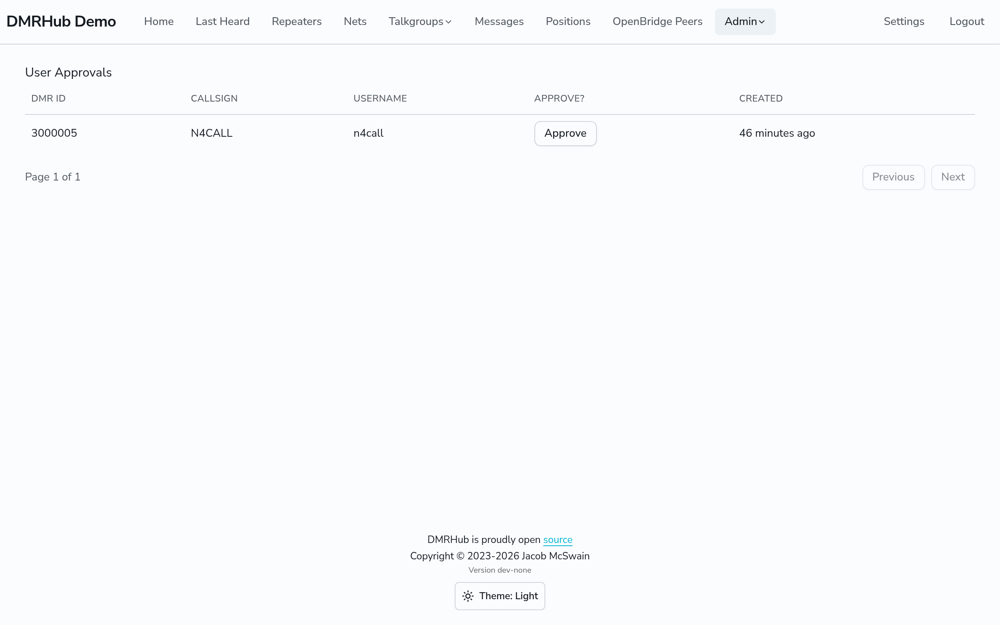
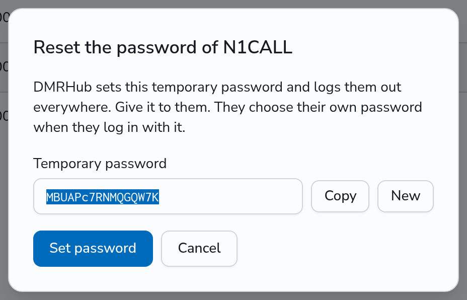
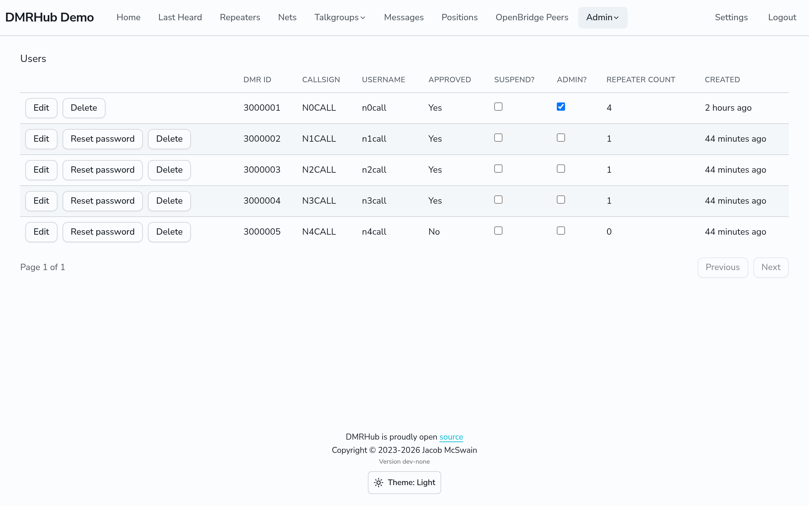

# Users

This page tells how to approve new users, and how to edit, suspend and delete users. You must be an admin. Some actions need the super admin (see [Admins and the super admin](overview.md#admins-and-the-super-admin)).

## Approve new users

When a ham registers at `<siteurl>/register`, DMRHub checks that RadioID.net lists the DMR ID under the callsign (see [RadioID checks](#radioid-checks)). A new password must have at least 8 characters. This applies when a user registers, changes their password, or uses a reset link, and when an admin sets a password. A password set before this rule still works until the user changes it. If you set the HIBP API key (`hibp-api-key`), DMRHub also refuses passwords that are in the Have I Been Pwned list.

Then the new user waits for an admin, unless `auto-approve-users` is on. With `auto-approve-users` on, the new user can log in at once.

To approve a user:

1. Go to **Admin**, then **User Approvals** (`<siteurl>/admin/users/approval`).
2. Find the user, and click **Approve** in the **Approve?** column.
3. The browser shows the message "Are you sure you want to approve this user?". Click **OK**. This message has no **Cancel** button: DMRHub approves the user when it closes.

The RadioID.net check shows that the DMR ID and the callsign go together. It does not show that the person who registered holds that callsign. Use your own judgment before you approve a user.

## Who can register

Go to **Admin**, then **Setup**, then **Accounts** (`<siteurl>/admin/setup#accounts`). In the **Registration** card, **Who can register** is one of:

- **Anyone**: the default.
- **Invite only**: only a person with an invite from an admin. A user who registers with an invite can log in at once.
- **Nobody**: the register page shows "Registration is closed." and the Register link does not show.

The first admin can register in any mode. The config key is `registration` (`open`, `invite` or `closed`).

### Invite a user

When **Who can register** is **Invite only**, **Admin** has an **Invites** page (`<siteurl>/admin/invites`).

1. Click **New invite**.
2. DMRHub shows the invite link once. Click **Copy** and send the link to the person.
3. The link works once, for 7 days.

The list shows when each invite was made, by whom, when it expires, and who used it. Click **Delete** to stop an unused invite. Without an invite link, the register page shows "Registration needs an invite."

## What visitors see

In the **Visibility** card of the **Accounts** tab, **Visitors who are not logged in see** is one of:

- **Everything**: the last heard calls, the talkgroups, the nets and the RadioID details of a radio. This is the default.
- **No names or positions**: the same, without the talker alias, the position and the grid square of each call, and without the name, city and state from RadioID. Callsigns and DMR IDs still show.
- **Nothing**: visitors go to the login page first.

A logged-in user sees the same in each mode. The login, register and password reset pages work in each mode. The config key is `visibility` (`public`, `hide-names` or `login`).

## Edit a user

1. Go to **Admin**, then **Users** (`<siteurl>/admin/users`).
2. Click **Edit** in the row of the user.
3. Change the **Callsign** or the **Username**, then click **Save Changes**. Click **Cancel** to keep the old values.

DMRHub checks a new callsign against RadioID.net when the callsign check is on. When RadioID.net lists another callsign for the DMR ID, DMRHub shows that callsign. Click **Save <callsign> anyway** to keep yours. The RadioID drift check then skips the user. DMRHub refuses a callsign that another user has.

Users can change their own username and callsign in the **Account** card on **Settings**. A user can only set the callsign that RadioID.net lists for their DMR ID.

Usernames are the same in any case, so a user can log in as `alice` or `Alice`, and two users cannot have usernames that differ only by case. A user can log in with their callsign in any case too. A username cannot be the callsign of another user, in any case, and a callsign cannot be the username of another user, because a login by a username comes before a login by a callsign. A user can have their own callsign as their username.

## RadioID checks

The **RadioID checks** card of the **Accounts** tab has five checks of DMR IDs and callsigns, most of them against the RadioID.net data. Each one is on by default.

| Switch | Config key | When it is on |
|--------|------------|---------------|
| **DMR ID has 7 digits** | `dmr.radio-id-checks.user-id` | DMRHub refuses a registration whose DMR ID does not have 7 digits. |
| **Callsign matches DMR ID** | `dmr.radio-id-checks.callsign` | DMRHub refuses a registration or a callsign change whose callsign RadioID.net does not list under the DMR ID of the account. The RadioID drift check covers the DMR ID of each account. |
| **Added radio IDs** | `dmr.radio-id-checks.radio-ids` | DMRHub refuses an added radio ID that RadioID.net does not list under the callsign of the user. The RadioID drift check covers the added radio IDs. |
| **Repeater IDs** | `dmr.radio-id-checks.repeater-ids` | DMRHub refuses a 6-digit repeater ID that RadioID.net does not list under the callsign of its owner, and fills in the details of the repeater from RadioID.net. |
| **Hotspot IDs start with owner ID** | `dmr.radio-id-checks.hotspot-ids` | DMRHub refuses a 9-digit hotspot ID that does not start with the DMR ID of its owner. |

**Turn off all checks** (`dmr.disable-radio-id-validation`) turns off all five, whatever they are set to. While it is on, the five switches do not show.

## Fix RadioID drift

A callsign can change on RadioID.net after a user registers. Each night at 01:00 (server time), DMRHub compares the DMR ID and the added radio IDs of each user with RadioID.net. Go to **Admin**, then **RadioID Drift** (`<siteurl>/admin/users/radio-id-drift`) to see the radio IDs that no longer match. This page shows only when the callsign check or the radio IDs check is on. The callsign check covers the DMR ID of each account, and the radio IDs check covers the added radio IDs.

- Click **Fix** to give the user the callsign that RadioID.net lists. If the user confirmed an email address, you can also send them an email about the change.
- **Not listed** means that RadioID.net no longer has the radio ID.
- A row has no **Fix** when RadioID.net does not have the radio ID, or lists an added radio ID under another callsign than the DMR ID of the user. Click **Edit user** to change the user.

When SMTP is on, DMRHub sends one email to a user with a confirmed address when the check first finds one of their radio IDs. If more than 5 radio IDs and more than 5% of the checked radio IDs drift in one check, DMRHub sends no emails and logs a warning, because a bad RadioID.net download is more likely than a real change.

## Logins

In the **Logins** card of the **Accounts** tab:

- **Login lasts** is how long a login lasts, in hours or days. The default is 30 days. The new length applies to each new login at once. A shorter length also ends the older logins that are past it. A longer length does not make the older logins last longer. The config key is `http.session-length`.
- **Pause an account after 10 failed logins** slows down password guessing. It is on by default. After 10 failed logins of one account in 15 minutes, DMRHub refuses each login of that account, even with the right password, until fewer than 10 failures are in the last 15 minutes. A login by the username and a login by the callsign count for the same account. A successful login clears the count. Other accounts are not affected. The config key is `login-backoff`.

## Suspend a user

On the **Users** page, turn on the **Suspend?** box of the user. A suspended user cannot log in, and DMRHub refuses the API calls of their open sessions. Turn the box off to let the user in again. You cannot suspend yourself.

## Reset the password of a user

1. On the **Users** page, click **Reset password** in the row of the user.
2. DMRHub shows a temporary password. Copy it, then click **Set password**.
3. Give the temporary password to the user.

DMRHub logs the user out everywhere. When the user logs in with the temporary password, DMRHub asks them to choose their own password before they can use the other pages. You cannot reset your own password here.

When SMTP is on, users can also reset their own password with **Forgot your password?** on the login page. DMRHub sends the link only to the email address of the account, and only when the user confirmed that address. The link works once, for 1 hour. Users set and confirm their address in the **Email** card on **Settings**.

## Make a user an admin

Only the super admin can do this. On the **Users** page, turn on the **Admin?** box of the user. Turn it off to stop the user being an admin. Other admins get the message "Only the System Admin can do this."

## Delete a user

Only the super admin can do this. On the **Users** page, click **Delete** in the row of the user, then click **OK** in the browser message. Click **Cancel** to keep the user.

