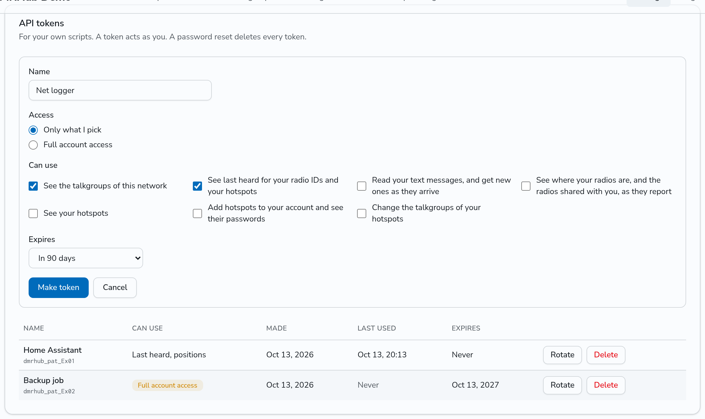
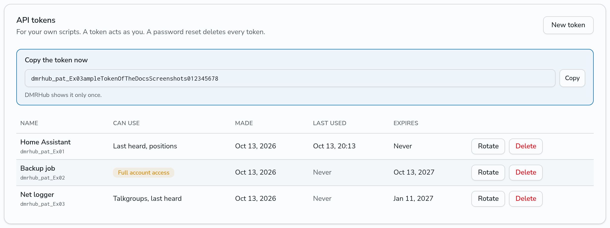
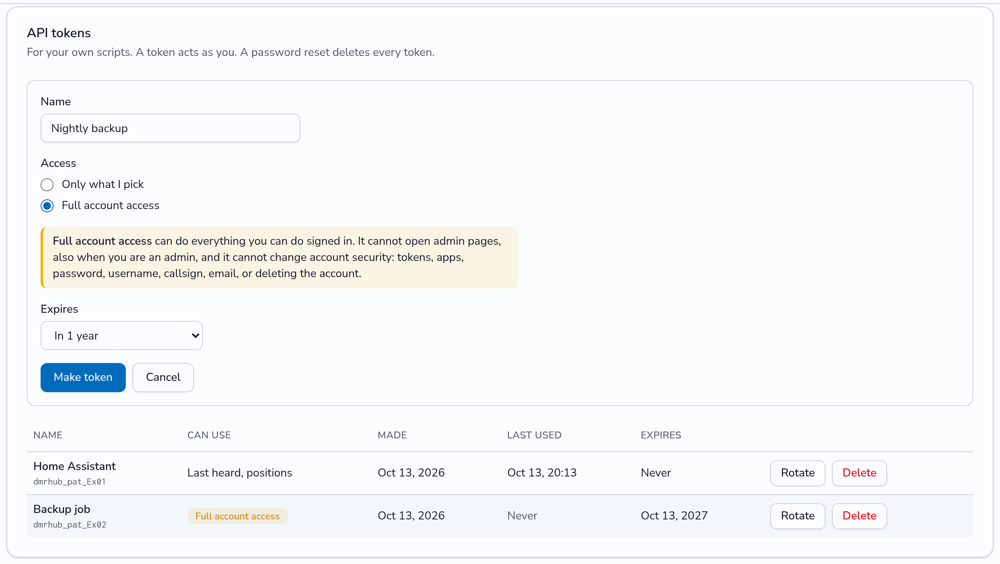

# API tokens

An API token lets your own scripts use the DMRHub API as you, without your password. Make tokens in **Settings** (`<siteurl>/settings`), in the **API tokens** card. For a web app that other people use, use [OAuth apps](oauth-apps.md) instead.

In this page, `<siteurl>` is the URL of your DMRHub instance.

## Make a token

1. In the **API tokens** card, click **New token**.
2. Type a **Name**, so that you can tell your tokens apart later. Use 1 to 64 characters.
3. Under **Access**, pick one:
   - **Only what I pick**: then, under **Can use**, pick each thing that the token can use. These are the same scopes as for [OAuth apps](oauth-apps.md#scopes).
   - **Full account access**: see [Full account access](#full-account-access).
4. Pick when the token **Expires**: in 30 days, in 90 days, in 1 year, or **Never**.
5. Click **Make token**.



DMRHub shows the token once. Copy it at once and keep it in a safe place, such as the secret store of your script. DMRHub keeps only a hash of it, and cannot show it again. If you lose a token, rotate it or delete it and make a new one.



Each user can have up to 50 tokens.

## Full account access

A token with **Full account access** can do everything that you can do while you are signed in, as you. It does not stop at the scopes, so a script can use any route of the API, such as starting a net or adding a radio ID.

It never has more rights than you, and it has fewer:

- It never has admin rights, also when you are an admin. The admin routes refuse it.
- It cannot change account security. These routes refuse it with `403` and `insufficient_scope`:
  - the API tokens themselves (`/api/v1/users/me/tokens`);
  - the OAuth apps and the consent page (`/api/v1/oauth/...`);
  - your password, username and callsign (`PATCH /api/v1/users/:id`);
  - your email address (`PUT /api/v1/users/me/email`);
  - deleting the account (`DELETE /api/v1/users/:id`);
  - logging in and out (`/api/v1/auth/...`).
- Like every token, it cannot rotate the password of a hotspot, repeater or peer.



Pick **Full account access** only when a script needs a route that no scope gives. Otherwise pick only the scopes that the script needs.

## Use a token

Send the token in the `Authorization` header:

```bash
curl -s <siteurl>/api/v1/lastheard -H "Authorization: Bearer $DMRHUB_TOKEN"
```

A websocket takes the token in the `dmrhub.bearer.` subprotocol, as for an app. See [OAuth apps](oauth-apps.md).

A token with scopes may use the routes of its scopes, as listed in [OAuth apps](oauth-apps.md#scopes), and the routes that every token may use. Every other route refuses it with `403` and `insufficient_scope`. A token that does not work, such as a deleted, rotated or expired one, gets `401` and `invalid_token`:

```text
HTTP/1.1 401 Unauthorized
WWW-Authenticate: Bearer error="invalid_token"

{"error":"invalid_token"}
```

Tokens start with `dmrhub_pat_`. The list shows this start and the next 4 characters of each token, so that you can find which script has which token.

## Rotate a token

Click **Rotate** next to a token to give it a new secret. The new token has the same name, the same access, and the same lifetime, counted from now: a 90-day token works for 90 more days, and a token that never expires still never expires. You can rotate an expired token to make it work again.

The old token stops working at once, on every DMRHub server of the network. Its open websockets close with code `1008` and the reason `token revoked`. DMRHub shows the new token once.

## Delete a token

Click **Delete** next to a token. It stops working at once, and its open websockets close, as when you rotate it.

## Expiry and other ends

An expired token stays in the list, marked **Expired**, until you rotate or delete it.

DMRHub deletes every token of a user when their password is reset with a reset link, and when an admin sets a password for them, as it does for the apps. Removing a user removes their tokens. A change of your own password in Settings keeps your tokens.

## The API of the card

The Settings page uses these routes. They need you signed in to DMRHub; a token cannot use them.

| Route                                     | What it does                                       |
| ----------------------------------------- | -------------------------------------------------- |
| `GET /api/v1/users/me/tokens`             | Lists your tokens, the scopes, and the expiries    |
| `POST /api/v1/users/me/tokens`            | Makes a token and answers its secret once          |
| `POST /api/v1/users/me/tokens/:id/rotate` | Gives the token a new secret and answers it once   |
| `DELETE /api/v1/users/me/tokens/:id`      | Deletes the token                                  |

`POST /api/v1/users/me/tokens` takes `name`, either `scopes` (a list of scope names) or `"full": true`, and `expires_in_days`: `30`, `90`, `365`, or `0` for never. For example:

```json
{"name":"Net logger","scopes":["talkgroups:read","lastheard:read"],"expires_in_days":90}
```

It answers with `Cache-Control: no-store`:

```json
{"secret":"dmrhub_pat_<secret>","token":{"id":"<id>","name":"Net logger","prefix":"dmrhub_pat_-WA8","scopes":["talkgroups:read","lastheard:read"],"full":false,"can_use":"Talkgroups, last heard","days":90,"made":"2026-11-01T16:53:35.325011853-06:00","last_used":null,"expires":"2027-01-30T16:53:35.325011853-06:00","expired":false}}
```

The list and the rotate answer use the same `token` object, and the list never has the secret.
