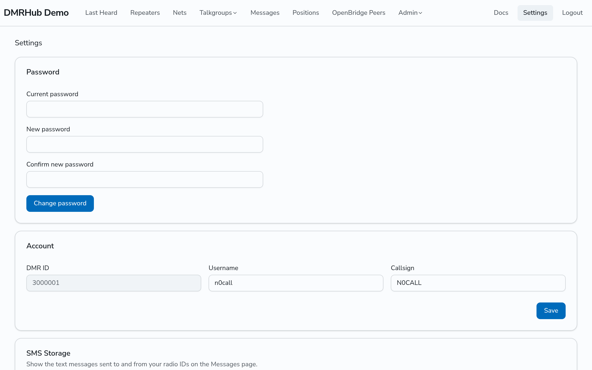
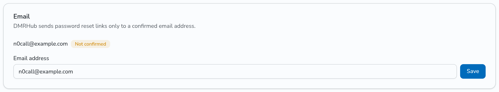
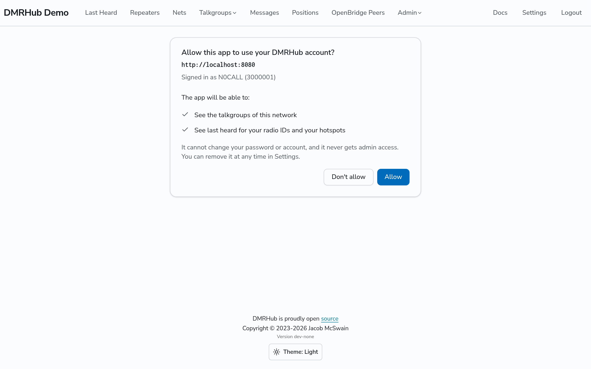
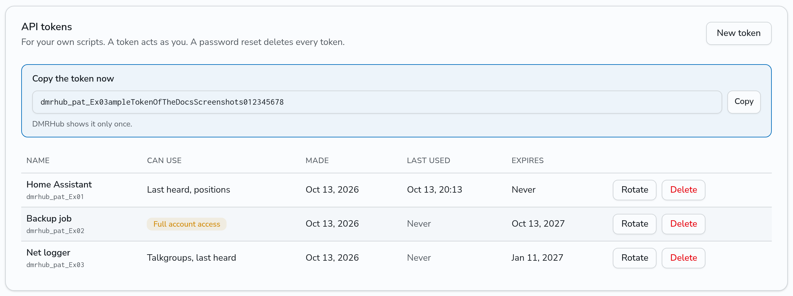
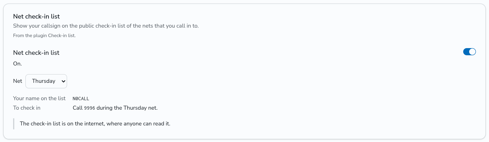

# Manage your account

Go to **Settings** (`<siteurl>/settings`) to change your password, set your email address, turn SMS Storage on or off, add your other radio IDs, turn on the services of plugins, remove apps, and make API tokens for your own scripts.

## Change your password

1. In the **Password** card, type your **Current password**.
2. Type the **New password** and type it again in **Confirm new password**.
3. Click **Change password**.

DMRHub logs out your other sessions.

If an admin set a temporary password for you, DMRHub shows only the Password card until you choose your own password. Until then, the other pages send you back to Settings.

## Email

DMRHub sends password reset links only to a confirmed email address.

1. In the **Email** card, type your address in **Email address** and click **Save**. To remove the address, clear the field and click **Save**.
2. DMRHub sends a link to the address. Open it to confirm the address. The link works once, for 24 hours. The card shows **Not confirmed** until you open it, and **Confirmed** after.

When you change the address, the new one is not confirmed until you open its link. A link sent to an older address no longer works.

If the network cannot send email, the card says so instead. Then only an admin can reset your password.

## SMS Storage and radio IDs

See [Send and read text messages](text-messages.md#turn-on-sms-storage).

## Apps

Some web apps, such as [DMRHub Radio](browser-radio.md), can use your DMRHub account. The first time, DMRHub asks you on its own page, **Allow this app to use your DMRHub account?** The page shows the address of the app and a list of what it can do. Click **Allow** or **Don't allow**.

An app can never change your password or account, and never gets admin access.

The **Apps** card on Settings lists the apps that you allowed, what each one can use, when you allowed it and when it last used your account. Click **Remove** to take away the access of an app. DMRHub signs it out at once.

An app keeps its access while you use it. If you do not use an app for 30 days, its login ends and you must log in again in the app.

## API tokens

The **API tokens** card makes tokens that let your own scripts use the DMRHub API as you. A token can use only what you pick for it, or have **Full account access**: everything you can do signed in, except admin pages and account security (tokens, apps, password, username, callsign, email, and deleting the account). DMRHub shows each token once. **Rotate** gives a token a new secret and ends the old one at once; **Delete** ends it. See [API tokens](../api-tokens.md).

## Plugin services

Some plugins of the network serve you only after you turn on their switch on Settings, such as a service that sends your messages to the internet. Each such plugin has its own card. Turn on its switch to use the service. The card then shows what the service needs from you, such as your address on that service and how to use it from your radio, and a note on who can read what it sends. Some cards also have a list, such as a choice of net. Turn the switch off to stop the service.

The cards show only the plugins that an admin turned on, and the name of the plugin of each. When you turn on a switch, you also let that plugin send APRS messages from your callsign. Turn on only the switches of services that you use.

## On-air code

The **On-air code** card locks your radio IDs on the air until you unlock them with a code from an authenticator app, as a private call to 9 and the code. See [Lock your radio ID with an on-air code](on-air-code.md).

## Theme

Use **Theme** at the bottom of each page to pick **Light**, **Dark** or **System**. Your browser remembers the choice.

## Log out

Click **Logout** in the navigation bar.

## Delete your account

You cannot delete your account yourself. Ask an admin.
