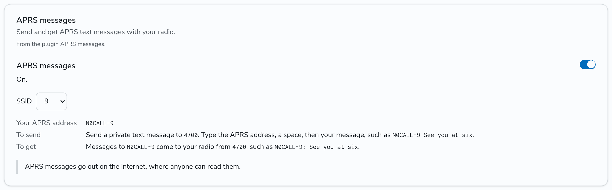

# Send and get APRS messages

With the APRS messages plugin, you send APRS text messages from your DMR radio to any APRS station, and APRS messages to you come to your radio as text messages. The messages go through the APRS-IS login of the hub.

The plugin works only when your admin turned it on and gave it an ID. The examples on this page use the ID 4700. Your network can use another ID: the **APRS messages** card in **Settings** shows the right one.

APRS messages go out on the internet, where anyone can read them. Do not send what you would not say on the air.

## Turn APRS messages on

1. Go to **Settings**.
2. On the **APRS messages** card, turn on the switch.
3. Pick the **SSID** of your APRS address. The default is 7, so that your address does not clash with the APRS station that you may already run under your callsign.



The card shows your APRS address, such as `N0CALL-7`. Tell your APRS friends to send their messages to that address.

Turn the switch off to stop. Then the plugin does not send or deliver any APRS message for you, and does not answer your texts.

## Send an APRS message

Send a private text message to the ID of the plugin, such as 4700. The text has two parts, with one space between them:

1. The APRS address of the station that gets the message, such as `N0CALL-9`. Use the callsign alone, such as `N0CALL`, for a station with no SSID.
2. Your message.

For example, to send "See you at six" to `N0CALL-9`, send this text to 4700:

```
N0CALL-9 See you at six
```

The plugin sends the APRS message from your APRS address, with a message number. It sends the message again after 30 seconds, then after 1, 2 and 4 minutes, until the station acknowledges it (an APRS ack). After 5 sends with no ack, it stops.

An APRS message carries at most 67 characters. The plugin sends a longer text as several APRS messages, split between words. APRS cannot carry the characters `|`, `~` and `{`, so the plugin sends `/`, `-` and `(` in their place, and `?` for each character that is not plain ASCII, such as an accented letter.

When your text does not start with an APRS address and a space, the plugin answers with a short text that tells you the right format.

## Get APRS messages

An APRS message to your APRS address comes to your radio as a private text message from the plugin's ID. The text starts with the address of the sender, then a colon:

```
N0CALL-9: Copy, see you at the hamfest
```

To answer, send a text to the plugin's ID as in [Send an APRS message](#send-an-aprs-message), with the sender's address first.

The plugin sends the text to the radio of yours that the hub heard last. It sends the text in the exact format of a text that the radio itself sent before through your own hotspot or repeater, or one that the admin trusts. A format that a radio did not send can lock it up, so the plugin sends nothing to a radio that has not sent a text yet. Send any text from your radio first, such as a text to the plugin's ID.

The plugin acknowledges the APRS message only after the hub sent the text to your radio. When the hub cannot reach your radio, the sender's station gets no ack and sends the message again later. A message that comes again after it reached your radio is not sent to your radio twice.

## If nothing comes

- Check that the **APRS messages** card shows in **Settings** and that its switch is on. When the card is not there, the plugin is off on this network. Ask your admin.
- Check the address. Messages to your callsign with another SSID, or with no SSID, do not come to your radio.
- Send a text from your radio to the plugin's ID first, so that the hub knows the text format of your radio.
