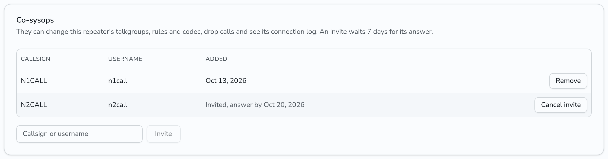
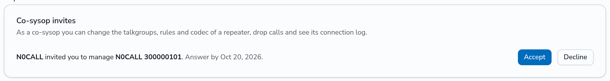
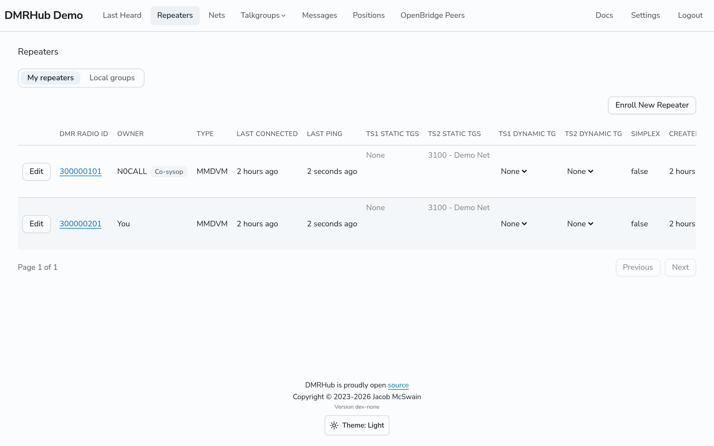

# Share a repeater with co-sysops

The owner of a hotspot or repeater can invite other users to look after it as co-sysops, for example the other members of a club that runs a repeater. A co-sysop can do most of what the owner does, but cannot see the password of the repeater.

## Invite a co-sysop

1. On the **Repeaters** page, click the ID of the repeater.
2. On the **Co-sysops** card, type the callsign or the username of the user and click **Invite**.

The invite shows in the list as "Invited, answer by" and the date. An invite waits 7 days. After that it ends, and you can invite the user again. To take back an invite before its answer, click **Cancel invite**.

The user sees the invite at the top of their **Repeaters** page and clicks **Accept** or **Decline**.

## What a co-sysop can do

A co-sysop can:

- change the talkgroups of the repeater, link and unlink talkgroups, and set the voice codec
- set the [rules of the repeater](repeater-rules.md)
- see the Last Heard of the repeater
- see the [connection log](sysop-tools.md#connection-log) and use the [sysop actions](sysop-tools.md#sysop-actions): drop a call, drop a dynamic talkgroup, reset the connection
- turn on an [offline alert email](sysop-tools.md#offline-alert-email) for themselves

A co-sysop cannot see or rotate the password of the repeater, delete the repeater, or invite or remove other co-sysops. The repeater shows on the **Repeaters** page of the co-sysop, with the callsign of the owner and a **Co-sysop** badge.

## Remove a co-sysop

The owner clicks **Remove** in the row of the co-sysop. A co-sysop who wants to stop clicks **Leave** in their own row. An admin can remove any co-sysop.

When the repeater or the user is deleted, the co-sysop role ends.

## API

- `GET /api/v1/repeaters/<id>/cosysops` lists the owner, the co-sysops, and for the owner and admins the invites that wait. `role` is `owner`, `cosysop` or `admin`.
- `POST /api/v1/repeaters/<id>/cosysops` with `{"user": "<callsign or username>"}` invites a user. Only the owner and admins can invite.
- `DELETE /api/v1/repeaters/<id>/cosysops/<user ID>` removes a co-sysop or takes back an invite.
- `GET /api/v1/repeaters/cosysop-invites` lists your invites that wait.
- `POST /api/v1/repeaters/<id>/cosysop-invite/accept` and `.../decline` answer an invite.
