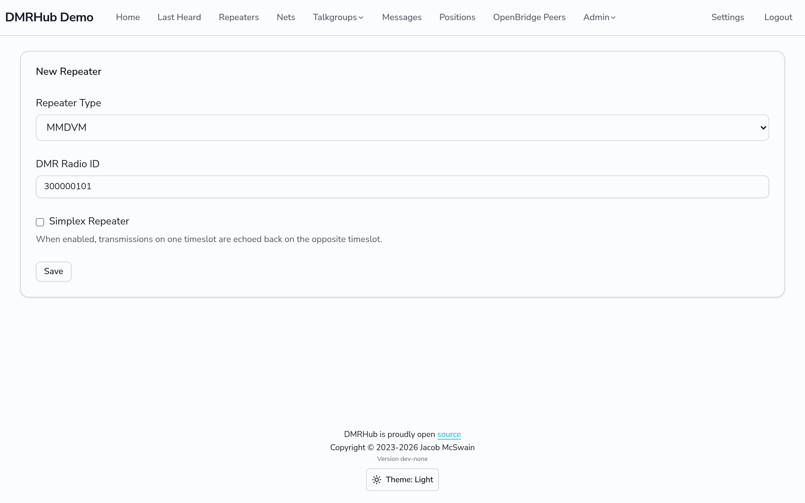
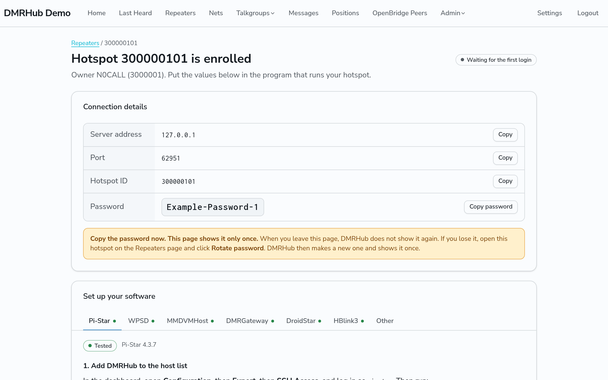
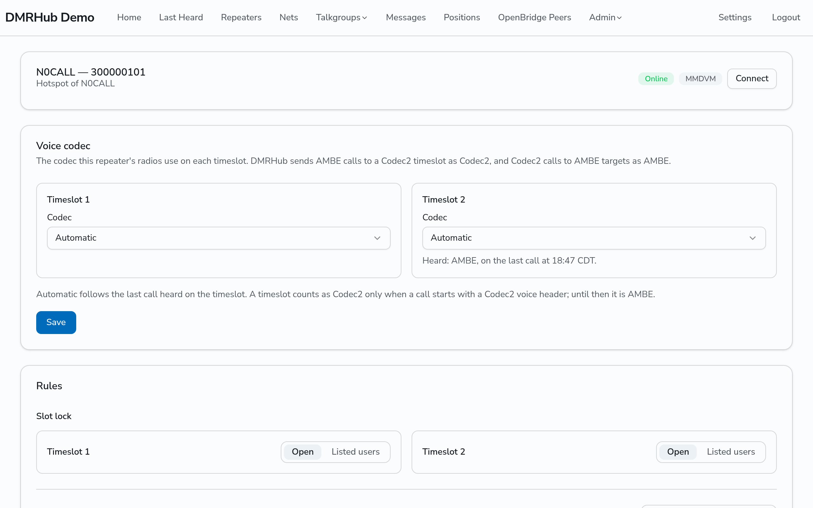

# Connect a hotspot

This guide tells you how to enroll a hotspot on DMRHub and connect it. DMRHub treats a hotspot and a repeater the same way. For a repeater with its own 6-digit ID, or a Motorola repeater, see [Link a repeater](link-repeater.md).

Your hotspot connects with the MMDVM network protocol, the same protocol that MMDVMHost and DMRGateway use for BrandMeister and TGIF.

## Pick the hotspot ID

A hotspot ID is one of these:

- Your 7-digit DMR ID, for example 3000001.
- Your 7-digit DMR ID with two more digits, from 00 to 99, for example 300000101. Use this form when you have more than one hotspot.

The ID must start with the DMR ID of your account, unless the admin turned off the RadioID.net checks.

## Enroll the hotspot

1. Log in.
2. Go to **Repeaters** (`<siteurl>/repeaters`) and click **Enroll New Repeater**.
3. If the network accepts Motorola repeaters, set **Repeater Type** to **MMDVM**. If it does not, the page does not show this field.
4. Enter the hotspot ID in **DMR Radio ID**.
5. Leave **Simplex Repeater** off for a normal hotspot. When it is on, DMRHub sends what it hears on one timeslot back on the other timeslot.
6. Click **Save**.

DMRHub then opens the connect page of the hotspot. It shows:

- **Connection details**: the server address, the port, the hotspot ID and the password, each with a **Copy** button. The port is the MMDVM port of the network (62031 by default). The server address is the address that your admin set for hotspots, or else the host name of the DMRHub web site.
- A status at the top: **Waiting for the first login** until the hotspot logs in, then **Connected now** with the time of the last ping. The page updates it while you wait.
- **Set up your software**: one tab for each program, with the values of your hotspot already filled in. The tabs are Pi-Star, WPSD, MMDVMHost, DMRGateway, DroidStar, HBlink3 and Other. A **Tested** mark shows the version that the steps were tested with.

> **Important:** Copy the password now. DMRHub shows it only once. If you lose it, click **Rotate password** on the page of the hotspot. See [Rotate the password](#rotate-the-password).

An older password can have a `#` or a `%`, which some hotspot software does not read correctly. If your password has one, rotate it. See [Rotate the password](#rotate-the-password).

To open the connect page later, open the page of the hotspot and click **Connect**. The password is then hidden, and the steps show `<hotspot password>` in its place.

Each user can add up to 100 repeaters and hotspots, unless the admin set another limit. Past the limit, the save fails with a message that tells the limit.

## Set up your software

Pick the tab of the program that runs your hotspot and follow its steps:

- **Pi-Star**: add a DMRHub line to the host list, set the DMR fields, and put the password in MMDVMHost. Newer Pi-Star dashboards do not take the password from the host list when MMDVMHost already has one. See [Pi-Star](../external/pi-star.md).
- **WPSD**: add DMRHub as the custom DMR network.
- **MMDVMHost**: current builds connect through DMRGateway. The tab also has the direct settings for older builds.
- **DMRGateway**: pick a network number that is free in your file, and copy the section into `DMRGateway.ini`. The section has `PassAllTG` and `PassAllPC` lines, so that all group and private calls on both timeslots go to DMRHub. When DMRHub shares DMRGateway with other networks, write rewrite rules (`TGRewrite`, `PCRewrite`) in their place. See the DMRGateway documentation for the rule format.
- **DroidStar**: add DMRHub on the **Hosts** tab of the Android app and set the DMR fields.
- **HBlink3**: add a `PEER` system to `hblink.cfg`.
- **Other**: any software that speaks the MMDVM network protocol works with the server address, port, ID and password.

## Rotate the password

If you lose the password, or think that someone else has it, make a new one:

1. Open the page of the hotspot and click **Connect**.
2. Click **Rotate password**, then click **Rotate password** again in the dialog to confirm. **Cancel** or Escape closes the dialog without a change.
3. Copy the new password. DMRHub shows it once.
4. Put the new password in the software of the hotspot.

The old password stops working at once, and DMRHub drops the connection of the hotspot. The hotspot stays disconnected until it logs in with the new password. Only the owner of the hotspot or an admin can rotate the password.

## Check the connection

1. Go to **Repeaters** and find your hotspot.
2. **Last Connected** shows when the hotspot logged in. **Last Ping** shows the last keepalive.
3. Click the hotspot ID to open its page. It shows **Online** or **Offline**, the frequencies, color code and software that the hotspot sent, and the last calls through it.
4. Call the parrot to test your audio. See [Test with the parrot](parrot.md).

## Delete a hotspot

1. Go to **Repeaters**.
2. Click **Edit** on the row of the hotspot.
3. Click **Delete**, then confirm.

## Next

- [Pick your talkgroups](talkgroups.md)
- [Use Codec2 radios](voice-codec.md)
