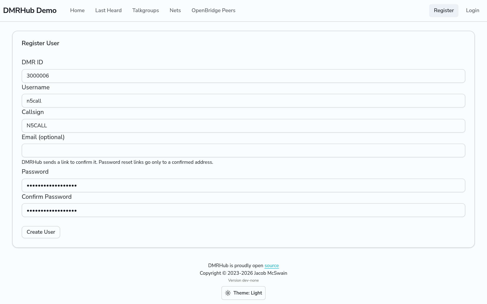

# Create an account

You need an account to enroll a hotspot, pick talkgroups, read your text messages and see your positions. Anyone can see the **Home**, **Last Heard**, **Talkgroups** and **Nets** pages without an account.

## Before you start

- Get a DMR ID from [RadioID.net](https://radioid.net/). DMRHub checks that RadioID.net lists your DMR ID under your callsign, unless the admin turned this check off. DMRHub updates its copy of the RadioID.net database when it starts and then once a day at midnight, in the time zone of the server. A DMR ID that you got today can fail until the next update.
- Pick a password that you do not use anywhere else. On a network without HTTPS, other people on the network can see your password when you log in.

## Register

1. Go to `<siteurl>/register`, or click **Register** in the navigation bar.
2. Fill in the form:
   - **DMR ID**: your 7-digit DMR ID, for example 3000001.
   - **Username**: the name you log in with.
   - **Callsign**: your callsign, for example N0CALL.
   - **Email (optional)**: an email address for password reset links. The form shows this field only when the network can send email. When it cannot, the form says so, and only an admin can reset your password.
   - **Password** and **Confirm Password**.
3. Click **Create User**.
4. If you gave an email address, open the link in the email that DMRHub sends to it. The link works once, for 24 hours. Until you open it, the address is not confirmed, and DMRHub sends no password reset link to it.

The message that comes up tells you what happens next:

- **Your account is ready. You can log in now.** The network approves new accounts at once.
- **User created, please wait for admin approval.** An admin must approve your account before you can log in.

### If registration fails

| Message | What to do |
| --- | --- |
| DMR ID is not valid | RadioID.net does not list this DMR ID. Check the number, or wait for the daily update. |
| Callsign does not match DMR ID | RadioID.net lists the DMR ID under another callsign. |
| Username is already taken | Pick another username. |
| DMR ID is already registered | The DMR ID belongs to another account on this network. Ask an admin. |
| Enter an email address, such as n0call@example.com | The email address is not valid. Leave the field empty, or fix the address. |
| Password has been reported in a data breach. Please use another one | The network checks passwords against [Have I Been Pwned](https://haveibeenpwned.com/), and your password is on its list. Pick another password. |

DMRHub stores only a salted Argon2id hash of your password, never the password itself.

## Log in

1. Go to `<siteurl>/login`, or click **Login**.
2. Enter your username or callsign, and your password.
3. Click **Log in**.

If an admin set a temporary password for you, DMRHub opens **Settings** and asks you to choose your own password before you can use the other pages. See [Manage your account](account.md).

## Forgot your password

The login page shows **Forgot your password?** only when the network can send email.

1. Click **Forgot your password?** and enter your username or callsign.
2. DMRHub sends a reset link to the email address of your account, but only when you confirmed that address. The link works once, for 1 hour.

To add or confirm an email address, see [Manage your account](account.md#email). If your account has no confirmed email address, or the network cannot send email, ask an admin to set a temporary password for you.

## Next

[Connect a hotspot](connect-hotspot.md)
