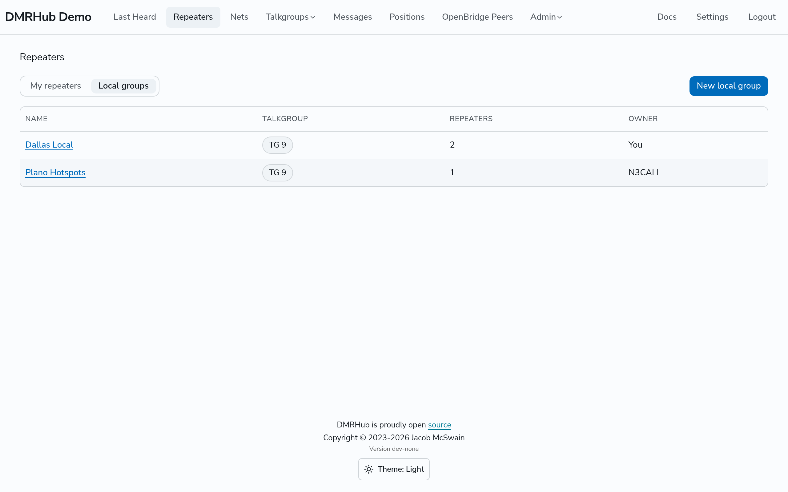
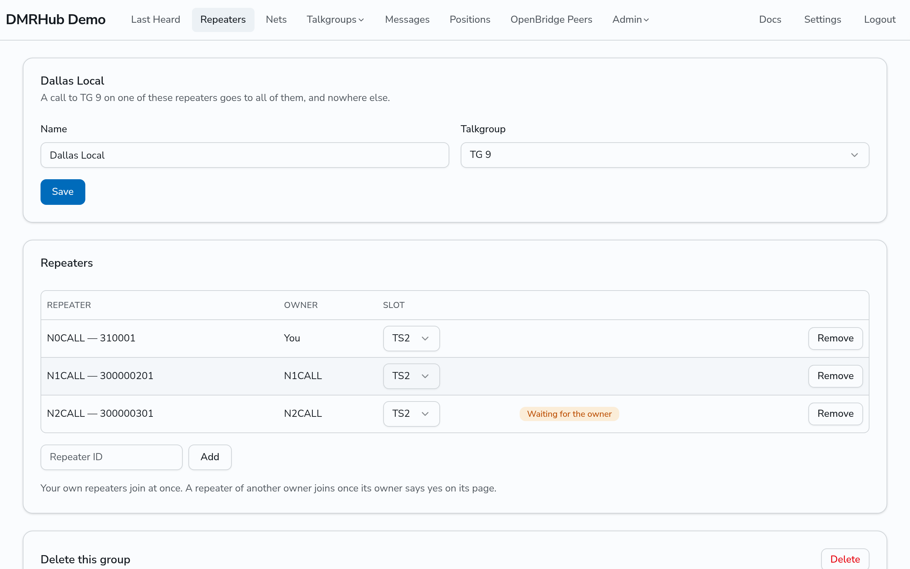
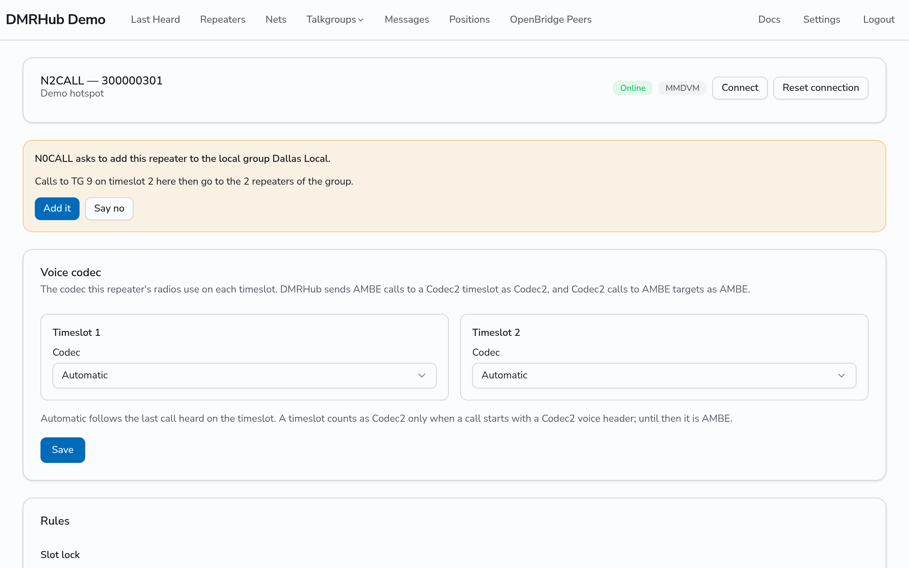
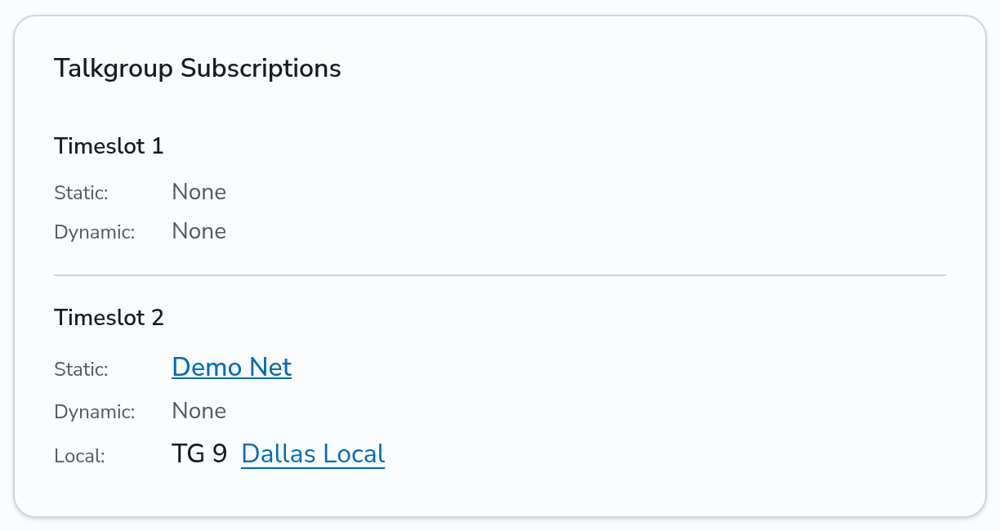
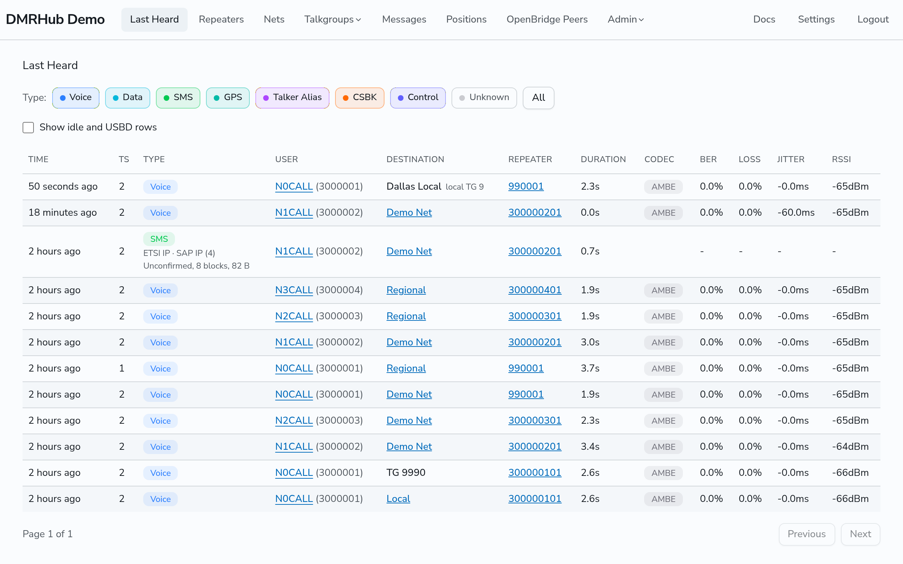

# Make a local group

A local group is a set of hotspots and repeaters that share a local talkgroup. A group call to that talkgroup on one of them goes to the others, and nowhere else: not to a network talkgroup of the same number, and not to OpenBridge peers. A club can use it to link its repeaters, or a family its hotspots.

The admin picks which talkgroups are local, on the **Routing** tab of Setup. By default they are TG 8 and TG 9. See [Routing settings](../admin/routing.md#local-talkgroups).

## How calls go

- Each repeater in a group has a timeslot for the group. A call to the local talkgroup on that timeslot goes to the other repeaters of the group, each on its own timeslot for the group.
- A call to a local talkgroup on the other timeslot, or on a repeater in no group on that talkgroup, goes nowhere. Last Heard marks it as not delivered.
- A repeater can be in more than one group, but in only one group for each local talkgroup. For example, a repeater can be in a club group on TG 8 and a regional group on TG 9.
- A call to a local talkgroup links no dynamic talkgroup.
- The routing rules of a repeater, such as a slot lock, also apply to the calls of its groups.

## Make a group

1. Log in and go to **Repeaters**.
2. Click **Local groups**, and then **New local group**.
3. Type a name, pick the talkgroup, and click **Make group**.

## Add repeaters

1. On the page of the group, type the ID of a hotspot or repeater under **Repeaters**, and click **Add**.
2. Pick the timeslot of each repeater in the **Slot** column. A new repeater gets TS2.

Your own hotspots and repeaters join at once. A repeater of another owner shows **Waiting for the owner** until its owner says yes. To take a repeater out, click **Remove**. To delete the group, click **Delete** under **Delete this group**, and then click it again.

## Say yes or no to a group

When the owner of a group adds your repeater, the page of your repeater asks you. Click **Add it** to join the group, or **Say no**. You can change the timeslot of your repeater on the page of the group, or take it out of the group with **Remove**, at any time. A co-sysop of the repeater can do the same as its owner, and a repeater that you are a co-sysop of joins your own groups at once.

The **Talkgroup Subscriptions** card of a repeater shows its local groups under each timeslot.

## See the calls

Last Heard shows a call to a local group with the name of the group and its local talkgroup.

