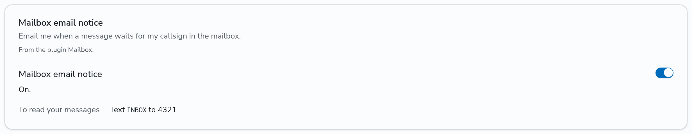

# Leave messages in the mailbox

The mailbox keeps text messages for callsigns. You leave a message for another ham by callsign, even when that ham's radio is off the air. The ham reads it later from any of their radios.

The mailbox is a plugin. It works only when your admin turned it on and gave it an ID. This page uses 4321 as the ID of the mailbox. Ask your admin for the ID on your network.

You send every command to the mailbox ID as a private text message, and the mailbox answers you with a text message from that ID. The commands are not case sensitive.

## Leave a message

Send the callsign and the message, with a space between them:

```text
N1CALL Net moved to 8 PM tonight
```

The mailbox answers `Saved for N1CALL.`

- The callsign must be the callsign of a user on this network. Otherwise the mailbox answers `No user has callsign N0NONE on this network.`
- A message has at most 120 characters.
- The mailbox keeps at most 20 messages for one callsign, and keeps each message for 30 days.

## Read your messages

The mailbox keeps the messages for the callsign of your account. Send the commands from any of your radio IDs.

| Send         | The mailbox answers                                                                 |
| ------------ | ----------------------------------------------------------------------------------- |
| `INBOX`      | How many messages wait, and for each its number, the sender and its first words: `2 messages: 1 N2CALL Net moved to... 2 N6CALL Thanks for the...` |
| `GET 1`      | Message 1 with its sender and the time it came, in UTC: `1/2 N2CALL 10-13 23:30Z: Net moved to 8 PM tonight` |
| `DELETE 1`   | Deletes message 1: `Deleted 1. 1 message left.`                                     |
| `DELETE ALL` | Deletes all your messages: `Deleted all 2 messages.`                               |

Message 1 is the oldest one. After you delete a message, the messages after it move up one number. Send `INBOX` again to see the new numbers. Any other text gets a short help text.

## Notices of new messages

When a message waits for you, the mailbox sends you one short text the next time DMRHub hears one of your radios, such as `1 new message for N1CALL. Text INBOX to 4321.` You get one notice for each group of new messages. After you read your messages, a new message gets a new notice.

The mailbox can also send you an email when a message waits. The email does not include the message.

1. Log in.
2. Go to **Settings** (`<siteurl>/settings`).
3. In the **Mailbox email notice** card, turn on the switch.



You get the email only at an email address that you confirmed on the Settings page. You get one email for each group of new messages, until you read them.

## If the mailbox does not answer

- The mailbox answers each text in the exact format of that text, through the hotspot or repeater that it came through. A format that a radio did not send can lock it up, so the mailbox sends no other format.
- DMRHub answers only a text that came through your own hotspot or repeater, or one that your admin trusts. Send the text through one of those.
- The notice of new messages goes in the format of the last text that your radio sent through such a hotspot or repeater. Until your radio sent one, you get no notice. Send any text, such as `INBOX`, to the mailbox once.
- Ask your admin whether the mailbox runs on this network, and which ID it has.
