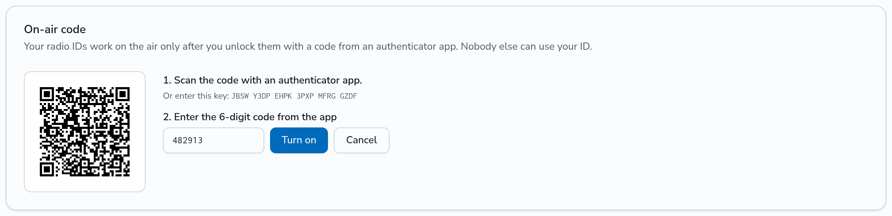
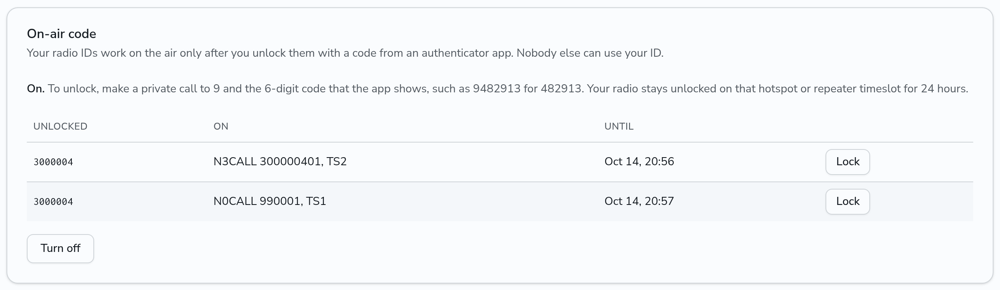
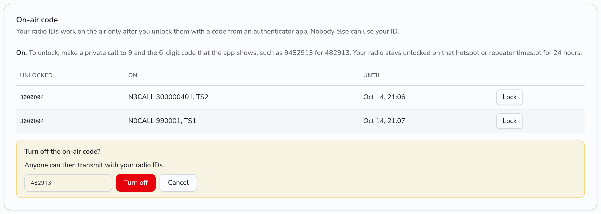

# Lock your radio ID with an on-air code

Someone can program your DMR ID into their radio and transmit as you. The on-air code stops that: when it is on, DMRHub refuses every transmission from your radio IDs until you unlock the radio ID with a code from an authenticator app, on the hotspot or repeater timeslot that you use.

This works as the AirSecurity feature of BrandMeister does. It uses TOTP codes, which change every 30 seconds, so any authenticator app works, such as FreeOTP, Aegis, Google Authenticator or 1Password.

In this page, `<siteurl>` is the URL of your DMRHub instance.

## Turn it on

1. Open **Settings** (`<siteurl>/settings`) and find the **On-air code** card.
2. Click **Set up**. DMRHub shows a QR code and the same key as text.
3. In your authenticator app, add an account and scan the QR code, or type the key.
4. Type the 6-digit code that the app shows into **Enter the 6-digit code from the app**, and click **Turn on**.

DMRHub shows the key only during the setup. It keeps the key encrypted with the secret of the server, and no page or API shows it again. If you lose the app, turn the code off and set it up again, or ask an admin to turn it off.

## Unlock your radio

1. Open the authenticator app and read the 6-digit code.
2. On your radio, make a private call to **9** followed by the 6 digits. For the code 482913, call **9482913**. Key up for a moment, then let go.
3. Make your calls as usual.

The private call unlocks the radio ID that made it, on that timeslot of that hotspot or repeater only. Your other radio IDs, the other timeslot and other repeaters stay locked. The unlock lasts 24 hours, or the time that the admin set (see [Routing settings](../admin/routing.md)). An unlock again before the end starts the time again.

The private call to the code never reaches another radio and DMRHub does not record it: it is not in **Last Heard**, in the call history of a repeater or in the logs. The logs keep only that your radio ID tried a code, and whether it worked.

Each code works once. A code that someone hears on the air does not work again, on this replica or on any other. DMRHub takes the code of the 30 seconds before and after too, so a clock in the phone that is a little off still works.

DMRHub limits the tries: 5 in 5 minutes from one radio ID, and 20 in 5 minutes through one hotspot or repeater. After that, DMRHub refuses every try, also a right code, until the 5 minutes end.

When the admin turned spoken prompts on, your radio hears "Unlocked." or "Wrong code." about 1 second after the private call to the code, and "Code needed." after a call that the lock refused. Pick the voice in Settings, under **Spoken prompts**.

## See and end the unlocks

With the code on, the **On-air code** card lists each unlocked radio ID, the hotspot or repeater and timeslot, and when the unlock ends. Click **Lock** to end an unlock at once.

A transmission from a locked radio ID shows in **Last Heard** with the note that the hotspot or repeater needs the on-air code of the radio ID first. DMRHub carries none of it to other radios.

## Turn it off

1. Click **Turn off**.
2. Type a code from the app, and click **Turn off**.

When it is off, anyone can transmit with your radio IDs again, as before. An admin can also turn it off for you; see [Users](../admin/users.md#turn-off-the-on-air-code-of-a-user).
