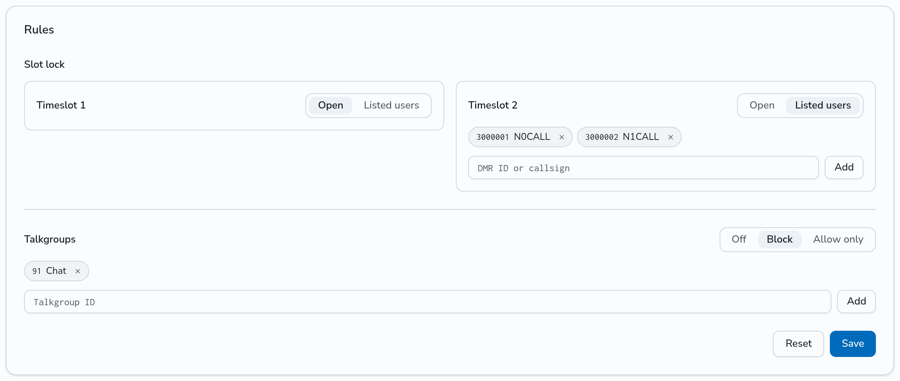

# Set the rules of your repeater

The owner of a hotspot or repeater, and an admin, can set rules for it on the **Rules** card of the repeater page (click the ID of the repeater on the **Repeaters** page). The rules apply to traffic in both directions: what the repeater sends to the network, and what the network sends to the repeater.

## Lock a timeslot to listed users

A slot lock keeps a timeslot for a list of users, for example to keep it open for emergency traffic.

1. In **Slot lock**, set the timeslot to **Listed users**.
2. Type the DMR ID or callsign of a user and click **Add**. Do this for each user.
3. Click **Save**.

A locked timeslot carries only the traffic of the radios of the listed users: their account ID and the radio IDs that they added. Traffic from any other radio on that timeslot stops at the repeater. This applies to group calls, private calls, text messages and data. Last Heard shows such a call with the reason "keeps that slot for listed users".

Private calls, text messages and data to a listed user still reach that user on the locked timeslot, whatever sends them, for example the parrot or a service.

To open the timeslot again, set it to **Open** and click **Save**. The other timeslot is not affected.

## Block talkgroups, or allow only some

1. In **Talkgroups**, pick **Block** or **Allow only**.
2. Type a talkgroup ID and click **Add**. Do this for each talkgroup.
3. Click **Save**.

- **Block**: the repeater carries no traffic of the listed talkgroups.
- **Allow only**: the repeater carries only the listed talkgroups.

The list applies to group calls on both timeslots. TG 4000 (unlink) always works. A call that the list stops shows in Last Heard with the reason "does not carry that talkgroup".

Use these lists to fit the repeater to its users, not to keep people off a shared repeater.

## API

The repeater page uses `GET` and `PATCH` on `/api/v1/repeaters/<id>/rules`, with `ts1_users`, `ts2_users`, `talkgroup_mode` (`off`, `block` or `allow`) and `talkgroups`. A field that a `PATCH` leaves out keeps its value.
