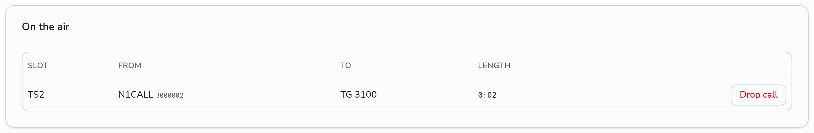
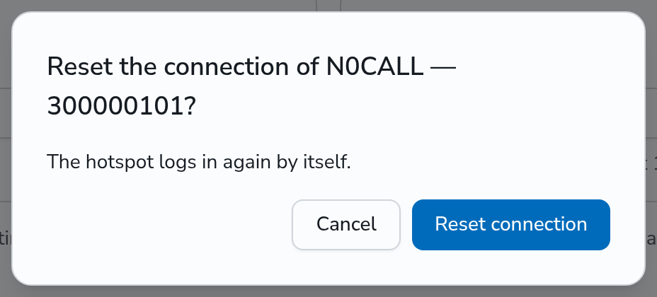
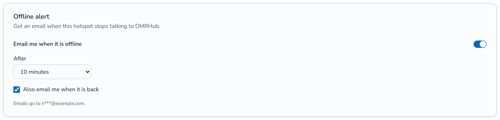

# Look after your hotspot or repeater

The repeater page has tools for the owner of a hotspot or repeater, its [co-sysops](co-sysops.md) and admins. To open the page, click the ID of the repeater on the **Repeaters** page.

## Connection log

The **Connection log** card shows what DMRHub saw of the logins and the connection of the hotspot or repeater in the last 24 hours, newest first. Each entry says what happened in plain words. An entry for a problem also says what to change.


Turn on **Problems only** to hide the logins and logouts.

The same event from the same address, one after another, shows once, with the number of times and the time of the first one. The address is the IP address that the packets came from.

| Entry | What it means | What to change |
|---|---|---|
| Connected | The hotspot logged in. The entry shows its address and software. | Nothing. |
| Login refused: wrong password | The password in the hotspot, or the auth key of an IPSC repeater, does not match. | Rotate the password on the Connect page and enter the new one in the hotspot. |
| Login refused: the address is blocked | An IP list of the network refuses the address. | Ask an admin of the network. |
| Login refused: bad configuration packet | DMRHub cannot read the configuration that the hotspot sent. | Check the callsign, frequencies and location in the hotspot settings. |
| Pushed off by another login with the same ID | A second device logged in with the ID of this one, and took its place. | Give each device its own ID: your DMR ID and two more digits. |
| Connection lost: no ping | The hotspot sent nothing for the session timeout. | Check the internet connection of the hotspot. It logs in again by itself. |
| Logged out by the hotspot | The hotspot logged out, for example when it shut down. | Nothing. |
| Logged out: the password was rotated | DMRHub ended the session after a new password. | Enter the new password in the hotspot. |
| Talkgroup in the hotspot options does not exist | The Options line of the hotspot names a talkgroup that DMRHub does not have. | Remove it from the Options line, or pick one from Talkgroups. |
| The options of the hotspot have a value that is not valid | DMRHub cannot read a value of the Options line. | Check the Options line. |

DMRHub runs on more than one replica in some networks. When a replica restarts, the hotspot moves to another replica without a new login. Such a move does not show in the log, and it is not a lost connection.

The Connection log of an IPSC repeater shows its registrations, the ends of its registrations, and packets with a wrong auth key. A modem on a serial port of the server has no log.

## Sysop actions

The repeater page gives the owner, the co-sysops and admins three actions. Each one shows only while it applies.

### Drop a call

While a call is on the air on the repeater, the **On the air** card shows it: the timeslot, who talks, the talkgroup or radio that the call goes to, and how long it has run. The card shows calls in both directions: calls from a radio on the repeater, and calls that the network sends to it.



Click **Drop call** to stop the call on this repeater. DMRHub sends the radios on the repeater the end of the call, so that they unmute at once, and carries nothing more of that call to or from this repeater until it ends. The next call goes through as usual. The drop applies to this repeater only:

- A call from the network that you drop still reaches the other repeaters.
- A call from a radio on this repeater that you drop ends for every listener on the network.

### Drop a dynamic talkgroup

On the **Talkgroup Subscriptions** card, click **Drop** next to the dynamic talkgroup of a timeslot to unlink it.

### Reset the connection

While the hotspot or repeater is online, click **Reset connection** in the top card, and then **Reset connection** in the dialog. DMRHub ends the session of the hotspot, on whichever DMRHub replica holds it. A call on the air ends. The hotspot logs in again by itself. The connection log shows the reset with the callsign of the sysop.



A reset helps when a hotspot stays logged in but does not seem to pass traffic, or after a change to its settings that it reads only at login.

## Offline alert email

When the network sends email, the **Offline alert** card lets you get an email when the hotspot or repeater stops talking to DMRHub. Each user who looks after a repeater (the owner, a co-sysop or an admin) turns it on for themselves.



1. Add an email address under **Settings** and verify it with the link that DMRHub sends. Until then, the switch on the card is off and the card links to Settings.
2. Turn on **Email me when it is offline**.
3. In **After**, pick how long the hotspot must be offline before the email: 5, 10, 30 or 60 minutes.
4. To get an email when it is back too, check **Also email me when it is back**.

DMRHub saves each change at once. The card shows the address that the emails go to, with most of it hidden.

DMRHub sends one email for each outage. An outage starts at the last ping of the hotspot, so a hotspot that is offline when you turn the alert on gets no email until it is back and goes offline again. The email names the last problem of the [connection log](#connection-log), when there is one:

```text
Subject: Hotspot KP4DJT 319186801 is offline

Your hotspot KP4DJT 319186801 has been offline on DMRHub Demo since Nov 1, 14:41 UTC (10 minutes).

Last problem: Connection lost: no ping for 60 seconds. Check the internet connection of the hotspot.

Open the connection log: https://dmrhub.example.org/repeaters/319186801

To stop these emails, turn off "Email me when it is offline" on the same page.
```

A hotspot that pings again within the delay, for example after a restart, sends no email. A move of the hotspot to another replica of DMRHub does not stop its pings, so it sends no email either. When a co-sysop stops being one, their alert for that repeater ends.

To turn the emails off, turn off **Email me when it is offline** on the card.

## API

- `GET /api/v1/repeaters/<id>/on-air` lists the voice calls that the repeater carries now: `call_id`, `slot`, `direction` (`from` or `to`), `source_id`, `callsign`, `destination_id`, `group_call` and `start_time`.
- `POST /api/v1/repeaters/<id>/drop-call` with `{"call_id": <id>}` drops a call that `on-air` lists.
- `POST /api/v1/repeaters/<id>/reset` resets the connection.
- `POST /api/v1/repeaters/<id>/unlink/dynamic/<slot>/<talkgroup>` drops the dynamic talkgroup of a timeslot.
- `GET` and `PUT /api/v1/repeaters/<id>/alert` read and set your offline alert for the repeater: `enabled`, `delay_minutes` (5, 10, 30 or 60) and `back`.
- `GET /api/v1/repeaters/<id>/events` returns the entries of the connection log of the last 24 hours, newest first: `kind`, `address`, `detail`, `count`, `first_at` and `last_at`.
