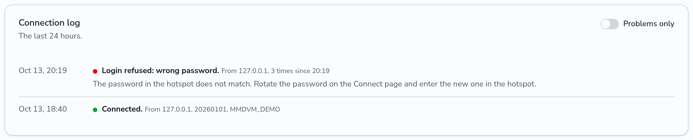

# Look after your hotspot or repeater

The repeater page has tools for the owner of a hotspot or repeater, its [co-sysops](co-sysops.md) and admins. To open the page, click the ID of the repeater on the **Repeaters** page.

## Connection log

The **Connection log** card shows what DMRHub saw of the logins and the connection of the hotspot or repeater in the last 24 hours, newest first. Each entry says what happened in plain words. An entry for a problem also says what to change.

Turn on **Problems only** to hide the logins and logouts.

The same event from the same address, one after another, shows once, with the number of times and the time of the first one. The address is the IP address that the packets came from.

| Entry | What it means | What to change |
|---|---|---|
| Connected | The hotspot logged in. The entry shows its address and software. | Nothing. |
| Login refused: wrong password | The password in the hotspot, or the auth key of an IPSC repeater, does not match. | Rotate the password on the Connect page and enter the new one in the hotspot. |
| Login refused: the address is blocked | An IP list of the network refuses the address. | Ask an admin of the network. |
| Login refused: bad configuration packet | DMRHub cannot read the configuration that the hotspot sent. | Check the callsign, frequencies and location in the hotspot settings. |
| Pushed off by another login with the same ID | A second device logged in with the ID of this one, and took its place. | Give each device its own ID: your DMR ID and two more digits. |
| Connection lost: no ping | The hotspot sent nothing for the session timeout. | Check the internet connection of the hotspot. It logs in again by itself. |
| Logged out by the hotspot | The hotspot logged out, for example when it shut down. | Nothing. |
| Logged out: the password was rotated | DMRHub ended the session after a new password. | Enter the new password in the hotspot. |
| Talkgroup in the hotspot options does not exist | The Options line of the hotspot names a talkgroup that DMRHub does not have. | Remove it from the Options line, or pick one from Talkgroups. |
| The options of the hotspot have a value that is not valid | DMRHub cannot read a value of the Options line. | Check the Options line. |

DMRHub runs on more than one replica in some networks. When a replica restarts, the hotspot moves to another replica without a new login. Such a move does not show in the log, and it is not a lost connection.

The Connection log of an IPSC repeater shows its registrations, the ends of its registrations, and packets with a wrong auth key. A modem on a serial port of the server has no log.

## API

- `GET /api/v1/repeaters/<id>/events` returns the entries of the connection log of the last 24 hours, newest first: `kind`, `address`, `detail`, `count`, `first_at` and `last_at`.
