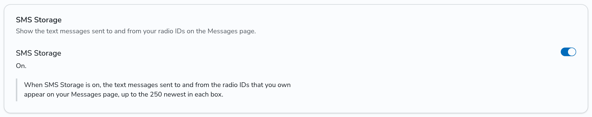
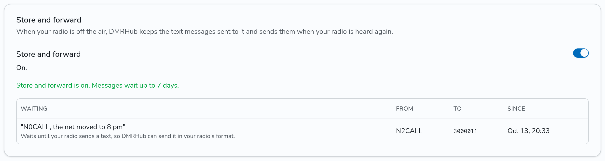
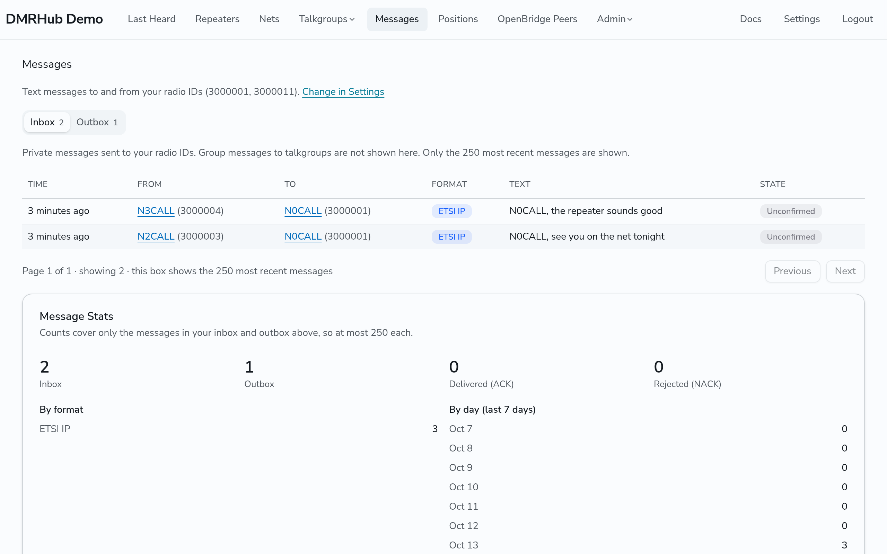
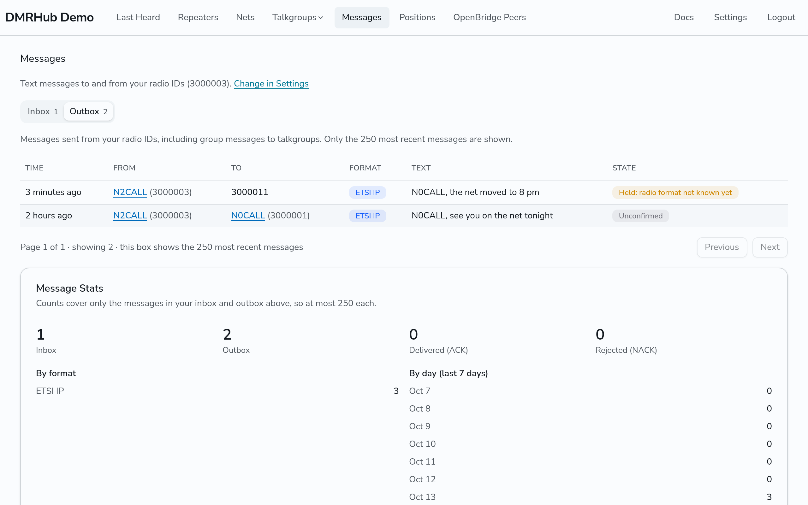

# Send and read text messages

DMRHub routes text messages (SMS) between radios like it routes voice. You send and receive them on your radio. You can also read the messages of your radio IDs on the DMRHub web site, if you turn on SMS Storage.

## Send a text message

1. On your radio, write a message.
2. Send it to the DMR ID of the other radio, as a private message. To send to everyone on a talkgroup, send it to the talkgroup as a group message.

A private message goes to the hotspot or repeater where DMRHub last heard the other radio, as a private call does. See [How DMRHub finds the other radio](private-calls.md#how-dmrhub-finds-the-other-radio).

Send the message in a text format that the other radio reads. Radios of different makes often use different formats. The [Messages reference](../messages.md#formats) lists the formats that DMRHub can show.

## Turn on SMS Storage

SMS Storage is off by default. While it is off, DMRHub keeps no copy of your messages for the web site.

1. Log in.
2. Go to **Settings** (`<siteurl>/settings`).
3. In the **SMS Storage** card, turn on the switch.

To turn it off, turn off the switch, then click **Turn off**. Your inbox and outbox are then empty.

## Keep messages for your radio while it is off the air

Store and forward is off by default. When you turn it on, DMRHub keeps the private text messages that it cannot deliver to your radio, and sends them when DMRHub hears your radio again.

1. Log in.
2. Go to **Settings** (`<siteurl>/settings`).
3. In the **Store and forward** card, turn on the switch.

The card lists the messages that wait for your radios. DMRHub keeps a message when:

- It does not know where your radio is, so it cannot send the message at all.
- The sender asked for a reply, and your radio did not answer within 10 seconds.

DMRHub sends the waiting messages when your radio is heard on a hotspot or repeater that your private calls can go to, after your radio stops sending for 2 seconds.

DMRHub sends a waiting message only in the text format that your radio itself sends, as the wrong format can lock up some radios. It learns the format from the last private text message that your radio sent through a hotspot or repeater that you own, or one that the admin trusts. Until your radio sends one, the message stays waiting, and the card shows "Waits until your radio sends a text". To fix this, send any private text message from your radio through your own hotspot or repeater.

When you turn store and forward off, DMRHub stops keeping messages for you and does not send the waiting ones.

## Add your other radio IDs

The Messages page shows the messages of your account ID and of the other radio IDs that you add. To add one:

1. Go to **Settings**.
2. In the **Radio IDs** card, type a 7-digit DMR ID in **Add a radio ID** and click **Add**.

RadioID.net must list the ID under your callsign. Hotspot and repeater IDs go on the Repeaters page, not here. When you remove an ID, its messages go away from your Messages page.

## Read your messages

1. Go to **Messages** (`<siteurl>/messages`).
2. Click **Inbox** for private messages to your radio IDs, or **Outbox** for messages from your radio IDs, group messages too.

New messages appear while the page is open. Each box shows the 250 newest messages. The **State** column shows whether the other radio accepted the message, and whether DMRHub keeps it for a radio that is off the air.

See the [Messages reference](../messages.md) for what each column means.

## Read messages in an app

An app that you allow with the `messages:read` scope can read your messages and get new ones as they arrive. DMRHub Radio is such an app. See [Use DMRHub Radio](browser-radio.md) and [Manage your account](account.md#apps).
