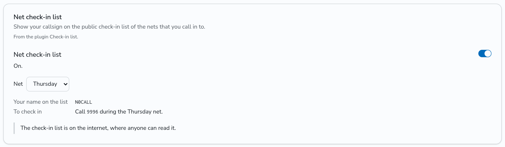

# Plugins

A plugin is a program that answers the calls to the DMR IDs that an admin gives it. The parrot (9990), the location server (5050 to 5059), the status service (5000), the mailbox and APRS messages are plugins. A plugin runs in one of two ways:

- **Inside DMRHub.** DMRHub runs the plugin as a WebAssembly module, in a sandbox. You install nothing else. The parrot, the location server, the status service, the mailbox and APRS messages are built in, and an admin can upload other plugins as `.wasm` files. This is on by default.
- **As its own program.** The plugin runs next to DMRHub or on another computer, and connects to the hub over TLS.

This page is for developers who write plugins. To install, upload and manage plugins on a DMRHub server, see [Plugins](admin/plugins.md) in the admin guide.

## How the hub routes plugin calls

- A private call to one of a plugin's IDs goes only to the plugin.
- A group call to one of a plugin's IDs goes to the plugin. When a talkgroup has that ID, its subscribers get the call too.
- A plugin sends calls only from its own IDs. It sends private calls to radios, and group calls only to talkgroups among its own IDs. It never sends to the IDs of another plugin. The hub refuses other bursts with a `Refusal`.
- The hub routes a plugin's calls as it routes the calls of a repeater, with the same limit of one call at a time on each timeslot.
- A group call of a plugin goes to the OpenBridge peers whose rules take it. A private call of a plugin goes to the peers only when the radio is not on this hub, so that a reply to a radio here does not arrive twice.
- A plugin can ask for the radios whose owners turned position tracking on, and for where the hub hears them. It can send the positions that those radios report to its IDs. The hub keeps a position only when the radio's owner turned tracking on. It then shows the position on the map and sends it to APRS-IS as the owner chose.
- To send a text message, a plugin asks the hub, which builds it in the format of a text that the radio itself sent. See [Send a text](#send-a-text). Build no text bursts yourself: the wrong format can lock up a radio.
- A plugin sends an APRS message only from the address of a user who turned its switch on. See [APRS messages](#aprs-messages).

## Write a plugin

### With the Go SDK

The Go SDK is the package `github.com/USA-RedDragon/DMRHub/sdk/plugin`, under the MIT license (`sdk/LICENSE`). The messages are in `github.com/USA-RedDragon/DMRHub/sdk/plugin/v1`.

```go
package main

import (
	"context"

	"github.com/USA-RedDragon/DMRHub/sdk/plugin"
	pluginv1 "github.com/USA-RedDragon/DMRHub/sdk/plugin/v1"
)

func main() {
	plugin.MainWith(&pluginv1.Hello{
		Name:        "Net check-in",
		Version:     "0.4.1",
		Author:      "N0CALL",
		Description: "Logs each radio that calls 9100 during a net and answers with a short tone.",
		Ids:         []*pluginv1.IDRange{{First: 9100, Last: 9100}},
		Hosts:       []*pluginv1.Host{{Address: "nets.example.org:443", Reason: "Posts the check-in list when a net ends."}},
	}, func(ctx context.Context, conn *plugin.Conn) error {
		for {
			m, err := conn.Recv()
			if err != nil {
				return err
			}
			if b := m.GetBurst(); b != nil && plugin.IsVoice(b) {
				// Record the call, then answer it from 9100 with conn.Send.
			}
		}
	})
}
```

`plugin.MainWith` connects the plugin to the hub and calls your function with the connection. When the function returns an error, a plugin inside DMRHub exits and the hub starts it again. A plugin that runs as its own program connects again.

The main parts of the SDK:

| Name                                                  | What it does                                                                                   |
| ----------------------------------------------------- | ---------------------------------------------------------------------------------------------- |
| `plugin.MainWith(hello, serve)`                       | Runs the plugin with its manifest. `plugin.Main(serve)` runs it with no manifest.             |
| `conn.Recv()`                                         | Returns the next message from the hub, such as a burst to one of the plugin's IDs.           |
| `conn.Send(burst)`                                    | Sends a burst. It is safe to call from several goroutines.                                    |
| `conn.SubscribeTracking(on)`                          | Asks for the radios with position tracking on, and for where the hub hears them.             |
| `conn.SendPosition(position)`                         | Gives the hub a position that a radio reported to one of the plugin's IDs.                    |
| `conn.Dial(ctx, "host:port")`                         | Opens a TCP connection. Inside DMRHub, only to the hosts that an admin allowed.               |
| `conn.Name()`, `conn.Ranges()`                        | The plugin's name and IDs on the hub.                                                         |
| `plugin.DataOf(burst)`, `plugin.BurstOf(data)`        | Change a burst into a DMRD packet of [dmrgo](https://github.com/USA-RedDragon/dmrgo), and back. |
| `plugin.IsVoice(burst)`, `plugin.IsTerminator(burst)` | Tell whether a burst is part of a voice call, and whether it ends one.                        |
| `plugin.VoiceBursts(call, slots)`, `plugin.Play(ctx, conn.Send, bursts)` | Build a voice call from AMBE+2 vocoder slots, such as a few clips one after another, and send it at the pace of a timeslot. |
| `conn.Subscribe(sub)`                                  | Asks for more than the calls to the plugin's IDs: every radio the hub hears, texts, switches and APRS messages. |
| `conn.StoreGet`, `StorePut`, `StoreDelete`, `StoreList` | Keep data in the plugin's store in the hub's database.                                        |
| `conn.LookupRadio(ctx, id)`, `conn.LookupCallsign(ctx, call)` | Find a user, the user's radio IDs and how the user set the plugin's switches.            |
| `conn.Repeater(ctx, id)`                               | The static and dynamic talkgroups of each timeslot of a repeater or hotspot.                  |
| `conn.SendText(ctx, from, radio, text)`                | Asks the hub to send a text message to a radio.                                               |
| `conn.ReplyText(ctx, from, text, body)`                | Answers a `Text` in the exact format of that text.                                            |
| `conn.PlayPrompt(ctx, prompt)`                         | Asks the hub to play its spoken prompts, one after another, to a radio.                       |
| `plugin.IsText(message)`                               | Tells whether the hub answers a data packet to the plugin's IDs itself, because it is a text. |
| `conn.SendAPRS(ctx, message)`                          | Asks the hub to send an APRS message on its APRS-IS login.                                    |
| `conn.SendEmail(ctx, user, switch, subject, body)`     | Asks the hub to email a user who turned a switch of the plugin on.                            |
| `conn.Has(feature)`, `conn.Request(ctx, request)`      | Tell whether the hub serves a feature, and make any request of the hub.                       |

dmrgo has voice and data receivers and transmitters that decode and build calls from DMRD packets. The parrot in `plugins/parrot`, the location server in `plugins/locator` and the mailbox in `plugins/mailbox` are full examples.

To reach a web API, use `conn.Dial` as the `DialContext` of an `http.Transport`. A plugin inside DMRHub has no certificate authorities of its own, so its TLS client needs a set, such as `golang.org/x/crypto/x509roots/fallback`.

### Build the plugin

To run it inside DMRHub, build a `wasip1` module and upload the `.wasm` file:

```bash
GOOS=wasip1 GOARCH=wasm go build -trimpath -ldflags='-s -w' -o net-checkin.wasm .
```

You can also build it with [TinyGo](https://tinygo.org) 0.43.0 or later, as DMRHub builds its built-in plugins. The module is much smaller and uses less memory inside DMRHub:

```bash
tinygo build -target=wasip1 -no-debug -o net-checkin.wasm .
```

TinyGo writes `print`, `println` and its panics on stdout, where DMRHub reads the plugin's messages. Log with `log/slog`, which writes on stderr. When a plugin writes something on stdout that is not a message, DMRHub logs it and stops the plugin.

The same code, built for your computer, runs as its own program. It takes the flags and the environment variables in [Run the parrot and the location server as programs](admin/plugins.md#run-the-parrot-and-the-location-server-as-programs).

### The manifest

A plugin tells the hub who it is with a `Hello` message. In Go, this is the first argument of `plugin.MainWith`.

| Field         | Rules                                                                                                                                       |
| ------------- | ------------------------------------------------------------------------------------------------------------------------------------------- |
| `name`        | Required. 1 to 64 characters, with no space at the start or end. The plugins page shows it.                                                |
| `version`     | Required for an upload. DMRHub cuts it to 32 characters. When it is empty, the Go SDK uses the version of the plugin's Go module.         |
| `author`      | At most 64 characters.                                                                                                                      |
| `description` | What the plugin does, in a sentence or two. At most 500 characters.                                                                         |
| `ids`         | The ID ranges that the plugin asks for, from `first` to `last`, both included. The admin can change them.                                  |
| `hosts`       | For a plugin inside DMRHub: at most 16 hosts that it asks to reach. Each has an `address` as `host:port`, at most 255 characters, and a `reason` of at most 200 characters. |
| `switches`    | At most 4 per-user switches that the Settings page shows. See [Per-user switches](#per-user-switches).                                      |

A plugin that runs as its own program can send its `Hello` after the `Welcome`. The hub then keeps only its version, for the plugins page, and its switches. The admin sets the name and the IDs.

### Services of the hub

Besides calls, a plugin can ask the hub for data and services. The Go SDK makes each request and waits for its answer, also while another goroutine waits in `conn.Recv`. A request fails with an `*plugin.AnswerError`, which matches `plugin.ErrNotFound`, `plugin.ErrInvalid`, `plugin.ErrRefused`, `plugin.ErrFull`, `plugin.ErrUnavailable`, `plugin.ErrNoFormat` or `plugin.ErrRate` with `errors.Is`.

```go
func serve(ctx context.Context, conn *plugin.Conn) error {
	if err := conn.Subscribe(&pluginv1.Subscribe{Texts: true, Heard: true}); err != nil {
		return err
	}
	for {
		m, err := conn.Recv()
		if err != nil {
			return err
		}
		if t := m.GetText(); t != nil && t.GetBody() == "INBOX" {
			mail, _, err := conn.StoreList(ctx, fmt.Sprintf("mail/%d/", t.GetSource()), "", 0)
			if err != nil {
				return err
			}
			_, err = conn.SendText(ctx, t.GetDestination(), t.GetSource(), fmt.Sprintf("%d messages", len(mail)))
			if errors.Is(err, plugin.ErrNoFormat) {
				continue
			}
		}
	}
}
```

| Service      | What it does                                                                                                                                                                                              |
| ------------ | --------------------------------------------------------------------------------------------------------------------------------------------------------------------------------------------------------- |
| Store        | Each plugin has a store of keys and values in the hub's database, which every replica shares. A key has 1 to 255 bytes and a value at most 16 KiB. A store holds at most 10000 keys. A key can expire after a time. `StoreList` returns the keys with a prefix, at most 100 at a time, in byte order. Deleting the plugin deletes its store. |
| Users        | `LookupRadio` and `LookupCallsign` return a user who is approved and not suspended: the account ID, the callsign, all the user's radio IDs, and how the user set each switch of the plugin.             |
| Repeaters    | `Repeater` returns the static talkgroups and the dynamic talkgroup of each timeslot of a repeater or hotspot, such as the `repeater` of a burst.                                                          |
| Heard        | `Subscribe` with `heard` sends a `Heard` each time the hub hears any radio on a repeater, not only the radios with tracking on.                                                                         |
| Texts        | `Subscribe` with `texts` sends a `Text` for each text message to the plugin's IDs, as the hub read it: the source, the destination, the format and the text. The bursts of the message still come. A stream gets each message once; while a plugin moves to another replica, the Go SDK drops the copy from the other stream. |
| Voice        | `plugin.VoiceBursts` builds the bursts of a voice call from AMBE+2 vocoder slots, and `plugin.Play` sends them one burst each 60 ms.                                                                     |

#### Send a text

A plugin never builds the bursts of a text message itself. It asks the hub with `SendText`: from one of its IDs, to a radio, with at most 500 characters. The hub builds the message in the exact format of the last text that the radio itself sent: its header, rate, encoding and service, as [store and forward](guides/text-messages.md) does. The wrong format can lock up a radio, so when the radio sent no text that the hub can build again, the hub sends nothing and answers `ErrNoFormat`.

The hub reads the format only from a text that the radio sent through a repeater or hotspot of its owner, or one that an admin trusts, so that another hotspot cannot set it with the radio's ID. It sends the text through the repeater and timeslot of that text. `SendText` returns once the hub sent the text, or, when the format asks the radio for an answer, once the radio acknowledged it. It returns `ErrRefused` when the radio refused the text, `ErrUnavailable` when the radio did not answer, and `ErrInvalid` for a text that the format cannot carry, such as Chinese in a 7-bit format.

To answer a text, use `ReplyText` with the `Text` that came. The hub then builds the answer from that exact text, not from the last text of the radio, and sends it through the repeater and timeslot of that text. It returns `ErrNoFormat`, and sends nothing, when that text came through a hotspot that is not the owner's and not trusted, or in a format that the hub cannot build again exactly, such as a UDT. `ReplyText` needs the feature `FEATURE_PROMPT`; on an older hub it returns `ErrUnsupported`, so that no answer goes in another format.

The hub answers the texts to a plugin's IDs at the data link layer itself: an ACK for a confirmed text, a NACK for any packet that came damaged (never a SACK, which some radios do not take), and the TMS acknowledgement that a TMS text asks for, in the rate of the text. It answers only while the plugin is connected. A radio must get one answer for each packet, so a plugin that answers its own confirmed data, as with a `data.Receiver` that responds, sends only the ACKs of the packets for which `plugin.IsText` is false.

#### Spoken prompts

`PlayPrompt` asks the hub to play its spoken prompts to a radio as a private voice call from one of the plugin's IDs: 1 to 64 clips, such as `word-timeslot` and `digit-2`, one after another. The hub plays them as it plays its spoken refusals: in the voice that the radio's owner picked or the network's voice, in the codec of the timeslot, through the hotspot or repeater where it sends private calls to the radio, after the timeslot is quiet for about a second, and at most once for each `stream_id`. It never plays them through an OpenBridge peer. `Clips` in `internal/prompts` lists the clips; the status service (`plugins/status`) is an example. `PlayPrompt` returns `ErrNotFound` when the hub does not know where the radio is, and `ErrInvalid` for an unknown clip.

#### APRS messages

`SendAPRS` sends an APRS message on the hub's APRS-IS login. The source is the address, as `CALLSIGN-SSID`, of a user who turned a switch of the plugin on, and whose callsign is a licensed one. The addressee has at most 9 characters, and the text at most 67, with none of `|`, `~` or `{`. The hub sends at most 30 messages a minute for a plugin, over all its connections and replicas. A hub with no APRS-IS login answers `ErrUnavailable`. An answer with no error means that the hub handed the message to the replica that holds its APRS-IS login; APRS-IS does not say whether the addressee got it. During an upgrade, a replica of an older version that holds the login drops the message, so send it again until its ack comes.

`Subscribe` with `aprs` lists the addresses whose APRS messages, acks included, come to the plugin as `APRSMessage`. It needs the feature `FEATURE_APRS_INBOX`, which a hub offers once it reads APRS messages from APRS-IS. The hub takes only the addresses of users who turned a switch of the plugin on, and drops an address when its user has no switch of the plugin on any more.

#### Email a user

`SendEmail` asks the hub to email a user who turned a switch of the plugin on, such as a notice that a message waits. Give the user's account ID, the key of the switch, a subject of 1 to 120 characters on one line and a body of 1 to 4000 characters. The plugin never sees the address: the hub finds it, and sends only to an address that the user confirmed. The hub ends the body with a line that names the plugin and the switch, so the user knows how to stop the emails. It answers `ErrRefused` when the switch is off or the user has no confirmed address, `ErrNotFound` for a user that `LookupRadio` does not find, `ErrUnavailable` when the hub has no SMTP server set up, and `ErrRate` after 30 emails of the plugin in a minute, over all its connections and replicas. It needs the feature `FEATURE_EMAIL`.

#### Per-user switches

A plugin can declare in its `Hello` at most 4 switches that each user turns on or off on the Settings page, such as for a service that sends the user's messages to the internet. Serve a user only when that user turned the switch on. The card shows the name of the plugin. A user who turns on any switch of a plugin lets it send APRS messages from the user's callsign.

```go
plugin.MainWith(&pluginv1.Hello{
	Name: "Check-in list",
	Switches: []*pluginv1.Switch{{
		Key:         "list",
		Title:       "Net check-in list",
		Description: "Show your callsign on the public check-in list of the nets that you call in to.",
		Notice:      "The check-in list is on the internet, where anyone can read it.",
		Details: []*pluginv1.SwitchDetail{
			{Label: "Your name on the list", Value: "`{callsign}`"},
			{Label: "To check in", Value: "Call `{id}` during the {choice} net."},
		},
		Choice: &pluginv1.SwitchChoice{Label: "Net", Options: []string{"Tuesday", "Thursday"}},
	}},
}, serve)
```



| Field         | Rules                                                                                                                         |
| ------------- | ----------------------------------------------------------------------------------------------------------------------------- |
| `key`         | 1 to 32 of `a` to `z`, `0` to `9`, `_` and `-`, one per switch.                                                               |
| `title`       | 1 to 64 characters. The title of the card and the label of the switch.                                                       |
| `description` | At most 300 characters.                                                                                                       |
| `notice`      | At most 300 characters. A caution under the details, such as who can read what the service sends.                           |
| `details`     | At most 4 lines that the card shows while the switch is on, each a `label` of at most 32 characters and a `value` of at most 200. In the value, `{callsign}` is the user's callsign, `{choice}` the user's choice and `{id}` the plugin's first ID. Text between backticks shows in a fixed-width font. |
| `choice`      | A list that the user picks from while the switch is on: a `label`, 1 to 32 `options` of at most 16 characters, and the `preset`, which is the first option when empty. |

The hub drops a switch that breaks a rule, and logs why. `Subscribe` with `switches` sends a `UserSwitches` with each user who turned a switch on, and a `UserSwitch` at each change. `LookupRadio` and `LookupCallsign` also give the switches of a user.

#### During an upgrade

During a rolling upgrade, replicas of two versions run together, and a plugin can move from one to the other. The `Welcome` of each replica lists the features it serves. `conn.Has` tells whether the replica that holds the plugin now serves one, and can change after a move: check it again before you rely on a feature, such as each time you handle a call. A request or subscription that the replica does not serve fails with `plugin.ErrUnsupported` and the hub does nothing. When the plugin moves to another replica, the SDK subscribes there again with the parts of the last `Subscribe` that the replica serves. A request whose stream ends before its answer fails with `plugin.ErrLost`; the hub may have done it. Strings, such as store keys, are UTF-8; the SDK refuses others with `plugin.ErrInvalid`.

### The sandbox

A plugin inside DMRHub has these limits:

| Limit        | Value                                                                                                                                                  |
| ------------ | ------------------------------------------------------------------------------------------------------------------------------------------------------ |
| Files        | None.                                                                                                                                                  |
| Environment  | None.                                                                                                                                                  |
| Memory       | 64 MiB.                                                                                                                                                |
| CPU          | Half a core over each 10 seconds.                                                                                                                      |
| Network      | Only the hosts that an admin allowed. At most 4 connections at once. A connection must open within 10 seconds. A read or write that waits 5 minutes ends. |
| Start        | The plugin must send its `Hello` within 10 seconds.                                                                                                    |
| Reading      | The plugin must read what the hub sends within 30 seconds.                                                                                             |
| Message size | 64 KiB from the plugin. 4 MiB from the hub.                                                                                                            |
| Logs         | At most 20 lines of stderr each second go to DMRHub's log.                                                                                             |

A host that an admin allowed by name must have a public address, so that its DNS cannot point the plugin at the hub's own network. An IP address that an admin allowed can be private, such as a device on your LAN. A plugin never reaches loopback, link-local, multicast or unspecified addresses.

A plugin that goes over a limit, or ends, stops. DMRHub starts it again after a wait that doubles from 1 second to 1 minute.

DMRHub compiles plugins to machine code on amd64 and arm64. On other machines, such as a 32-bit Raspberry Pi or riscv64, the wazero interpreter runs them, which is much slower. DMRHub compiles each plugin file once. The plugins that run the same file share its code, and a plugin that starts again does not compile it again. The parrot and the location server are one file.

### The protocol

A plugin in another language uses the messages in `proto/dmrhub/plugin/v1/plugin.proto` (MIT license). The service is `dmrhub.plugin.v1.PluginService`. It has one method, `Connect`, a stream in both directions. The plugin sends `ConnectRequest` messages and the hub sends `ConnectResponse` messages.

- **As its own program,** the plugin opens one `Connect` stream of the gRPC service over TLS. It sends its token in the `authorization` metadata as `Bearer <token>`. The hub answers first with a `Welcome`.
- **Inside DMRHub,** the plugin is a WASI preview 1 (`wasip1`) command. It reads the `ConnectResponse` messages on its stdin and writes the `ConnectRequest` messages on its stdout. Each message is its length, as 4 bytes big-endian, then its protobuf encoding. The first message of the plugin is a `Hello`, and the hub answers with the `Welcome`. The plugin reaches the network with `NetRequest` messages, and the hub answers each with a `NetResponse`. A read or write moves at most 16384 bytes.

What the plugin sends (`ConnectRequest`):

| Message      | Use                                                                                                          |
| ------------ | ------------------------------------------------------------------------------------------------------------ |
| `Hello`      | Who the plugin is and what it asks for. See [The manifest](#the-manifest).                                  |
| `Burst`      | A burst of a call that the plugin sends.                                                                     |
| `Subscribe`  | `tracking: true` asks for the radios with position tracking on; `heard`, `texts`, `switches` and `aprs` ask for the services above. A later `Subscribe` replaces an earlier one. |
| `Position`   | A position that a radio reported to one of the plugin's IDs.                                                 |
| `NetRequest` | Opens, reads, writes or closes a TCP connection. Only inside DMRHub.                                         |
| `Request`    | A request of the store, a user, a repeater, a text or an APRS message, with the plugin's `id` of the request. The hub answers each with an `Answer` of the same `id`. |

What the hub sends (`ConnectResponse`):

| Message       | Use                                                                                                                                                                                                    |
| ------------- | ------------------------------------------------------------------------------------------------------------------------------------------------------------------------------------------------------ |
| `Welcome`     | The first message: the plugin's name and IDs on the hub.                                                                                                                                              |
| `Burst`       | A burst of a call to one of the plugin's IDs.                                                                                                                                                          |
| `Refusal`     | A burst of the plugin that the hub did not send, with the reason: the source is not the plugin's, the destination is not allowed, the burst is malformed, or the plugin sent faster than a timeslot carries. |
| `Ranges`      | The admin changed the plugin's IDs.                                                                                                                                                                    |
| `Tracked`     | After a `Subscribe` with tracking: all the radios with tracking on.                                                                                                                                   |
| `Tracking`    | An owner turned tracking of a radio on or off, or changed how often it reports.                                                                                                                       |
| `Heard`       | The hub heard a tracked radio, or any radio after a `Subscribe` with heard, on a repeater, with its timeslot, its color code and `at`, when the hub heard it in milliseconds since 1970 UTC. A `Heard` can come later than `at`. A hub older than `at` leaves it out: use the time the `Heard` came then. |
| `Draining`    | The replica stops soon. Connect again while you keep this stream. See [Several replicas](admin/plugins.md#several-replicas).                                                                                         |
| `NetResponse` | The answer to a `NetRequest`.                                                                                                                                                                          |
| `Answer`      | The answer to a `Request`: a result, or an error code and its reason.                                                                                                                                  |
| `Text`        | After a `Subscribe` with texts: a text message to one of the plugin's IDs.                                                                                                                            |
| `UserSwitches`, `UserSwitch` | After a `Subscribe` with switches: each user who turned a switch of the plugin on, then each change.                                                                                    |
| `APRSMessage` | After a `Subscribe` with aprs: an APRS message to one of the plugin's addresses.                                                                                                                      |

The `features` of the `Welcome` list what the replica serves besides bursts, tracking, positions and the network. A hub that does not list a feature ignores its requests and subscriptions.

A `Burst` is one DMR burst as the MMDVM network protocol carries it. It has the source and destination IDs, group or private call, the timeslot (1 or 2), the stream ID, the frame type, the data type or voice sequence, the sequence number (0 to 255), and the 33 bytes of the burst. Its `repeater` field is the repeater or hotspot that the call came from. The hub ignores that field on the bursts that a plugin sends.
