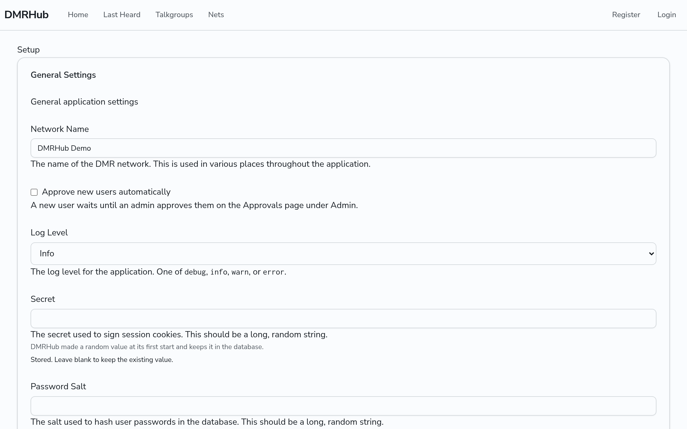
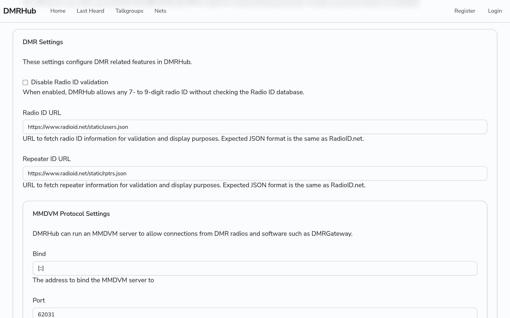
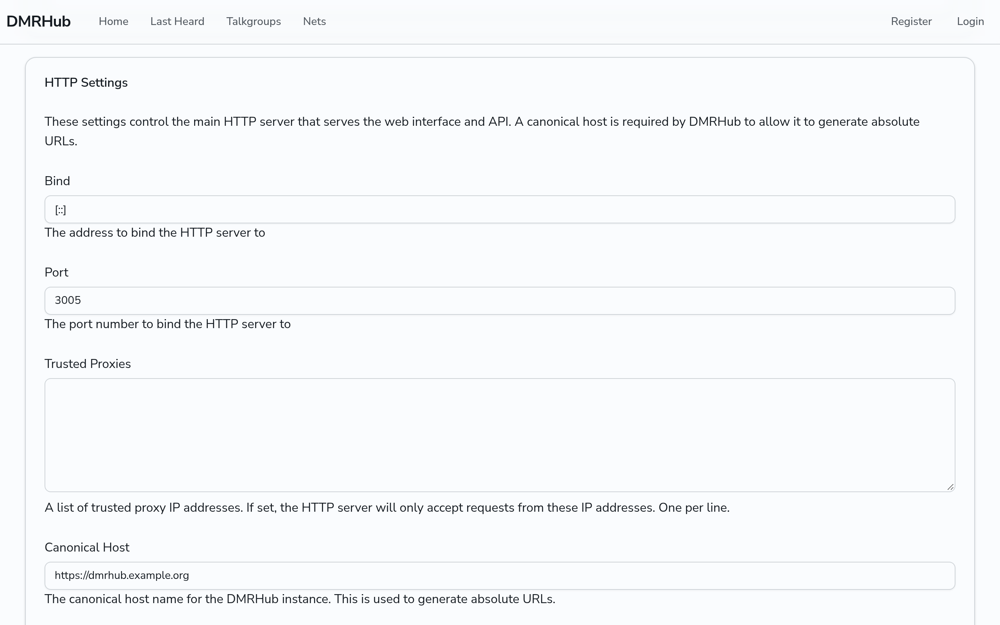
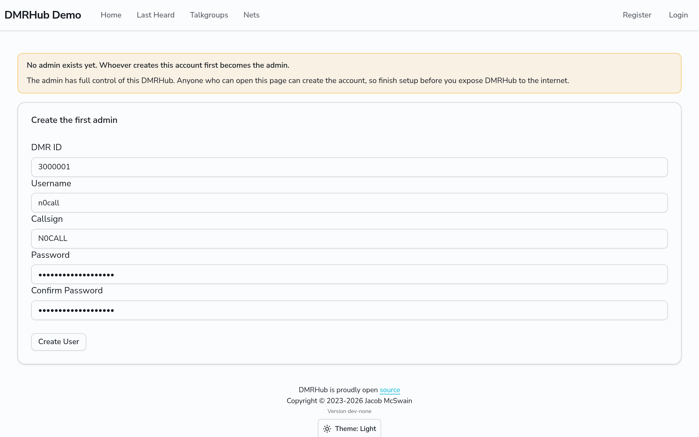
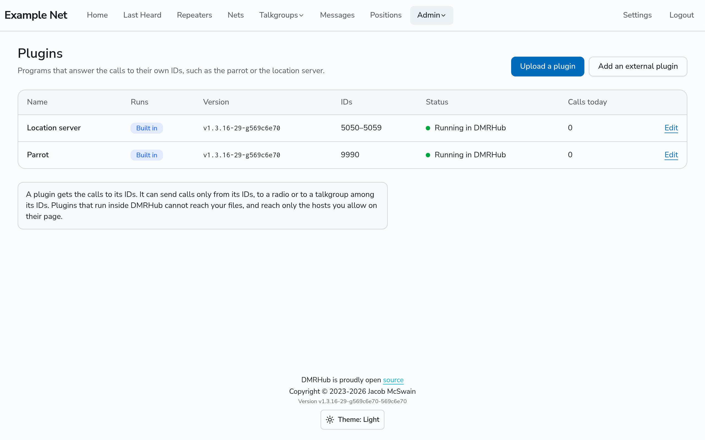
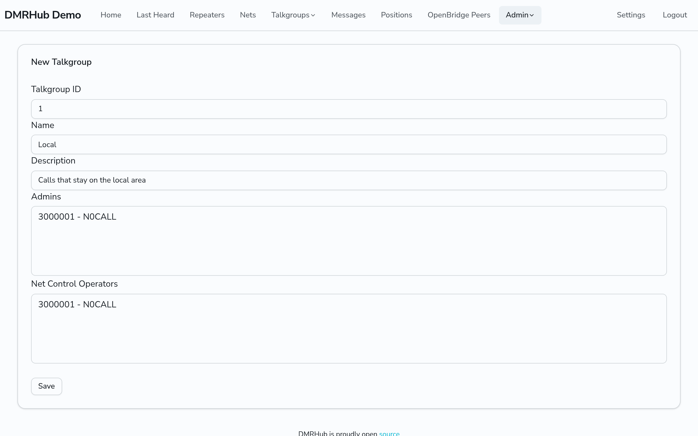
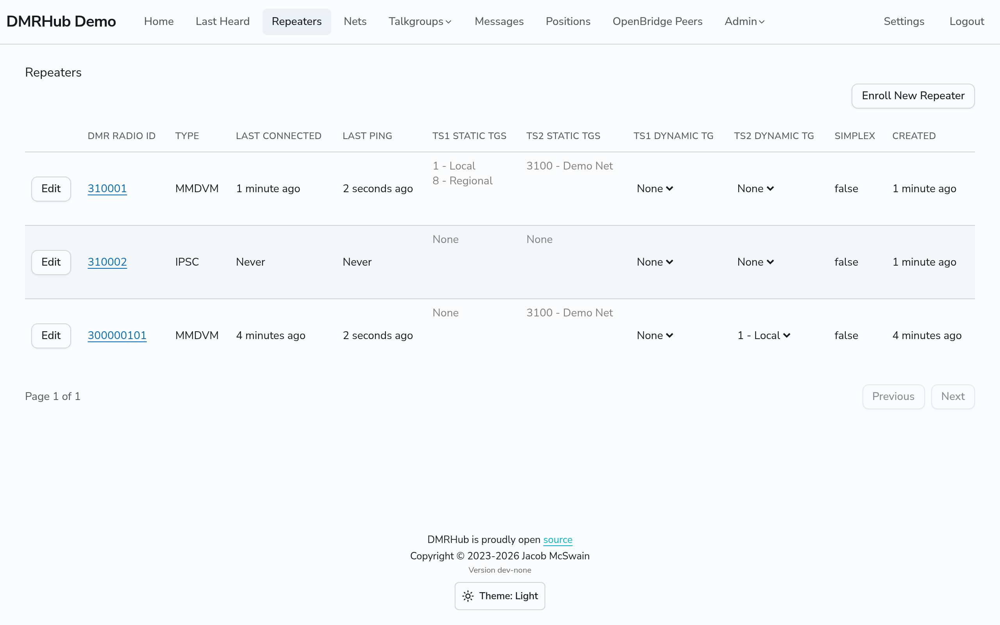
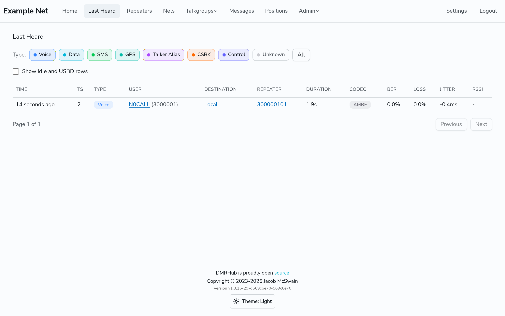
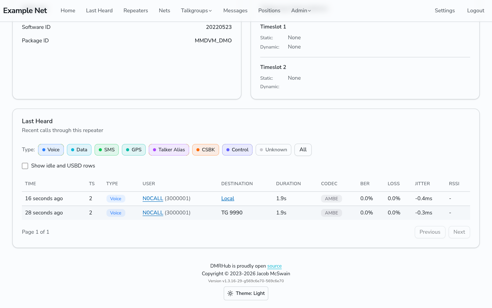

# Set up a DMRHub server

This page takes you from nothing to a working DMRHub network. At the end you have a DMRHub server, an admin account, a hotspot that is connected, and a call to the parrot and a call to a talkgroup on the network.

Each step on this page was done on a test server. The section [How this page was tested](#how-this-page-was-tested) gives the versions and the test setup.

In these docs, `<siteurl>` is the web address of your DMRHub server, for example `https://dmrhub.example.org`.

## What you need

- A Linux server, with Docker or with systemd.
- These ports open from your hotspots and users to the server:
  - TCP 3005, the web interface and the setup wizard.
  - UDP 62031, the MMDVM server for hotspots and repeaters.
- Your DMR ID from [RadioID.net](https://radioid.net/) and your callsign.
- A hotspot or repeater that uses the MMDVM network protocol, for example a Pi-Star hotspot or MMDVMHost with DMRGateway.

For other install options, the ports of the optional servers and the file locations, see [Install DMRHub](admin/install.md).

## Step 1: Install DMRHub

Do one of the options below.

### Option A: Docker

The image runs as user and group 65534, so the data volume must belong to that user.

1. Make the volume and give it to user 65534:

   ```bash
   docker volume create dmrhub-data
   docker run --rm -v dmrhub-data:/data alpine chown 65534:65534 /data
   ```

2. Start DMRHub:

   ```bash
   docker run -d \
       --restart unless-stopped \
       --name dmrhub \
       -e DATABASE_DATABASE=/data/DMRHub.db \
       -p 3005:3005 \
       -p 62031:62031/udp \
       -v dmrhub-data:/data \
       ghcr.io/usa-reddragon/dmrhub:v1
   ```

   `DATABASE_DATABASE` puts the SQLite file at `/data/DMRHub.db`, in the volume. DMRHub keeps the Setup settings, the secret and the password salt in that database.

3. Check in the log that the setup wizard started:

   ```bash
   docker logs dmrhub 2>&1 | grep 'setup wizard at'
   ```

   The line looks like this:

   ```text
   INF Opening setup wizard at http://localhost:3005/setup
   ```

   The log also shows a `Failed to open browser` error. This error is normal in a container.

If you prefer Docker Compose, use this `compose.yaml` instead of steps 1 and 2. The `volume-owner` service sets the owner of the volume before DMRHub starts:

```yaml
services:
  volume-owner:
    image: alpine
    command: chown 65534:65534 /data
    volumes:
      - dmrhub-data:/data

  dmrhub:
    image: ghcr.io/usa-reddragon/dmrhub:v1
    restart: unless-stopped
    depends_on:
      volume-owner:
        condition: service_completed_successfully
    environment:
      DATABASE_DATABASE: /data/DMRHub.db
    ports:
      - "3005:3005"
      - "62031:62031/udp"
    volumes:
      - dmrhub-data:/data

volumes:
  dmrhub-data:
```

```bash
docker compose up -d
docker compose logs dmrhub | grep 'setup wizard at'
```

### Option B: Release binary with systemd

1. Download the release for your platform from [GitHub Releases](https://github.com/USA-RedDragon/DMRHub/releases) and check it. For v1.3.17 on `amd64`:

   ```bash
   curl -sSLO https://github.com/USA-RedDragon/DMRHub/releases/download/v1.3.17/DMRHub_1.3.17_linux_amd64.tar.gz
   curl -sSLO https://github.com/USA-RedDragon/DMRHub/releases/download/v1.3.17/DMRHub_1.3.17_checksums.txt
   sha256sum --ignore-missing -c DMRHub_1.3.17_checksums.txt
   ```

   The last command must print `DMRHub_1.3.17_linux_amd64.tar.gz: OK`.

2. Make a system user and its directory:

   ```bash
   sudo groupadd --system dmrhub
   sudo useradd --system --gid dmrhub --home-dir /etc/dmrhub --no-create-home \
       --shell /sbin/nologin dmrhub
   sudo mkdir /etc/dmrhub
   sudo chown dmrhub:dmrhub /etc/dmrhub
   sudo chmod 770 /etc/dmrhub
   ```

3. Install the program:

   ```bash
   tar -xzf DMRHub_1.3.17_linux_amd64.tar.gz DMRHub
   sudo install -m 0755 DMRHub /usr/local/bin/DMRHub
   ```

4. Install the unit file [`hack/dmrhub.service`](../hack/dmrhub.service) from the repository, and start DMRHub. The release archive does not contain the unit file.

   ```bash
   sudo cp hack/dmrhub.service /etc/systemd/system/
   sudo systemctl daemon-reload
   sudo systemctl enable --now dmrhub.service
   ```

5. Check in the log that the setup wizard started:

   ```bash
   journalctl -u dmrhub.service | grep 'setup wizard at'
   ```

The unit runs DMRHub as the `dmrhub` user, in `/etc/dmrhub`. DMRHub keeps its database in `/etc/dmrhub/DMRHub.db`, and the Setup settings, the secret and the password salt in that database. See [Install DMRHub](admin/install.md#run-dmrhub-with-systemd) for the other files in that directory.

## Step 2: Finish the setup wizard

The setup wizard has no password. Anyone who opens it can change the settings, and the first visitor to make the admin account becomes the super admin. Do this step before you open port 3005 to the internet, or open the port only to you until you finish.

1. Open `http://<server>:3005/setup` in a web browser. Use the address of the server for `<server>`, or `localhost` on the server itself. You do not need anything from the log.
2. In **General Settings**, enter a **Network Name**. Leave **Secret** and **Password Salt** blank: DMRHub made random values for them at the first start and keeps them in the database, so both show `Stored. Leave blank to keep the existing value.`

   

3. In **DMR Settings**, keep the defaults. The MMDVM server listens on port 62031. Keep **Disable Radio ID validation** off: DMRHub then checks each DMR ID and callsign against the RadioID.net data.

   

4. In **HTTP Settings**, set **Canonical Host** to the address that your users open, with `http://` or `https://`, for example `https://dmrhub.example.org`. It is required. Without it, the wizard shows `canonical host is required for generating absolute URLs in the HTTP server`.

   

5. Click **Save** at the bottom of the page. The wizard opens the **Create the first admin** page. A banner above the form says that no admin exists yet, and that whoever makes this account first becomes the admin.
6. Enter your **DMR ID**, a **Username**, your **Callsign** and a **Password** two times, then click **Create User**.

   

   If the DMR ID and the callsign do not match in the RadioID.net data, the page shows `Callsign does not match DMR ID`. Correct them and try again.

   If another visitor made the admin first, the page shows `Someone else made the first admin already. Log in with that account.`

7. DMRHub closes the wizard and starts the network in the same process. The browser goes to the **Log in** page. Log in with your username or callsign and your password.

This first user is the super admin. The wizard is the only way to make the first admin. Only one visitor can make it, also when several replicas run the wizard at once.

## Step 3: Check the parrot

The parrot is a plugin that plays your call back to you. It is built in and runs inside DMRHub by default.

1. Click **Admin**, then **Plugins**.
2. Find the **Parrot** row. **Runs** shows **Built in**, **IDs** shows **9990** and **Status** shows **Running in DMRHub**.



If the parrot is not there, open **Admin**, then **Setup**. In **DMR Settings**, under **Plugins**, turn on **Run plugins inside DMRHub**, and click **Save**.

## Step 4: Add a talkgroup

A new network has no talkgroups. Add one for the test call.

1. Click **Admin**, then **Talkgroups**, then **Add New Talkgroup**.
2. Enter a **Talkgroup ID**, for example `1`, a **Name**, for example `Local`, and a **Description**.
3. Click **Save**.



## Step 5: Enroll the hotspot

1. Click **Repeaters**, then **Enroll New Repeater**.
2. In **DMR Radio ID**, enter the hotspot ID: your 7-digit DMR ID, or your DMR ID with two more digits (the ESSID), for example `300000101`.
3. Leave **Simplex Repeater** off, and click **Save**.


The browser then shows a dialog with a DMRGateway configuration, like this one:

```ini
[DMR Network 2]
Name=DMRHub
Enabled=1
Address=dmrhub.example.org
Port=62031
Password="kG7tZ2pQ9wX4"
Id=300000101
Location=1
Debug=0
```

> **Important:** Copy the password now. DMRHub shows it only once. If you lose it, delete the hotspot on the Repeaters page and enroll it again.

The dialog takes `Address` from the address in your browser, and `Port` from the MMDVM port of the server. If you opened DMRHub by another name, use the real address.

## Step 6: Configure the hotspot

Use the values from step 5: the address of the server, the port, the hotspot ID and the password.

### Pi-Star

When you select a DMR master other than DMRGateway, Pi-Star configures MMDVMHost to connect to the master directly. DMRHub needs no other rules in this mode.

[Connect a hotspot](guides/connect-hotspot.md#connect-a-pi-star-hotspot) has the steps to add DMRHub to the Pi-Star host list. Then set these values in the Pi-Star **Configuration** page:

| Section | Setting | Value |
| --- | --- | --- |
| General Configuration | CCS7/DMR ID | Your 7-digit DMR ID, for example `3000001` |
| DMR Configuration | DMR Master | The DMRHub line that you added, for example `DMRHub_Local` |
| DMR Configuration | DMR ESSID | The two extra digits of the hotspot ID, for example `01`, or None for a 7-digit hotspot ID |

Pi-Star keeps a password that MMDVMHost already has. In **Expert**, then **MMDVMHost**, check that **Password** in **DMR Network** is the DMRHub password.

With these settings, Pi-Star writes this to `MMDVMHost.ini`:

```ini
[General]
Id=3000001

[DMR]
Id=300000101

[DMR Network]
Enable=1
Type=Direct
RemoteAddress=dmrhub.example.org
RemotePort=62031
Password="kG7tZ2pQ9wX4"
```

MMDVMHost logs in with the `Id` of the `[DMR]` section, so this ID must be the ID that you enrolled.

### MMDVMHost with DMRGateway

MMDVMHost releases since June 2023 cannot connect to a master directly. They connect to DMRGateway, and DMRGateway connects to the networks.

1. In `MMDVMHost.ini`, point the DMR network at DMRGateway:

   ```ini
   [DMR Network]
   Enable=1
   LocalAddress=127.0.0.1
   LocalPort=62032
   GatewayAddress=127.0.0.1
   GatewayPort=62031
   Slot1=1
   Slot2=1
   ```

2. In `DMRGateway.ini`, set `RptPort` and `LocalPort` of the `[General]` section to the two ports above, then add the section from step 5. Use a network number that is free in your file.
3. Add pass rules to the section. Without them, DMRGateway sends nothing to DMRHub. When DMRHub is the only network, add all of these lines:

   ```ini
   [DMR Network 2]
   Name=DMRHub
   Enabled=1
   Address=dmrhub.example.org
   Port=62031
   Password="kG7tZ2pQ9wX4"
   Id=300000101
   PassAllTG=1
   PassAllTG=2
   PassAllPC=1
   PassAllPC=2
   Location=1
   Debug=0
   ```

   `PassAllTG` sends the group calls of a timeslot to DMRHub. `PassAllPC` sends the private calls, and lets the private calls from DMRHub come back to the hotspot. The parrot answers with a private call, so without `PassAllPC` you do not hear the parrot: DMRGateway logs `not matched so rejected` for the reply from 9990.

   When DMRHub shares DMRGateway with other networks, use rewrite rules (`TGRewrite`, `PCRewrite`) instead, and send only the talkgroups that you want to DMRHub. See the DMRGateway documentation for the rule format.

With the section from step 5 alone, DMRGateway logs in to DMRHub, but drops each call. With `RuleTrace=1` in the `[General]` section, its log shows:

```text
Rule Trace, RF transmission: Slot=2 Src=3000001 Dst=TG9990
Rule Trace,	not matched so rejected
```

### Check the connection

Click **Repeaters**. When the hotspot is logged in, **Last Connected** and **Last Ping** show a time.



## Step 7: Make a call

### Call the parrot

1. On your radio, select the timeslot of your hotspot (timeslot 2 on a simplex hotspot), and make a group call to 9990.
2. Talk for a few seconds, then release the PTT.
3. About 3 seconds later, the parrot plays your call back, as a private call from 9990 to your DMR ID.

The **Last Heard** page shows your call to 9990. The **Last Heard** card at the bottom of the repeater page also shows it: click the hotspot ID on the **Repeaters** page.

### Call a talkgroup

1. Make a group call to talkgroup 1 on the same timeslot.
2. Open **Last Heard**. It shows your call, with **Local** as the destination and your hotspot as the repeater.



Your call to a talkgroup makes that talkgroup the dynamic talkgroup of the timeslot: on the **Repeaters** page, **TS2 Dynamic TG** shows `1 - Local`. Other hotspots hear the talkgroup when it is their dynamic talkgroup or one of their static talkgroups. See [Pick your talkgroups](guides/talkgroups.md).



## Step 8: Start DMRHub when the server starts

- **Docker:** with `--restart unless-stopped` (or `restart: unless-stopped` in the Compose file), Docker starts the container again when Docker starts, unless you stopped it with `docker stop`. The database, with the Setup settings, stays in the volume, so after `docker restart dmrhub`, or `docker compose down` and `docker compose up -d`, DMRHub starts the network and not the wizard.
- **systemd:** `systemctl enable` in step 1 starts DMRHub at boot. To restart it by hand, use `sudo systemctl restart dmrhub.service`.

When DMRHub restarts, the hotspots log in again by themselves. In the test, MMDVMHost logged in again about 10 seconds after a `docker restart`.

## Next steps

- [Install DMRHub](admin/install.md): the other install options, the ports, and the files.
- [Connect a hotspot](guides/connect-hotspot.md) and [Link a repeater](guides/link-repeater.md), for your users and for other types of repeaters, such as Motorola IPSC repeaters.
- [Get started](getting-started.md), the page for the hams who join your network.

## How this page was tested

The steps were done on 2026-10-27 with these versions:

| Part | Version |
| --- | --- |
| DMRHub | v1.3.16 (`77d9c9f`), the Docker image `ghcr.io/usa-reddragon/dmrhub:v1.3.16` and the release archive. The screenshots are from a build of `569c6e70`. |
| systemd host | Debian 12 in a container that runs systemd |
| MMDVMHost with DMRGateway | MMDVMHost `9384d68` (2026-10-18), DMRGateway `d751e20` (2026-10-22) |
| MMDVMHost in Pi-Star direct mode | MMDVMHost `0ecf2de` (2023-01-19), the last version before direct mode was removed |
| Pi-Star settings | From the source of the Pi-Star dashboard, `Pi-Star_DV_Dash` `ca50804` |

v1.3.17 keeps the Setup settings, the secret and the password salt in the database, and the hotspot dialog shows `Name=DMRHub` and the MMDVM port of the server. The install, wizard and dialog steps above follow v1.3.17. Of these changes, only the stored secret and password salt of a new install were checked again, with a build of v1.3.17. The screenshots of the wizard are from before v1.3.17.

The first-admin steps follow the release after v1.3.17, which has no setup token and adds the banner. In v1.3.17 and earlier, the log address ends in `?token=` and a code, the wizard opens only with that address, and the page is named **Create Initial Admin User**. These first-admin steps were not checked again with a build.

No radio and no RF were used. A fake MMDVM modem stood in for the modem board and the radio. It is the `modemtest` package of DMRHub (`internal/dmr/servers/modem/modemtest`). It spoke the MMDVM modem protocol to MMDVMHost over UDP (`Protocol=udp` in the `[Modem]` section), sent voice calls on timeslot 2 as a radio does, and counted the bursts that MMDVMHost sent back for the air. MMDVMHost, DMRGateway and DMRHub ran on the same computer, so the test used other ports between MMDVMHost and DMRGateway (62037 and 62038) than the examples on this page.

The tests that passed:

- Docker, Docker Compose and systemd installs: the wizard, the first admin, and a parrot call through a hotspot. After `docker restart`, `docker compose restart`, `systemctl restart` and a restart of the systemd container, DMRHub started the network with the saved configuration.
- MMDVMHost with DMRGateway: with the section from step 5 alone, DMRGateway rejected the call. With `PassAllTG` and `PassAllPC`, the parrot reply came back to the hotspot.
- MMDVMHost in direct mode, as Pi-Star configures it: the parrot reply came back with no other settings.
- A call to talkgroup 1 from one hotspot reached a second hotspot that had made a call to talkgroup 1 before.
